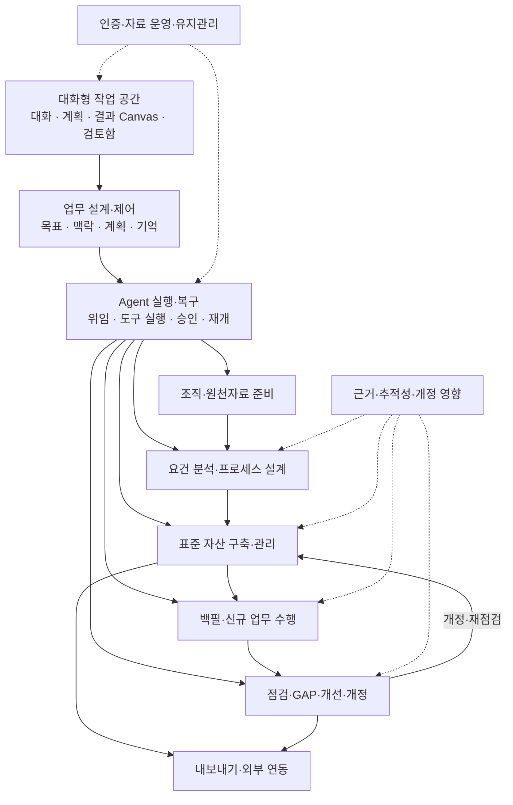

# Processware 제품 기획 대화 기록

내보낸 날짜: 2026-10-09 · 메시지 137개

사용자 메시지·AI 최종 답변·진행 메시지. 최초 요청부터 저장소 업로드 요청까지.

자동 첨부 UI/환경 정보, 내부 지시, 비공개 추론, 도구 호출·출력은 제외. 기계별 로컬 문서 경로를 저장소 상대 경로로 변환. 사용자 답변·주석은 보존.

이 기록은 당시 대화의 순서를 보존한다. 초기 제안과 후속 변경이 함께 있으므로 현재 설계는 docs의 해당 기준선 및 결정사항 요약과 함께 읽는다. 원문 전체 세션 로그가 아닌 사용자에게 보이는 대화의 정리본이다.

## 001. 사용자 · 2026-10-06 23:03:05 KST

[https://github.com/Processware-AI/processware](https://github.com/Processware-AI/processware)

위 repo는 내가 만든 repo인데, ISO/IEC 표준, 각종 가이드, 각종 매뉴얼 등 조직에서 필요로 하는 프로세스 표준 원천소스를 통해, 표준 프로세스 자산을 만들고, 지속 유지관리하고, 실제 산출물을 표준 프로세스 산출물로 backfill 하고 개선 하는 등의 표준 프로세스 업무를 지원하는 harness agent 기반 프로젝트야.
이를 일단 나만 사용하는 전문 웹 어플리케이션으로 만들고 싶은데, 이에 대해 기획서, 요구사항정의서가 우선 필요해.
요구사항 정의서를 최대한 잘 만들어서, 무료 Web Application 템플릿을 활용해 그 기능을 구현하고 싶어.

---

## 002. AI 진행 메시지 · 2026-10-06 23:03:09 KST

저장소의 현재 구조와 구현 방향을 살펴보고, 설명해 주신 업무 흐름을 바탕으로 기획서와 상세 요구사항정의서를 만들겠습니다. 무료 웹 앱 템플릿도 함께 검토해, 요구사항이 실제 화면과 구현 작업으로 이어지도록 정리하겠습니다.

---

## 003. AI 진행 메시지 · 2026-10-06 23:04:33 KST

저장소에는 이미 표준 전처리·자산 생성·백필·심사·개정 흐름과 문서 체계가 정의되어 있습니다. 이를 웹 앱에서 이어 쓰되, 실행 엔진과 승인·버전 관리를 명확히 연결하는 것이 핵심입니다.

특히 백필한 자료는 실제 수행 기록과 구분하고, 1인 사용자의 자체 점검도 독립 심사와 구분하도록 요구사항에 반영하겠습니다. 무료 템플릿은 목록·폼·탐색 화면에 활용하고, 근거 추적과 변경 승인 화면은 업무에 맞게 설계하겠습니다.

---

## 004. 사용자 · 2026-10-06 23:04:48 KST

질문: 첫 버전은 어디에서 사용할 계획인가요? 답이 없으면 개인 PC에서 실행하고 브라우저로 접속하는 방식으로 기획하겠습니다.

사용자 답변: 개인 서버에 설치해 원격 접속

---

## 005. AI 진행 메시지 · 2026-10-06 23:05:04 KST

개인 서버에 설치해 원격 접속하는 조건으로 반영하겠습니다. 이에 맞춰 단일 사용자 로그인, 비공개 파일 접근, 서버 재시작 후 작업 복구, 백업·복원을 첫 버전의 필수 요건으로 잡겠습니다.

저장소에서 확인한 실행 정의와 Python 유틸리티를 재사용하되, 아직 웹 화면이나 API 서버는 확인되지 않았습니다. 문서에는 기존 자산, 새로 구현할 기능, 연동 검증이 필요한 부분을 구분해 표시하겠습니다.

---

## 006. AI 진행 메시지 · 2026-10-06 23:08:10 KST

원격 서버 조건에서는 인증·데이터베이스·배포 구성이 함께 있는 무료 **Full Stack FastAPI Template**이 가장 잘 맞아 보여, 권장 기반으로 정리하고 있습니다.

표준 원문 이용 정책도 확인했습니다. ISO는 AI 입력에 대한 이용 제한을 명시하고 있어, 자료의 AI 이용 권한을 별도로 관리하고 확인된 자료만 처리하도록 반영하겠습니다. 요구사항에는 각 기능의 예외 처리와 인수 기준, 대응 화면, 기존 하네스 연결 지점을 넣겠습니다.

---

## 007. AI 진행 메시지 · 2026-10-06 23:19:37 KST

초안에 기능 요구사항 52개, 비기능 요구사항 16개, 화면 12개, 인수 시나리오 18개를 정리했습니다. 첫 구현은 승인 자산 구축까지, 다음 단계는 백필·점검·개정까지로 나누되 전체 개선 루프가 이어지도록 설계했습니다.

문서 간 요구사항 번호와 의존성을 점검하고 있습니다. 편집용 Markdown, Excel에서 열 수 있는 요구사항 CSV, 한 번에 읽기 편한 통합 HTML을 제공하겠습니다.

---

## 008. AI 답변 · 2026-10-06 23:21:40 KST

저장소를 검토해 **개인 서버에서 원격 접속하는 1인 전문 웹 앱** 기준으로 문서를 작성했습니다.

먼저 [통합 문서 보기](outputs/00_Processware_기획_요구사항_통합.html)에서 전체 내용을 읽을 수 있습니다.

- [기획서](outputs/01_Processware_기획서.md): 제품 범위, 업무 흐름, 단계별 구현 계획
- [요구사항정의서](outputs/02_Processware_요구사항정의서.md): **기능 52개·비기능 16개·화면 12개·인수 시나리오 18개**
- [구현가이드](outputs/03_Processware_구현가이드.md): 템플릿 적용, 하네스 연결, 구현 순서
- [요구사항 CSV](outputs/04_Processware_요구사항목록.csv): Excel에서 관리할 수 있는 기능별 목록

무료 기반은 [Full Stack FastAPI Template](https://github.com/fastapi/full-stack-fastapi-template)을 권장했습니다. 백필 출처 보존, 승인·버전 관리, 작업 복구를 핵심으로 설계했습니다.

우선 적용할 표준과 실행 엔진은 미확정 항목으로 표시했습니다. ISO의 AI 이용 제한도 반영해 자료별 이용 권한을 확인하도록 정의했습니다. [ISO 정책](https://www.iso.org/copyright.html)

---

## 009. 사용자 · 2026-10-06 23:58:02 KST

AI와 인터렉티브한 대화를 통해 작업을 진행하는 방식에 대해 고려되었는가?

---

## 010. AI 답변 · 2026-10-06 23:58:25 KST

**부분적으로 고려했지만, 대화를 주된 작업 방식으로 삼는 설계는 충분히 반영하지 못했습니다.** 현재 기획서는 채팅을 작업 요청·검색 보조로 두고, 요건 검토·매핑·승인은 구조화된 화면 중심으로 설계했습니다.

Processware에는 **AI와 대화하며 작업을 진행하고, 옆 작업 패널에서 근거와 결과를 확인하는 방식**이 더 적합하다고 봅니다. 다음 흐름을 핵심 요구사항으로 추가해야 합니다.

- **목표 구체화:** “우리 조직의 개발 프로세스를 정비해 줘”라는 요청에 AI가 적용 범위·자료·기존 자산을 확인합니다.
- **계획 협의와 실행:** AI가 작업 계획을 제시하고, 사용자가 대화로 범위를 수정하면 실제 작업을 시작합니다.
- **결과 검토와 수정:** “이 절차는 과도해”, “이 두 문서를 묶어 줘” 같은 지시를 선택한 자산·요건·백필 그룹에 적용합니다.
- **대화 중 승인:** 무엇을 승인하는지 변경 내용과 버전을 제시하고, 명시적인 승인 응답을 해당 작업에 연결합니다.
- **중단 후 이어가기:** 대화 맥락뿐 아니라 작업 상태·결정·미해결 질문을 저장해 다음 접속에서 이어갑니다.

예를 들어 **“이 산출물들을 백필해 줘 → AI가 WI 후보와 불명확한 항목 제시 → 사용자가 매핑 수정 → AI가 REC 초안 생성 → 원본 근거 확인 후 승인”**이 하나의 대화 안에서 이어져야 합니다.

즉, 기존 문서의 실행·승인·버전 관리 기반은 활용할 수 있지만, **대화와 실제 업무 객체를 연결하는 요구사항과 화면 설계는 보강이 필요합니다.**

---

## 011. 사용자 · 2026-10-06 23:59:31 KST

이제는 사람이 입력하고 관리하는 방식보다는 AI Agent와 대화하면서 업무를 빌드하는 방식으로 가야하지 않나?

---

## 012. AI 진행 메시지 · 2026-10-06 23:59:54 KST

맞습니다. Processware의 중심은 **사용자가 AI Agent와 대화하며 업무를 정의하고, Agent가 계획·실행·검토·개정을 이어가는 방식**이어야 합니다. 제가 만든 초안은 사람이 화면에서 입력·관리하는 흐름에 무게를 두었습니다.

기획서와 요구사항을 대화 중심으로 수정하겠습니다. 기존 화면은 Agent가 진행한 작업의 근거·결과·변경 내용을 확인하는 패널로 재배치하고, 대화가 실제 작업·승인·버전 변경으로 연결되도록 정의하겠습니다.

---

## 013. AI 진행 메시지 · 2026-10-07 00:05:29 KST

대화를 기본 업무 진입점으로 개정했습니다. 이제 Agent가 목표를 계획으로 나누고 실제 작업을 실행하며, 사용자는 대화에서 수정 방향과 중요한 결정을 전달합니다. 기존 표·편집 화면은 근거와 결과를 확인하는 패널로 남겼습니다.

특히 “수정했어요”라는 답변과 실제 저장 결과를 연결하고, 계획 동의와 최종 발행 승인을 구분했습니다. 긴 대화의 요약, 재접속, 실행 중 범위 변경도 작업 상태와 함께 관리하도록 추가했습니다.

---

## 014. AI 답변 · 2026-10-07 00:05:44 KST

맞습니다. **Processware는 “사람이 문서를 관리하는 앱”보다 “AI Agent와 대화하며 프로세스 업무를 수행하는 작업 공간”으로 설계해야 합니다.**

사용자는 목표·자료·판단을 제공하고, Agent가 계획·분석·생성·백필·점검·개정을 이어갑니다. 화면은 근거와 변경 결과를 확인하는 역할을 맡습니다.

이 방향으로 문서를 **0.2로 개정했습니다.**

- 대화 지시를 실제 작업·저장 결과에 연결
- 전문 Agent의 계획·위임·실행
- 대화 중 수정·승인·취소
- 재접속 후 업무 기억과 작업 재개
- 원문·변경 비교·결과를 보여 주는 작업 패널

대화 관련 요구사항 12개를 추가했고, 문서와 CSV의 번호·의존성도 점검했습니다.

[개정된 통합 문서 보기](../docs/00_Processware_기획_요구사항_통합.html)

---

## 015. 사용자 · 2026-10-07 00:05:45 KST

UI도 기존의 표와 양식 위주보다 AI Agent와 대화하면서 업무를 진행하도록 하는 방식으로 기획서와 요구사항을 수정해줘. 그 방식은 아주 구체적이고, 최신 트렌드에 맞게 기술해줘.

---

## 016. AI 진행 메시지 · 2026-10-07 00:05:51 KST

UI 설계를 더 구체화하겠습니다. 최신 Agent 작업 공간의 공식 사례와 설계 지침을 확인해, 대화·작업 계획·진행 상황·결과 검토가 화면에서 어떻게 연결되는지 정의하겠습니다. 기획서와 요구사항에는 실제 대화 예시, 화면 상태, 승인·수정·재개 동작까지 반영하겠습니다.

---

## 017. AI 진행 메시지 · 2026-10-07 00:07:17 KST

공식 사례에서 확인한 패턴은 대화 옆의 산출물 편집, 접을 수 있는 작업 계획·진행 표시, 도구 결과에 맞춘 카드, 대화 안의 승인, 연결 복구입니다. 이를 Processware 업무에 맞게 적용하겠습니다.

추가 명세에는 입력창과 자료 첨부, 선택 문서의 맥락 표시, 백필 검토 카드, 수정·발행 승인, 연결이 끊긴 상태와 실제 작업 중단의 차이까지 정의하겠습니다. 최신 패턴의 근거와 Processware에 맞춘 설계 판단도 구분해 적겠습니다.

---

## 018. AI 진행 메시지 · 2026-10-07 00:15:06 KST

기획서와 요구사항을 0.3으로 개정하고, 대화형 UI·UX 상세명세를 추가했습니다. 표준 구축·백필·개정의 대화 예시를 각각 끝까지 기술하고, 홈·입력창·맥락 선택·계획·결과 카드·산출물 편집·승인·되돌리기의 동작을 연결했습니다.

무료 UI 후보로 AI Elements도 검토했습니다. 공식 저장소의 라이선스는 Apache-2.0이며, 기존 FastAPI 기반 앱의 UI 컴포넌트 후보로 반영했습니다. 실제 업무 승인·버전·복구 기능은 별도 구현해야 하는 부분으로 명시했습니다.

---

## 019. AI 답변 · 2026-10-07 00:16:58 KST

기획서와 요구사항을 **0.3 버전으로 수정했습니다.** 주 작업 화면을 **AI Agent와의 대화 + 결과물을 확인·수정하는 Canvas**로 설계했습니다.

구체적으로 다음을 반영했습니다.

- **대화로 업무 시작:** 목적 설명과 자료 첨부 → Agent의 실행 계획 → 필요한 질문 → 실제 작업 수행.
- **대화 중 조작:** 질문, 근거, 진행 상황, 변경안, 승인 요청을 메시지 안의 카드로 표시.
- **결과물 공동 편집:** 문서 일부를 선택하고 “이 부분을 수정해줘”라고 요청하면 해당 범위의 변경안을 제시.
- **Backfill 대화:** Agent가 산출물 매핑을 제안하고, 사용자는 누락·충돌·불확실한 항목을 중심으로 검토.
- **지속 가능한 작업:** 재접속 후 이어하기, 작업 중단, 변경안 비교, 버전 복구, 기억·참조 범위 확인을 명시.

최신 공식 [Generative UI 문서](https://ai-sdk.dev/docs/ai-sdk-ui/generative-user-interfaces)와 [Agent 설계 지침](https://learn.microsoft.com/en-us/agents/design-guidelines/human-centered-design)을 참고해 화면 구성, 대화 예시, 상태별 동작, 수용 기준까지 작성했습니다.

**[통합 문서 열기](../docs/00_Processware_기획_요구사항_통합.html)**

개별 문서:

- [기획서](../docs/01_Processware_기획서.md)
- [요구사항정의서](../docs/02_Processware_요구사항정의서.md)
- [대화형 UI·UX 상세명세](../docs/05_Processware_대화형_UI_UX_상세명세.md)

기능 요구사항 **80개**, 비기능 요구사항 **21개**, 수용 시나리오 **28개**로 정리했으며 문서 간 요구사항 일치와 링크를 검증했습니다.

---

## 020. 사용자 · 2026-10-07 00:21:01 KST

기능 구조도를 구성해줘.

---

## 021. AI 진행 메시지 · 2026-10-07 00:21:04 KST

기존 요구사항을 바탕으로, 대화형 작업 공간과 Agent 실행 기능, 프로세스 자산 관리 기능의 관계가 드러나는 구조도를 만들겠습니다. 첫 버전과 이후 확장 범위도 함께 표시하겠습니다.

---

## 022. AI 진행 메시지 · 2026-10-07 00:24:16 KST

기능을 11개 군으로 나누었습니다. 대화 화면에서 업무를 설계·실행하고, 원천자료 → 요건 → 자산 → 백필·수행 → 점검·개선으로 이어지는 구조입니다. 기존 기능 요구사항 80개도 각 기능군에 연결해 구현 범위를 추적할 수 있게 정리하고 있습니다.

---

## 023. AI 답변 · 2026-10-07 00:24:47 KST

**대화형 업무 흐름을 중심으로 11개 기능군을 구성했습니다.** 기존 기능 요구사항 80개를 모두 연결했습니다.

각 기능군은 Agent가 업무에 맞게 사용하는 기능입니다. 사용자는 **하나의 대화 공간에서 지시하고, 결과와 근거를 검토하며, 중요한 결정을 승인**합니다.

- **[기능 구조도 열기](../docs/06_Processware_기능구조도.html)** — 시각 구조도, 상세 기능, 대화 시나리오, 구현 단계
- [편집용 Markdown](../docs/06_Processware_기능구조도.md)
- [기능군–요구사항 매핑 CSV](../docs/07_Processware_기능구조_요구사항매핑.csv)

구현 범위는 **S1 자산 구축 → S2 백필·개선 → S3 확장**으로 구분했습니다.

---

## 024. 사용자 · 2026-10-07 00:27:44 KST

화면 목록을 만들어주고, 각 화면의 흐름도를 만들어줘.

---

## 025. AI 진행 메시지 · 2026-10-07 00:27:49 KST

기존 대화형 UI 명세를 기준으로 화면 목록과 화면별 흐름도를 만들겠습니다. 기본 화면과 보조 패널을 구분하고, 각 화면의 진입·검토·승인·오류·재개 경로를 표시하겠습니다.

---

## 026. AI 진행 메시지 · 2026-10-07 00:33:41 KST

기존 13개 화면 ID를 유지해 화면별 흐름도를 구성했습니다. 핵심인 Agent Workspace에는 새 업무·이어하기와 Canvas 선택 수정 흐름을 추가했고, 연결 끊김·작업 중단·부분 실패에 대응하는 공통 복구 흐름도 별도로 정리했습니다.

---

## 027. AI 답변 · 2026-10-07 00:34:53 KST

**화면 목록 13개와 흐름도 17개를 작성했습니다.** 각 화면에 진입 경로, 주요 행동, 완료·복귀, 질문·수정·오류·재개 경로를 포함했습니다.

**[화면 목록·흐름도 열기](../docs/08_Processware_화면목록_화면흐름도.html)**

| ID | 화면 | 역할 |
|---|---|---|
| UI-13 | **Agent Workspace** | 목표 입력·대화·계획·결과 Canvas·결정 |
| UI-01 | 로그인 | 인증 후 원래 업무로 복귀 |
| UI-02 | 업무 상태·조직 | 조직·기준선·진행·검토 대기 확인 |
| UI-03 | 자료 검토 | 원문·이용 권한·추출 품질 검토 |
| UI-04 | 적용요건·업무 흐름 | 적용 판단·상충 해결·테일러링 |
| UI-05 | 표준 프로세스 자산 | 초안·선택 수정·QA·비교·발행 |
| UI-06 | 근거·추적성 | 요건·자산·증적 연결과 누락 확인 |
| UI-07 | WI 기반 신규 수행 | 실제 수행·증적·신규 기록 작성 |
| UI-08 | 실제 산출물 백필 | WI·파일 그룹·필드 매핑·REC 발행 |
| UI-09 | 자체 점검·GAP | 증적 평가·판정·개선 연결 |
| UI-10 | 개선·개정 | 원인·영향·개정·효과 확인 |
| UI-11 | 작업·승인·복구 | 실제 진행·결정·중단·재개 |
| UI-12 | 설정·운영 | 실행 정책·가져오기·백업·운영 |

**UI-13을 기본 화면으로 두고**, 업무 중 필요한 상세 패널을 열었다가 같은 대화로 돌아오도록 구성했습니다.

흐름도는 화면별 13개에 전체 화면 연결, 새 업무·이어하기, Canvas 선택 수정·결정, 공통 복구 흐름을 추가했습니다.

- [편집용 Markdown·Mermaid](../docs/08_Processware_화면목록_화면흐름도.md)
- [화면 목록 CSV](../docs/09_Processware_화면목록.csv)

기존 기능 요구사항 **80개와 화면의 연결 관계**도 검증했습니다.

---

## 028. 사용자 · 2026-10-07 00:38:51 KST

여러 개의 표준을 통합하는 것도 가능한가? 각 표준별로 겹치는 부분은 통합하고, 겹치지 않는 부분은 그대로 반영하고. 또는 하나의 표준을 기반으로 만들고, 추가로 다른 표준을 덧붙이는 것도 가능한가?

---

## 029. AI 진행 메시지 · 2026-10-07 00:38:58 KST

현재 요구사항에 여러 표준의 통합과 추가 적용이 어떻게 정의되어 있는지 확인하겠습니다. 두 방식에서 공통 요건과 표준별 고유 요건을 어떻게 보존할지도 함께 설명하겠습니다.

---

## 030. AI 답변 · 2026-10-07 00:39:23 KST

네. **여러 표준을 함께 통합하는 방식과, 기존 표준에 다른 표준을 추가하는 방식 모두 지원하도록 설계할 수 있습니다.** 현재 요구사항에도 `FR-REQ-03 통합 요건·상충 관리`가 포함되어 있습니다. 다만 두 방식을 명시적인 업무 모드로 구체화할 필요가 있습니다.

| 방식 | 처리 방법 | 결과 |
|---|---|---|
| **여러 표준 동시 통합** | A·B·C의 요건을 비교해 공통 부분은 하나의 프로세스로 구현하고 고유 부분은 별도 활동·조건으로 반영 | 여러 표준을 포괄하는 통합 프로세스 자산 |
| **기준 표준에 추가 적용** | A 기반의 기존 자산과 B를 비교해 재사용 가능한 부분, 보완할 부분, 새로 만들 부분을 식별 | 기존 자산을 최대한 유지한 확장 기준선 |

중요한 것은 **원천 요건을 각각 보존하면서, 실제 업무와 문서를 통합하는 것**입니다. 하나의 절차가 두 표준의 요건을 충족하더라도 각 표준의 출처·판·의무·충족 여부는 따로 추적해야 합니다.

겹치는 부분도 다음처럼 구분해야 합니다.

| 요건 관계 | 반영 원칙 |
|---|---|
| 동등한 요건 | 하나의 활동·문서로 통합하고 양쪽 요건에 연결 |
| 부분적으로 중첩 | 공통 활동에 표준별 추가 조건을 반영 |
| 한쪽이 다른 쪽을 포함 | 포함 관계를 검증한 뒤 공통 활동을 재사용 |
| 고유한 요건 | 필요한 활동·역할·산출물을 추가 |
| 서로 상충 | 차이를 제시하고 적용 범위 분리 또는 사용자 판단 |
| 관계가 불확실 | 별도로 유지하고 근거 검토 |

예를 들어 A는 ‘검토 기록’을, B는 ‘검토 기록과 승인자 확인’을 요구한다면, **검토 절차와 기록 양식은 통합하되 B에 필요한 승인자 확인을 추가**할 수 있습니다. 단순히 문장이 비슷하다는 이유로 합치거나, 항상 더 엄격한 요건을 선택하는 방식은 피해야 합니다.

대화형 UI에서는 다음과 같이 진행할 수 있습니다.

> “A와 B를 통합해서 우리 조직의 프로세스를 만들어줘. 공통 업무는 한 번만 수행하도록 해줘.”

또는:

> “현재 A 기반 프로세스에 B를 추가해줘. 기존 문서와 번호는 최대한 유지하고 필요한 변경만 제안해줘.”

Agent는 **재사용 가능 / 보완 필요 / 신규 필요 / 상충 / 판단 대기**로 분석 결과를 제시하고, 사용자가 근거와 변경안을 검토하면 새 기준선을 발행합니다. 이후에도 표준별 커버리지를 각각 확인하고, 특정 표준이 개정되면 연결된 자산만 영향 분석할 수 있어야 합니다.

따라서 Processware의 핵심 기능으로 **‘다중 표준 통합 구축’과 ‘기존 기준선의 추가 표준 적용’**을 명확히 두는 것이 적절합니다.

---

## 031. 사용자 · 2026-10-07 00:40:11 KST

핵심 기능으로 명확히 해줘. 이전에 만들었던 문서들에 반영해줘.

---

## 032. AI 진행 메시지 · 2026-10-07 00:40:17 KST

‘다중 표준 통합 구축’과 ‘기존 기준선에 추가 표준 적용’을 핵심 업무 모드로 명시하겠습니다. 기획서부터 요구사항, 기능 구조도, 화면 흐름도까지 반영하고, 두 방식의 대화·검토·승인·추적성 기준도 구체화하겠습니다.

---

## 033. AI 진행 메시지 · 2026-10-07 00:46:53 KST

두 모드를 S1 출시 필수 기능으로 정의했습니다. 통합은 ‘공통 활동을 재사용하면서 표준별 원 의무를 보존’하는 방식으로, 추가 적용은 ‘기존 기준선을 고정하고 필요한 변경만 반영하면서 기존 의무의 손실을 검사’하는 방식으로 구체화했습니다.

---

## 034. AI 진행 메시지 · 2026-10-07 00:49:06 KST

기능 구조도와 화면 흐름도에도 두 모드를 연결했습니다. 대화에서 모드·표준 판·기존 기준선을 확인한 뒤 요건 대응, 공통·고유 설계 또는 증분 변경, 표준별 커버리지, 발행 검토로 이어집니다. 공통 업무를 합쳐도 각 표준의 원 요건 수와 충족 상태는 따로 유지하도록 명시했습니다.

---

## 035. AI 진행 메시지 · 2026-10-07 00:51:24 KST

문서 반영과 정합성 검증을 마쳤습니다. 핵심 기능 요구사항 8개를 추가해 전체 88개가 되었고, 수용 시나리오는 36개로 확장했습니다. 기존 13개 화면은 유지하면서 두 핵심 업무의 화면 연결 흐름을 추가해 흐름도는 19개로 갱신했습니다.

---

## 036. AI 답변 · 2026-10-07 00:51:38 KST

이전에 만든 문서 전체에 반영했습니다. 기획·요구사항은 **0.4**, 기능 구조도·화면 흐름도는 **0.2**로 개정했습니다.

두 방식을 **S1 출시 필수 핵심 기능**으로 명시했습니다.

- **다중 표준 통합 구축:** 공통 업무는 통합하고, 고유 의무와 표준별 출처·판·충족 상태는 보존.
- **기존 기준선에 추가 표준 적용:** 기존 자산을 재사용하고 필요한 부분만 변경하며, 기존 표준의 의무가 손실되지 않는지 검사.

요건 대응·상충 처리, 표준별 커버리지, 대화·Canvas 검토, 승인·발행까지 구체화했습니다. 기능 요구사항은 **88개**, 수용 시나리오는 **36개**, 화면 흐름도는 **19개**이며 문서 간 매핑을 검증했습니다.

- **[개정된 기획·요구사항 통합 문서](../docs/00_Processware_기획_요구사항_통합.html)**
- [기능 구조도](../docs/06_Processware_기능구조도.html)
- [화면 목록·흐름도](../docs/08_Processware_화면목록_화면흐름도.html)

---

## 037. 사용자 · 2026-10-07 00:53:39 KST

본 시스템의 산출물이 뭐지?

---

## 038. AI 답변 · 2026-10-07 00:54:03 KST

본 시스템의 핵심 산출물은 **여러 표준의 근거가 연결된 조직 표준 프로세스 자산과, 그 프로세스의 수행·점검·개선 기록**입니다.

| 산출물 | 주요 내용 |
|---|---|
| **적용요건·표준 대응표** | 표준별 원 요건, 적용·제외 판단, 공통·고유·상충 관계 |
| **표준 프로세스 문서** | 정책 **POL**, 절차 **PRO**, 업무지침 **WI** |
| **업무 수행 도구** | 빈 양식 **TMP**, 작성 예시 **EX**, 참고자료 **REF** |
| **수행·백필 기록** | 신규 수행 기록과 실제 산출물을 매핑한 **REC**. 백필은 출처·미확인 사항·한계를 보존 |
| **추적성·관리표** | **MAT**: 원 요건 ↔ 프로세스 자산 ↔ 증적 연결, 표준별 커버리지, 자산 목록 |
| **점검·개선 결과** | 자체 점검·GAP 보고서, finding, 부적합 기록 초안, 원인 분석·개선 계획·효과 확인 |
| **승인 기준선·개정 패키지** | 승인된 자산·요건·적용 표준 구성의 버전 묶음, 변경 비교, 승인·발행 이력 |

예를 들어 **A와 B를 통합**하면, 공통 검토 절차와 양식은 하나로 만들고 B의 고유 조건은 추가 단계나 필드로 반영합니다. 결과에는 해당 문서뿐 아니라 **A·B 각각의 어떤 요건을 충족하는지 보여주는 대응표**도 포함됩니다.

기존 A 기반 자산에 B를 추가하면 **재사용 자산 목록, 변경·신규 자산, 변경 비교, 기존 의무 보존 검사, 새 승인 기준선**이 산출됩니다.

따라서 결과를 전달하는 기본 단위는 **‘조직별 표준 프로세스 자산 패키지’**로 보는 것이 적절합니다. 이 패키지는 문서와 양식, 근거·추적성, 승인 버전을 포함하며 운영하면서 증적과 개선 이력이 축적됩니다.

---

## 039. 사용자 · 2026-10-07 00:54:48 KST

export에 대한 요구사항도 있나?

---

## 040. AI 진행 메시지 · 2026-10-07 00:54:52 KST

현재 요구사항에서 내보내기 대상과 형식, 권한·버전 관리 조건을 확인하겠습니다.

---

## 041. AI 답변 · 2026-10-07 00:55:07 KST

네. 현재 요구사항정의서에 **내보내기 기능 2개가 필수 요구사항으로 포함**되어 있습니다.

| 요구사항 | 대상 | 형식 | 단계 |
|---|---|---|---|
| **FR-EXP-01** | 선택한 프로세스 자산·승인 기준선 | MD/YAML ZIP, 읽기용 HTML | S1 필수 |
| **FR-EXP-02** | 점검·GAP 보고서와 커버리지·상세 결과 | XLSX, HTML, PDF | S2 필수 |

공통 조건도 정의되어 있습니다.

- 기준선·문서 판·파일 해시·출처 메타데이터를 함께 보존.
- 외부 제공이 허용되지 않은 콘텐츠는 제외하고 사유 표시.
- 인증된 사용자만 다운로드.
- 보고서 형식 간 동일한 결과·총계 유지.
- 한글·표·페이지 나눔과 초안·자체 점검·미평가 표시 검증.

다만 **프로세스 문서의 DOCX/PDF 출력, 조직 자산 전체 패키지, 다중 표준 대응표의 별도 XLSX 출력, 변경분만 내보내기**는 아직 명시적인 요구사항으로 구체화되지 않았습니다. 현재 범위는 자산 원본 패키지와 점검·GAP 보고서 중심입니다.

[요구사항정의서의 Export 항목 보기](../docs/02_Processware_요구사항정의서.md:1177)

---

## 042. 사용자 · 2026-10-07 00:55:50 KST

권한도 고려하고 있나?

---

## 043. AI 답변 · 2026-10-07 00:56:11 KST

네. 현재는 **1인 운영을 기준으로 사용자·AI Agent·자료·조직·내보내기 권한을 구분**해 설계했습니다.

| 권한 영역 | 현재 반영 내용 |
|---|---|
| **사용자 접근** | 로그인 필수. API·원문 파일·다운로드에도 인증 적용 |
| **조직 범위** | 선택한 조직의 자료·자산·검색·실행으로 제한 |
| **AI Agent·도구** | 작업별 읽기·쓰기 대상과 도구·외부 통신 제한. 다른 조직 파일·비밀키 접근 차단 |
| **승인·발행** | AI는 제안·초안을 만들고, 사용자가 명시적으로 승인. 승인한 대상·판·범위가 바뀌면 재검토 |
| **자료 이용** | 보관·AI 처리·인용·외부 제공 권한을 각각 관리 |
| **내보내기** | 외부 제공이 금지된 콘텐츠 제외, 사유 표시, 인증 다운로드 |

예를 들어 **자료를 열람할 수 있어도 AI에 전송하거나 Export에 포함할 수 있는 것은 아닙니다.** 또한 사용자가 자산 편집 권한을 가지고 있어도 Agent가 승인본을 임의로 덮어쓰지는 못합니다.

다만 **여러 사용자에게 관리자·작성자·검토자·승인자·열람자 권한을 나누는 역할 기반 권한 관리**는 현재 1인 버전의 필수 범위에 포함하지 않았습니다. 현재는 한 사용자가 검토와 승인을 맡되, AI 제안과 사용자 결정·변경 이력을 구분해 기록하는 구조입니다.

---

## 044. 사용자 · 2026-10-07 00:57:06 KST

산출물에 대한 편집 기능이 고려되어 있나?

---

## 045. AI 답변 · 2026-10-07 00:57:19 KST

네. **산출물을 AI와 대화하며 편집하고, 필요하면 Canvas에서 직접 정밀 편집하는 방식**을 고려했습니다.

| 편집 대상 | 지원 방식 |
|---|---|
| **프로세스 문서** | 문단 선택 후 수정 요청, 초안 직접 편집, 수정 전후 비교 |
| **적용요건·업무 흐름** | 요건 분할·병합, 적용·제외 사유 정정, 활동 순서·범위 변경 |
| **다중 표준 통합 결과** | 공통·고유 관계 정정, 추가 조건 보완, 상충 해결 |
| **백필 기록** | 파일 그룹·WI 매핑·필드 값 정정, 미확인·상충 상태 유지 |
| **점검·개선 결과** | 근거·판정·원인·개정 계획 수정 후 재검토 |

대표적인 편집 흐름은 다음과 같습니다.

**결과 열기 → 문단·항목 선택 → “이 부분을 수정해줘” → Agent 변경안 생성 → diff·근거·QA 검토 → 저장 또는 발행 승인**

대안 비교와 초안 변경 되돌리기도 포함되어 있습니다. **승인된 산출물은 새 버전으로 수정**하며, 이전 내용과 변경·승인 이력을 보존합니다. 편집으로 승인 대상이 바뀌면 기존 승인을 재사용하지 않습니다.

관련 요구사항은 `FR-AST-05 자산 편집·변경 비교`, `FR-UX-08 산출물 Canvas·선택 수정`, `FR-UX-11 변경 되돌리기·대안 비교`입니다.

다만 **다운로드한 PDF·DOCX를 웹에서 직접 편집하는 기능**은 현재 범위에 명시되어 있지 않습니다. 시스템의 원본 자산을 수정한 뒤 다시 내보내는 방식입니다.

---

## 046. 사용자 · 2026-10-07 00:58:05 KST

대화하면서 정밀 편집하면서, Harness Agent에 대한 보완이 가능한가?

---

## 047. AI 답변 · 2026-10-07 00:58:35 KST

네. **대화·정밀 편집에서 나온 피드백을 Harness Agent의 개선으로 연결하는 구조**가 가능합니다. 현재 문서에는 작업 중 지시와 산출물 수정이 있지만, **편집 결과를 Agent의 지속적인 개선으로 반영하는 기능은 아직 명시적으로 구체화하지 않았습니다.**

두 수준으로 나누면 좋습니다.

| 수준 | 반영 내용 |
|---|---|
| **현재 업무 보완** | 대화와 선택 편집을 통해 현재 계획·초안·검토 결과 수정 |
| **Agent의 지속 개선** | 반복되는 수정 원인을 분석해 역할 지침·템플릿·검증 규칙·도구 실행 방식을 보완 |

예를 들어 사용자가 WI를 편집하면서 다음과 같이 말할 수 있습니다.

> “담당자와 승인자가 계속 빠지고 있어. 앞으로 모든 업무지침에서 확인하도록 Agent를 보완해줘.”

Agent는 이를 다음과 같은 변경안으로 제시합니다.

- 생성 지침에 역할 명시 원칙 추가.
- WI 템플릿에 담당자·승인자 항목 반영.
- QA에 역할 누락 검사를 추가.
- 기존 대표 산출물로 누락 개선 여부와 부작용 검증.

개선 흐름은 **편집·피드백 → 원인 분석 → Harness 변경안 → 시험 실행·결과 비교 → 승인 → 새 버전 적용**으로 구성할 수 있습니다.

여기서 중요한 것은 **이번 문서만의 수정과 앞으로 적용할 규칙을 구분하는 것**입니다. 조직별 예외를 전체 Agent의 공통 규칙으로 자동 반영해서는 안 됩니다. 진행 중인 작업은 시작 당시 Harness 버전을 유지하고, 새 버전은 이후 작업에 적용하며 문제가 생기면 이전 버전으로 복귀할 수 있어야 합니다.

즉, Processware가 **프로세스 자산을 개선하는 동시에, 그 자산을 만드는 Harness도 검증하며 개선하는 시스템**으로 발전할 수 있습니다. 이는 모델 재학습 없이도 지침·템플릿·규칙·도구의 버전 관리로 구현할 수 있습니다.

---

## 048. 사용자 · 2026-10-07 00:59:22 KST

**프로세스 자산을 개선하는 동시에, 그 자산을 만드는 Harness도 검증하며 개선하는 시스템**  이 될 수 있게 반영해줘.

---

## 049. AI 진행 메시지 · 2026-10-07 00:59:26 KST

프로세스 자산의 편집·검토 피드백이 Harness 개선으로 이어지는 흐름을 핵심 기능에 추가하겠습니다. 현재 업무 수정과 지속 적용할 개선안을 구분하고, 변경안 시험·승인·버전 적용·복귀까지 기존 문서와 구조도에 반영하겠습니다.

---

## 050. AI 진행 메시지 · 2026-10-07 01:05:55 KST

Harness 개선을 별도 후보·평가·릴리스 흐름으로 정의했습니다. 새 버전은 시험 결과를 검토하고 승인한 뒤 이후 작업에 적용하며, 진행 중 작업과 기존 승인 자산은 각자의 버전을 유지합니다. 조직별 예외와 공통 개선을 구분하고, 문제 버전에서 이전 Harness로 복귀하는 조건도 추가했습니다.

---

## 051. AI 진행 메시지 · 2026-10-07 01:08:58 KST

기획·요구사항과 UI 명세에 반영했고, ‘Harness 검증·개선’ 기능군과 전용 작업 화면도 추가했습니다. 현재 문서 간 요구사항·단계·화면 매핑을 검증하고 있습니다. 원 의무 손실, 권한 위반, 필수 회귀 실패 또는 평가 미완료가 있으면 새 Harness를 활성화할 수 없도록 명시했습니다.

---

## 052. AI 답변 · 2026-10-07 01:10:50 KST

반영했습니다. 기획·요구사항을 **0.5**로 개정하고, 두 개선 루프를 핵심 기능으로 연결했습니다.

- **자산 개선:** 편집·점검 → 수정안 → 검증·승인 → 새 자산 기준선.
- **Harness 개선:** 편집 피드백 → 원인·적용 범위 → 변경 후보 → 기존/후보 비교 시험 → 승인 → 새 버전 적용 → 관측·복귀.

현재 문서만의 수정과 지속 적용할 규칙을 구분하고, 조직별 예외·공통 개선·진행 작업의 버전 고정도 명시했습니다.

**Harness 요구사항 10개**, 전용 화면 **UI-14**, 실패 후보의 활성화 차단과 이전 버전 복귀 조건을 추가했습니다. 문서 간 요구사항·화면 매핑을 검증했습니다.

- **[개정된 통합 문서](../docs/00_Processware_기획_요구사항_통합.html)**
- [Harness 검증·개선 상세명세](../docs/10_Processware_Harness_검증개선_상세명세.md)
- [기능 구조도](../docs/06_Processware_기능구조도.html)
- [화면 목록·흐름도](../docs/08_Processware_화면목록_화면흐름도.html)

---

## 053. 사용자 · 2026-10-07 01:17:47 KST

기존에 조직이 갖고 있던 파일 위주의 표준 절차 및 프로세스 자산 문서들도 input으로 들어갈 수 있나?

---

## 054. AI 답변 · 2026-10-07 01:18:04 KST

네. **조직이 기존에 보유한 절차서·업무지침·양식·매뉴얼 등의 파일도 입력으로 받을 수 있도록 고려되어 있습니다.** 현재 기획서의 **UC-02 기존 조직 매뉴얼 정비**가 해당 기능입니다.

입력은 역할에 따라 구분합니다.

| 기존 파일 | 입력 역할 | 활용 |
|---|---|---|
| 정책·절차서·업무지침·매뉴얼 | **기존 조직 기준·As-Is 자산** | 현재 업무 구조를 파악하고 외부 표준과 비교·정비 |
| 빈 양식·체크리스트 | **기존 템플릿** | 유지·보완·신규 양식의 필요성 판단 |
| 작성 예시 | **참고 예시** | 작성 방식·품질 기준 참고 |
| 실제 작성된 보고서·회의록·평가표 | **수행 증적** | 백필·이행 점검에 활용 |

예를 들어 다음과 같이 대화할 수 있습니다.

> “이 폴더가 우리 조직의 기존 절차서와 양식이야. 현재 구조를 먼저 정리하고, A·B 표준에 맞춰 필요한 부분만 보완해 줘.”

Agent는 파일을 분류하고 문서 간 관계·중복·상충·누락을 분석한 뒤 **재사용 가능 / 보완 필요 / 신규 필요 / 판단 대기**로 제안합니다. 기존 원본은 보존하고 변경안은 새 버전으로 만듭니다.

다만 **파일이 존재한다는 이유만으로 승인본이나 표준 충족 자산으로 확정하지는 않습니다.** 승인·시행 상태, 문서 번호·판, 적용 범위 등을 확인하고 모르는 항목은 미확인으로 남깁니다. 기존 문서의 요구사항과 외부 표준의 의무도 출처를 구분해 관리합니다.

현재 우선 지원 형식은 **PDF·DOCX·XLSX·PPTX·MD·TXT**이며, 스캔 PDF의 OCR은 S2, HWP/HWPX와 구형 Office 형식은 S3 확장으로 정의되어 있습니다.

---

## 055. 사용자 · 2026-10-07 01:23:27 KST

이제 더 뭐가 필요하지?

---

## 056. AI 답변 · 2026-10-07 01:23:46 KST

이제는 **대표 자료를 정하고, 핵심 흐름을 실제로 구현·검증할 준비**가 필요합니다. 우선순위는 다음과 같습니다.

| 우선순위 | 필요한 것 | 목적 |
|---|---|---|
| **1. 대표 입력·기대 결과** | 기존 조직 절차서·양식, 이용 가능한 표준 2종, 실제 산출물, 원하는 결과 예시 | 추출·통합·백필 품질의 판단 기준 마련 |
| **2. 첫 구현 범위 확정** | 한 조직·한 업무 영역에서 통합 구축과 추가 표준 적용 검증 | 첫 버전을 인수할 수 있는 범위 설정 |
| **3. 화면 프로토타입** | 대화, Canvas 정밀 편집, 근거·변경 비교, 승인, Harness 개선 화면 | 실제 사용 동선과 판단 부담 확인 |
| **4. 기술 검증 S0** | 기존 Harness 실행·승인 재개·중단·버전 고정·파일 격리 | 기존 엔진의 재사용 가능성 확인 |
| **5. 상세 구현 설계** | 데이터 구조, API·이벤트, 저장·발행·복구, 평가·릴리스 계약 | 구현 중 해석 차이 줄이기 |
| **6. 배포·운영 조건** | 개인 서버 사양, 접속 방식, AI 제공자·예산, 백업·복원 | 원격 운영 환경 확정 |

추가로 **Export 범위**는 결정해야 합니다. 현재 정의된 MD/YAML ZIP·HTML·점검 보고서 외에, 프로세스 문서의 **DOCX/PDF**, **조직 전체 자산 패키지**, **표준 대응표 XLSX**, **변경분만 내보내기**가 필요한지 명확히 해야 합니다.

가장 먼저 만들 것은 **‘대표 입력–기대 산출물–인수 기준’ 묶음**입니다. 이것을 기준으로 화면 프로토타입과 S0를 함께 진행하면, 설계가 실제 자료와 Harness에서 작동하는지 확인하면서 구현으로 넘어갈 수 있습니다.

---

## 057. 사용자 · 2026-10-07 01:25:57 KST

표준 프로세스가 만들어지면, 브라우징 하고 편집할 수 있는건가?

---

## 058. AI 답변 · 2026-10-07 01:26:17 KST

네. **생성된 표준 프로세스를 웹에서 탐색하고, 대화와 Canvas를 통해 편집할 수 있도록 설계되어 있습니다.**

| 기능 | 사용 방식 |
|---|---|
| **탐색·검색** | 조직·기준선·문서 유형·상태별로 정책, 절차, 업무지침, 양식 찾기 |
| **프로세스 따라 보기** | 절차에서 관련 업무지침 → 양식·예시 → 수행 기록으로 이동 |
| **근거 확인** | 각 자산에 연결된 표준별 요건과 원문 위치 확인 |
| **대화 편집** | “이 절차를 간소화해줘”, “이 단계에 승인자 확인을 추가해줘” |
| **정밀 편집** | 문단·항목을 선택해 수정 요청하거나 초안을 직접 편집 |
| **변경 검토** | 수정 전후 비교, 관련 요건·다른 자산에 미치는 영향, QA 결과 확인 |
| **버전 관리** | 승인본과 과거 판 조회, 새 버전 발행, 초안 변경 되돌리기 |

기본 흐름은 **자산 찾기 → Canvas에서 읽기 → 대화·직접 편집 → 변경 비교·검증 → 승인·새 버전 발행**입니다.

초안은 편집할 수 있고, **승인된 프로세스는 새 버전으로 수정**합니다. 이전 승인본과 수행 당시 기록의 연결은 보존합니다. 반복되는 수정은 별도로 Harness 개선 후보에도 연결할 수 있습니다.

현재 이는 문서에 정의된 기능이며, 실제 웹 앱 구현은 다음 단계입니다.

---

## 059. 사용자 · 2026-10-07 01:27:15 KST

생성된 표준 프로세스는 어떻게 저장하고 수정되고 관리되는가?

---

## 060. AI 답변 · 2026-10-07 01:27:38 KST

현재 설계에서는 **문서 내용은 조직별 Vault와 내부 Git에 저장하고, 검색·작업·승인·연결 정보는 데이터베이스에서 관리**합니다.

| 저장 대상 | 관리 방식 |
|---|---|
| **원천 표준·기존 조직 문서** | 원본 파일과 해시를 보존. 새 판·변환 결과는 별도로 저장 |
| **생성 중인 초안** | 승인 라이브러리와 분리된 작업 공간에 저장 |
| **승인된 프로세스 자산** | 조직별 Vault에 문서·양식으로 저장하고 내부 Git으로 변경 이력 관리 |
| **요건·추적성·승인 정보** | 데이터베이스에 문서 판·출처·관계·결정·작업 상태 저장 |
| **승인 기준선** | 어떤 표준 판·요건·자산 버전을 묶어 승인했는지 목록과 해시로 고정 |

**수정은 초안과 승인본을 구분해 진행합니다.**

1. 사용자가 문서를 선택하고 대화 또는 Canvas에서 수정합니다.
2. 승인본을 수정할 때는 해당 판을 기준으로 **새 초안 버전**을 만듭니다.
3. Agent가 변경 비교, 연결된 표준 요건, 영향 범위, QA 결과를 제시합니다.
4. 사용자가 정확한 변경 대상을 승인합니다.
5. 서버가 기준 판과 변경 내용을 재확인하고 새 버전을 발행합니다.

이 과정에서 기존 승인본을 덮어쓰지 않습니다. 다른 작업이 먼저 내용을 바꾸면 최신 판을 다시 검토하도록 하며, 발행 중 장애가 발생하면 기록된 변경 묶음을 기준으로 복구합니다.

발행 후에는 다음을 지속 관리합니다.

- **탐색·검색:** 조직·유형·상태·기준선별 조회.
- **추적성:** 원천 요건 ↔ 자산 ↔ 수행·백필 증적 ↔ 점검·개선 연결.
- **개정·폐기:** 새 버전과 사유를 기록하고 이전 판 보존.
- **과거 기록:** 수행 당시의 WI·양식·기준선을 계속 참조.
- **운영:** 백업·복원, 외부 편집 감지·재색인, 감사 이력.
- **Harness 이력:** 각 생성·수정 작업에 사용된 실행 버전 기록.

즉, 하나의 승인 기준선이 **그 시점의 조직 표준 프로세스 전체를 재구성할 수 있는 버전 묶음**이 됩니다. 문서 내용의 직접 수정 경로는 통제하고, 웹 편집과 승인·발행 절차를 통해 내용과 관리 정보가 함께 갱신되도록 설계했습니다.

---

## 061. 사용자 · 2026-10-07 01:28:14 KST

이 시스템의 목표와 목적이 뭐지?

---

## 062. AI 답변 · 2026-10-07 01:28:29 KST

이 시스템의 목적은 **조직이 필요한 표준 프로세스를 AI Agent와 함께 구축하고, 실제 업무 경험을 반영해 지속적으로 발전시키는 것**입니다.

핵심 목표는 다음과 같습니다.

1. **여러 기준을 조직의 실행 가능한 프로세스로 전환**  
   표준·가이드·매뉴얼과 기존 조직 문서를 분석해 정책·절차·업무지침·양식을 만듭니다. 공통 업무는 통합하고 고유 의무는 보존하며, 다른 표준도 추가 적용합니다.

2. **대화로 구축·탐색·정밀 편집**  
   사용자는 목표와 판단을 전달하고, Agent는 분석·설계·수정·검증을 수행합니다. 사용자는 근거와 변경안을 확인하고 승인합니다.

3. **실제 업무와 표준 프로세스를 연결**  
   기존 산출물을 백필하고 신규 수행 기록을 연결해, 문서에 정의된 절차와 실제 이행의 차이를 확인합니다.

4. **근거와 버전을 보존하며 개선**  
   원천 요건부터 자산·증적·점검·개정까지 추적하고, 개선 효과를 확인합니다.

5. **자산을 만드는 Harness도 검증하며 개선**  
   편집·실패 피드백을 지침·템플릿·규칙·도구의 개선 후보로 연결하고, 시험·승인을 거쳐 이후 작업에 적용합니다.

성공 기준은 **근거 있는 프로세스가 만들어지고, 실제로 사용되며, 그 결과가 프로세스와 Harness 양쪽의 검증된 개선으로 이어지는 것**입니다.

---

## 063. 사용자 · 2026-10-07 01:31:54 KST

프로젝트 차원의 표준 프로세스 자산 배포 (파일 또는 시스템 연동), 배포한 템플릿을 가지고 실제 산출물을 만들었을 때 필드에서는 중구난방으로 작성을 한 거를 이 시스템에서 정비해서 감사, 감리, 인증 및 심사의 증적자료로도 활용하고, 회사의 지적 자산으로도 활용하기 위한것도 목표야. 즉, 표준 프로세스는 일부 전문가 및 전문팀에서 관리하고, 그 결과는 필드의 조직원들이 사용하게 하는 거지. 조직의 모든 인원이 표준 프로세스 구축 과정을 알 필요는 없다는게 기본 컨셉이야.

---

## 064. AI 진행 메시지 · 2026-10-07 01:32:28 KST

이 설명을 제품 목적과 문서에 반영하겠습니다. 전문가는 표준을 구축·관리·배포하고, 현장 구성원은 배포된 절차와 템플릿을 사용하며, 시스템은 돌아온 산출물을 정비해 증적과 회사의 지적 자산으로 연결하는 구조로 구체화하겠습니다. 현장 사용자가 표준 구축 과정이나 Harness를 알아야 할 필요는 없도록 하겠습니다.

---

## 065. AI 진행 메시지 · 2026-10-07 01:39:00 KST

현장 사용은 배포 파일이나 기존 업무 시스템에서 가능하도록 정의했습니다. 돌아온 문서는 원본을 보존하면서 필드별 출처·변환·보정·미확인 사항을 연결해 정비합니다. 증적 제출용 패키지와 회사의 재사용 사례는 목적과 공개 권한이 다른 산출물로 구분했습니다.

---

## 066. AI 진행 메시지 · 2026-10-07 01:42:01 KST

문서의 목적을 ‘전문가의 표준 관리 → 프로젝트 배포 → 현장 작성 → 회수·정비 → 증적·지적 자산 → 개선’으로 갱신했습니다. 초기에는 전문 운영자 1명이 관리 앱을 사용하고 현장은 파일·외부 도구를 사용하는 방식으로 유지해, 모든 직원의 구축 계정을 요구하지 않도록 했습니다.

---

## 067. AI 답변 · 2026-10-07 01:43:09 KST

**전문가의 표준 관리와 현장 구성원의 사용을 분리하는 컨셉으로 문서 전체를 개정했습니다.** 기획·요구사항은 **0.6**입니다.

핵심 흐름을 다음과 같이 명시했습니다.

**전문가 표준 관리 → 프로젝트별 절차·템플릿 배포 → 현장 작성 → 회수·정비 → 증적 패키지·회사 지적 자산 → 표준·Harness 개선**

구체적으로 반영한 내용은 다음과 같습니다.

- **현장 사용:** 구축 과정이나 Harness를 몰라도 배포 파일·기존 업무 시스템에서 작성·제출.
- **산출물 정비:** 임의 작성된 문서를 원본·배포 버전·필드별 출처와 연결해 정비.
- **증적 활용:** 감사·감리·인증·심사 제출용으로 원본·정비본·보정 이력·미확인 사항을 묶어 제공.
- **지적 자산화:** 검토된 범용 사례·교훈을 재사용 권한과 공개 범위에 따라 축적.

초기에는 전문 운영자 1명이 관리 앱을 사용하고, 현장은 배포물을 사용하는 방식으로 유지했습니다.

- **[개정된 통합 문서](../docs/00_Processware_기획_요구사항_통합.html)**
- [프로젝트 배포·현장 정비·증적·지적 자산 상세명세](../docs/11_Processware_프로젝트배포_현장정비_증적지적자산_명세.md)
- [기능 구조도](../docs/06_Processware_기능구조도.html)
- [화면 목록·흐름도](../docs/08_Processware_화면목록_화면흐름도.html)

---

## 068. 사용자 · 2026-10-07 01:57:43 KST

선택한 이전 답변: 문서 내용은 조직별 Vault와 내부 Git에 저장
이게 무슨 의미지? 내부 git이라니?

---

## 069. AI 답변 · 2026-10-07 01:57:55 KST

제가 쓴 **‘내부 Git’은 개인 서버 안에서 문서 변경 이력을 관리하는 비공개 저장소**라는 의미입니다. GitHub에 문서를 올린다는 뜻은 아닙니다. :codex-annotation{index="1"}

두 부분을 나눠 보면 됩니다.

- **Vault:** 조직별 정책·절차·업무지침·양식 등의 파일을 보관하는 문서 폴더.
- **Git:** 승인·발행할 때 어떤 파일이 어떻게 바뀌었는지 이전 버전과 함께 기록하는 도구.

예를 들어 절차서를 v1에서 v2로 개정하면, 문서는 Vault에 저장되고 Git에는 **변경 전후 내용과 발행 단위의 이력**이 남습니다. 사용자는 웹에서 문서를 읽고 편집·승인하며, Git을 직접 다룰 필요는 없습니다.

현재 설계는 **개인 서버 안에서만 운영하고, 외부 GitHub 전송은 기본적으로 꺼두는 방식**입니다. 원본 자료·민감 증적·비밀키는 이 문서 이력 저장소에 넣지 않고 별도로 보관합니다.

Git은 버전 관리의 구현 수단으로 제안한 것입니다. **승인·검색·권한·백업은 별도 기능이 담당**하며, Git이 반드시 필요한 제품 요구사항은 아닙니다.

---

## 070. 사용자 · 2026-10-07 01:58:48 KST

UI framework에 대해서 더 고려할 사항이 있나?

---

## 071. AI 진행 메시지 · 2026-10-07 01:58:52 KST

현재 선정안을 기준으로, 대화·정밀 편집·증적 검토에 필요한 UI 기능과 무료 컴포넌트의 지원 범위를 확인하겠습니다. 특히 웹 앱 템플릿만으로 해결되는 부분과 별도 구현이 필요한 부분을 구분하겠습니다.

---

## 072. AI 답변 · 2026-10-07 02:00:00 KST

네. 현재의 **React·TypeScript·Vite·shadcn/ui 기반은 유지할 수 있지만, 문서 편집 엔진과 AI 편집 연결 방식을 더 구체적으로 결정해야 합니다.** 무료 웹 템플릿만으로 정밀 편집·증적 검토까지 해결되지는 않습니다.

| 고려사항 | Processware에서 필요한 기준 |
|---|---|
| **전문가·현장 UI 분리** | 전문가는 대화·편집·검증 화면, 현장은 절차·템플릿·제출 경로 사용 |
| **문서 편집 엔진** | 문단·표·목차·역할·필드를 편집하고, 선택 범위를 AI 지시에 연결 |
| **AI와 직접 편집의 충돌** | 사람이 편집하는 동안 AI 변경안이 도착하면 덮어쓰지 않고 비교·반영 |
| **저장·Export 정합성** | 화면에서 편집한 문단·표·필드가 저장과 DOCX/XLSX/PDF 출력에서도 보존 |
| **원문·증적 검토** | 원본과 정비본을 나란히 보고 페이지·셀·필드 출처로 이동 |
| **업무용 사용성** | 한글 입력, 긴 문서·대량 필드, 키보드 조작, 자동 저장·복구 검증 |

추천하는 구성은 다음과 같습니다.

- **기본 화면:** 현재 선정한 React·shadcn/ui 유지.
- **정밀 편집:** **Tiptap을 우선 검토**. 오픈소스 편집기와 유료 확장이 구분되어 있으므로 변경 추적·문서 변환·버전 비교까지 모두 무료라고 가정하면 안 됩니다. [Tiptap 공식 문서](https://tiptap.dev/docs/editor/getting-started/overview)
- **대화 컴포넌트:** AI Elements는 필요한 부분만 검토. 현재 공식 안내는 React 19·Tailwind CSS 4와 Next.js·AI SDK 환경을 기준으로 하므로, 기존 Vite·FastAPI 구성과의 호환성을 먼저 검증해야 합니다. [AI Elements 공식 문서](https://elements.ai-sdk.dev/docs)
- **매핑·증적 표:** TanStack Table 같은 기반을 활용하되, 필드 편집·출처 연결·검증은 별도로 구현해야 합니다. [TanStack Table 공식 문서](https://tanstack.com/table/latest/docs/overview)

가장 중요한 결정은 **문서의 내부 구조**입니다. 문단·표·필드에 안정적인 식별자가 있어야 “이 문단만 수정”, 원문 추적, 변경 비교, Export가 같은 대상을 가리킬 수 있습니다.

따라서 UI 기술을 확정하기 전에 **문단 선택 AI 수정 → 직접 편집과 충돌 처리 → 변경 비교·승인 → 파일 출력 → 현장 작성 후 회수**를 작은 시제품으로 검증하는 것이 좋습니다.

---

## 073. 사용자 · 2026-10-07 02:02:00 KST

각 표준별 표준 프로세스 자산을 골라서 또는 구매해서 import  시키는 방법이 있나?

---

## 074. AI 진행 메시지 · 2026-10-07 02:02:21 KST

현재 정의된 Import 기능이 기존 저장소 자산과 외부에서 확보한 자산 패키지를 어디까지 다루는지 확인하겠습니다. 표준 원문과 그 표준을 적용해 만든 절차·지침·양식 패키지도 구분하겠습니다.

---

## 075. AI 답변 · 2026-10-07 02:02:38 KST

네. **표준별로 이미 만들어진 프로세스 자산을 선택하거나 외부에서 구매한 뒤 Import해 활용하는 방식**도 가능합니다. 처음부터 전부 생성할 필요는 없습니다.

다만 두 입력을 구분해야 합니다.

| 입력 | 활용 방식 |
|---|---|
| **표준 원문** | 적용요건을 추출·검토하는 근거 자료 |
| **표준 기반 자산 패키지** | 이미 작성된 정책·절차·업무지침·양식을 가져와 검증·테일러링하는 초기 자산 |

예를 들어 A 표준용 절차·양식 패키지와 B 표준용 패키지를 확보했다면 다음처럼 요청할 수 있습니다.

> “두 패키지를 가져와 공통 자산은 통합하고 고유 항목은 유지해 줘. 우리 조직에 필요한 부분만 적용해 줘.”

권장 Import 흐름은 다음과 같습니다.

**패키지 등록 → 대상 표준·판·제공자·이용 권한 확인 → 포함 자산 선택 → 구조·중복·요건 대응 검증 → 조직 테일러링 → 승인 기준선 발행**

구매 여부와 별개로 다음을 관리해야 합니다.

- 패키지 버전, 대상 표준의 판, 제공자와 취득 출처.
- 수정·AI 처리·프로젝트 배포·재사용 허용 범위.
- 공급자가 주장하는 커버리지와 시스템에서 검토한 커버리지의 구분.
- 공급자 원본과 조직이 수정한 버전의 이력.

**현재 문서에는 기존 저장소 Import와 자산 재사용이 정의되어 있지만, 외부 패키지 카탈로그·선택 Import·공급자 업데이트 관리는 아직 별도 기능으로 구체화하지 않았습니다.**

초기에는 **외부에서 확보한 파일 패키지를 등록·검토하는 방식**이 적절합니다. 시스템 안에서 검색·결제하는 구매 기능은 이후 별도 범위로 둘 수 있습니다.

---

## 076. 사용자 · 2026-10-07 02:05:22 KST

지금까지의 대화를 ChatGPT 프로젝트로 옮길 수 있나? 이대로 그냥 계속 해도 되나?

---

## 077. AI 진행 메시지 · 2026-10-07 02:05:29 KST

현재 Codex 대화를 ChatGPT 프로젝트로 옮길 수 있는 경로를 확인하겠습니다. 이 대화에서 계속 작업할 때와 새 프로젝트에서 이어갈 때의 차이도 설명하겠습니다.

---

## 078. AI 진행 메시지 · 2026-10-07 02:07:21 KST

OpenAI Docs 스킬을 사용해 공식 안내를 확인하고 있습니다. ChatGPT 프로젝트와 Codex의 대화 기록이 구분되어 있어, 대화 전체를 그대로 옮길 수 있는지는 별도로 확인해야 합니다.

---

## 079. AI 답변 · 2026-10-07 02:07:41 KST

**이대로 여기서 계속 진행해도 됩니다. 지금 작업은 이곳에서 이어가는 편이 자연스럽습니다.** 기존 기획서·요구사항·화면 설계 파일을 직접 수정하고, 이후 웹 애플리케이션 구현까지 연결할 수 있기 때문입니다.

ChatGPT 프로젝트에서 이어가는 것도 가능하지만, **현재 Codex 대화 전체를 그대로 이전하는 기능은 공식 문서에서 확인하지 못했습니다.** ChatGPT와 Codex의 대화 기록은 별도로 관리됩니다. [공식 안내](https://learn.chatgpt.com/docs/projects)

ChatGPT 프로젝트로 옮겨 이어가려면 다음 방식이 확실합니다.

1. ChatGPT에 `Processware` 프로젝트를 만듭니다.
2. 최신 기획서·요구사항정의서·기능구조도·화면 흐름도를 업로드합니다.
3. 지금까지의 결정 사항과 미결 사항을 정리한 인계 문서를 넣고 새 대화를 시작합니다.

이 경우 문서와 설계 맥락은 전달할 수 있지만, 기존 대화 기록과 로컬 작업 상태까지 그대로 이전되는 것은 아닙니다. ChatGPT 프로젝트에서 현재 폴더를 자동으로 읽는 것도 아니므로 파일 업로드나 별도 연결이 필요합니다. [프로젝트의 파일·맥락 관리](https://learn.chatgpt.com/docs/projects)

**제 권장은 여기서 기획을 확정하고 구현까지 이어가는 것입니다.** 장기적으로는 대화 내용 중 확정된 결정과 남은 과제를 문서로 유지하면, 나중에 다른 대화나 ChatGPT 프로젝트로 옮겨도 안정적으로 이어갈 수 있습니다.

---

## 080. 사용자 · 2026-10-07 02:07:57 KST

TipTab 이 뭐야? 유료야?

---

## 081. AI 진행 메시지 · 2026-10-07 02:08:00 KST

앞서 언급한 Tiptap을 뜻하신 것으로 이해했습니다. 어떤 편집기인지와 무료·유료 기능의 구분을 공식 자료에서 확인하겠습니다.

---

## 082. AI 답변 · 2026-10-07 02:08:19 KST

앞서 말한 것은 **Tiptap(팁탭)**입니다. 웹 애플리케이션 안에 Word나 Notion처럼 문서를 작성·편집하는 기능을 넣을 때 사용하는 **문서 편집기 개발 도구**입니다. [공식 소개](https://tiptap.dev/docs/editor/getting-started/overview)

**기본 편집기는 무료이고, 일부 고급 기능과 서비스는 유료입니다.**

| 구분 | 비용 |
|---|---|
| 기본 편집기와 오픈소스 확장 기능 | 무료, MIT 라이선스 |
| Tiptap이 제공하는 댓글·문서 이력·변경 추적 등 고급 기능 | 유료 제품에 포함되거나 별도 추가 |
| 공식 AI Toolkit, 문서 변환, 페이지 레이아웃 등 | 유료 기능 포함, 구성별 확인 필요 |

무료 편집기는 개인 서버에 설치한 서비스에서도 사용할 수 있습니다. [공식 기능·요금 비교](https://tiptap.dev/feature-comparison)

Processware에서는 **무료 Tiptap을 문서 편집 영역에 사용하고, AI 대화·부분 수정 제안·승인·버전 관리는 우리 시스템에서 구현하는 방식**으로 시작할 수 있습니다. 예를 들어 문단을 선택하고 “이 절차를 ISO 요구사항에 맞게 보완해줘”라고 요청하면, Harness가 수정안을 만들고 사용자가 검토해 적용하는 것입니다.

따라서 **AI와 대화하며 정밀 편집하기 위해 Tiptap 유료 서비스를 반드시 구매할 필요는 없습니다.** 다만 무료 편집기를 사용해도, 그 업무 기능을 연결하는 개발 비용과 AI 사용 비용은 별도로 발생합니다.

---

## 083. 사용자 · 2026-10-07 02:09:12 KST

지금까지 논의된 시스템은 현실적으로 가치가 있을까?

---

## 084. AI 진행 메시지 · 2026-10-07 02:09:19 KST

지금까지 정리한 기능을 기준으로, 실제 업무에서 생기는 가치와 구현 부담을 나누어 평가하겠습니다. 표준 통합과 증적 관리의 실무적 근거도 확인하겠습니다.

---

## 085. AI 답변 · 2026-10-07 02:09:59 KST

**현실적인 가치가 있다고 봅니다. 특히 사용자님이 직접 쓰는 전문가용 도구로는 개발할 이유가 충분합니다.** 다만 조직 업무에서의 가치와 외부에 판매할 수 있는 상품성은 구분해야 합니다. 전자는 실제 프로젝트로 검증할 수 있고, 후자는 아직 고객 검증이 필요합니다.

가장 가치가 큰 부분은 **표준 요구사항 → 조직 프로세스 → 프로젝트에 배포한 템플릿 → 실제 산출물 → 심사 증적을 연결해 관리하는 것**입니다. 문서 작성부터 현장 회수와 개선까지 이어지는 이 연결이 제품의 중심이어야 합니다.

| 업무 | 기대할 수 있는 가치 | 가치가 생기는 조건 |
|---|---|---|
| 기존 절차서·프로세스 자산 정리 | 흩어진 파일을 검색·수정·재사용 가능한 자산으로 전환 | 원본과 변환 결과를 연결하고 전문가가 검토 |
| 여러 표준 통합 | 중복 업무를 줄이면서 표준별 요구사항 유지 | 문장이 비슷하다는 이유만으로 의무를 합치지 않음 |
| 프로젝트별 자산 배포 | 프로젝트마다 절차·양식을 다시 만드는 작업 감소 | 적용 범위와 배포 버전이 명확함 |
| 현장 산출물 정비 | 형식이 제각각인 결과물의 검토·정리 부담 감소 | 실제 수행 사실과 누락을 구분하고 원본 보존 |
| 증적 및 지적 자산 관리 | 심사 때 자료를 찾기 쉬워지고 다음 프로젝트에서 재사용 | 요구사항·수행 기록·근거 사이의 연결 유지 |

이 방향에는 실무적 근거도 있습니다. ISO는 여러 경영시스템 표준을 통합 운영하기 위한 공통 구조를 제공하고, NIST의 OSCAL은 요구사항부터 구현·평가 결과·증적까지 추적 가능한 데이터 모델을 제공합니다. **다만 이것이 Processware의 수요나 수익성을 입증하는 것은 아닙니다.** [ISO 통합 운영 안내](https://committee.iso.org/management-system-standards-list.html), [NIST OSCAL 모델](https://pages.nist.gov/OSCAL/learn/concepts/layer/)

제가 가장 높게 평가하는 것은 **현장에서 돌아온 산출물을 정비하는 기능**입니다. 표준 절차서를 잘 만들어도, 실제 결과물이 흩어지고 작성 수준이 제각각이면 전문가가 다시 많은 시간을 들여야 합니다. 이 작업을 줄이고 근거를 연결할 수 있다면, 사용자가 반복해서 쓸 이유가 생깁니다.

반대로, 현재 기획 전체를 한 번에 구현하면 부담이 큽니다. 다양한 파일의 정밀 편집, 여러 표준의 의미 비교, 외부 시스템 연동, 증적 관리, Harness 개선까지 각각 검증해야 합니다. 특히 다음 두 가지는 제품 신뢰를 좌우합니다.

- **산출물 정비가 수행 사실을 만들어내면 안 됩니다.** 없던 승인·검토·시험 결과는 누락으로 남기고 담당자의 확인을 받아야 합니다.
- **AI 결과를 확인하는 시간이 직접 작업하는 시간보다 길면 효용이 떨어집니다.** 생성량보다 전문가의 검토 부담 감소가 중요합니다.

그래서 첫 버전은 **실제 프로젝트 하나에서 업무의 한 사이클을 완주하도록** 만드는 것이 좋겠습니다.

> 보유 절차서와 사용 권한이 있는 표준 입력 → 프로세스 자산 검토 → 프로젝트 템플릿 배포 → 실제 산출물 회수 → 정비·누락 확인 → 증적 묶음 출력

이 과정에서 수작업과 비교해 **총 작업시간, 검토·재작업 시간, 누락 발견, 근거 추적 성공 여부, 다음 프로젝트 재사용 정도**를 측정하면 됩니다. Harness 개선도 이때 발생한 실제 오류와 수정 사례를 모아 시작하는 편이 효과적입니다.

**제 판단은 “개발할 가치가 있다”입니다.** 사용자님이 가진 전문 판단을 반복 가능한 업무로 만들고, 현장 결과를 조직 자산으로 회수한다는 목표가 분명하기 때문입니다. 이제 필요한 것은 기능을 더 늘리는 것보다, 실제 자료로 이 한 사이클이 얼마나 일을 줄여주는지 확인하는 것입니다.

---

## 086. 사용자 · 2026-10-07 02:12:35 KST

이런 비슷한 솔루션이 있나?

---

## 087. AI 진행 메시지 · 2026-10-07 02:12:40 KST

표준 통합, 프로세스 자산 관리, 증적 수집, AI 업무 지원을 기준으로 유사 제품을 찾아보겠습니다. Processware와 직접 겹치는 부분과 차이점을 구분해 설명하겠습니다.

---

## 088. AI 답변 · 2026-10-07 02:13:23 KST

**있습니다. Processware의 여러 기능과 상당히 겹치는 제품이 이미 있습니다.** 다만 표준 구축, 프로세스 관리, 현장 산출물 정비 중 어디에 중심을 두느냐가 다릅니다.

공식 제품 설명을 기준으로 비교하면 다음과 같습니다. 실제 사용 검증까지 수행한 비교는 아닙니다.

| 솔루션 | 제공하는 주요 기능 | Processware와 겹치는 부분 |
|---|---|---|
| **Vanta** | 여러 준수 프레임워크의 통제 항목 연결, 증적 수집, 지속 모니터링, AI 지원 | **여러 표준의 공통 항목을 재사용하고 표준별 요구사항을 유지하는 구조**가 가깝습니다. [제품 안내](https://www.vanta.com/products/custom-frameworks) |
| **Drata** | 준수 상태 관리, 증적 관리, AI Agent 및 외부 AI 도구 연결 | **대화하는 AI가 증적·통제 항목을 조회하고 수정하는 업무**와 겹칩니다. MCP와 업무용 Agent Skills도 제공합니다. [공식 개발 문서](https://developers.drata.com/developer-portal/v2/skills/) |
| **Advisera Conformio** | ISO 27001 구축 지원, 필요한 정책·절차 문서 작성, 운영 지원 | **표준을 바탕으로 조직에 맞는 절차와 문서를 만드는 기능**이 가깝습니다. [제품 안내](https://advisera.com/conformio/) |
| **Qualio** | 품질 문서 작성·승인·버전 관리, 기존 문서 수입, 문서 간 연결, AI 변경 요약 | **기존 파일을 관리 가능한 프로세스 자산으로 전환하고 유지하는 기능**이 가깝습니다. [공식 제품 자료](https://www.qualio.com/hubfs/Product%20collateral/Datasheets/Qualio%20datasheet.pdf) |
| **ARIS** | 프로세스 설계·분석·모니터링·거버넌스, AI에 프로세스 맥락 제공 | **조직의 프로세스를 자산으로 관리하고 지속 개선하는 방향**이 가깝습니다. [제품 설명](https://aris.com/resources/what-is-process-intelligence/) |

특히 **“AI를 사용한다”, “여러 표준을 통합한다”, “증적을 관리한다”만으로는 충분한 차별화가 어렵습니다.** Vanta는 공통 통제 항목을 통해 여러 프레임워크를 연결하면서 각 프레임워크의 세부 사항을 유지하는 구조를 설명하고 있습니다. [Vanta 공통 통제 안내](https://help.vanta.com/en/articles/16894224-managing-common-controls)

Processware에서 더 집중할 만한 차별화 후보는 사용자님이 설명한 다음 흐름입니다.

> **전문가가 표준 자산을 구축·관리 → 프로젝트에 절차와 템플릿 배포 → 현장에서는 기존 도구로 업무 수행 → 돌아온 다양한 산출물을 원본과 연결해 정비 → 증적과 재사용 자산으로 축적**

여기서 중요한 것은 세 가지입니다.

- **현장 사용자의 부담:** 조직원 모두가 표준 구축 시스템을 배우지 않아도 파일이나 기존 업무 시스템으로 참여할 수 있음.
- **현장 산출물의 회수와 정비:** 배포한 템플릿의 버전과 실제 결과물을 연결하고, 누락·변형·추가 내용을 전문가와 AI가 함께 검토함.
- **Harness의 검증과 개선:** 전문가가 수정한 사례를 평가 자료로 삼아, 자산을 만드는 Agent의 품질까지 관리함.

**이 세 가지를 연결하는 방식이 차별화 가설입니다.** 조사한 공개 설명만으로 경쟁 제품에 해당 기능이 없다고 단정할 수는 없습니다. 특히 Agent 지원 자체는 이미 경쟁 제품에 들어오고 있습니다.

따라서 Processware는 **전문가가 조직 표준을 만들고, 현장 결과를 회수해 조직 자산으로 축적하는 업무**에 초점을 맞추는 것이 설득력 있습니다. 비교 대상으로는 Vanta의 표준 매핑, Qualio의 문서 관리, Drata의 Agent 연계 방식을 먼저 살펴볼 가치가 있습니다.

---

## 089. 사용자 · 2026-10-07 02:16:17 KST

나는 오피스 파일 기반의 문서 작업은 이제 지양해야 한다고 생각해. 보고용이나 출력용으로는 이쁘게 편집할 수 있어 보기에는 좋지만, 그 편집 노력이 인간의 디지털 컨텐츠 생산 효율을 극대로 떨어뜨린다고 생각해.

---

## 090. AI 답변 · 2026-10-07 02:16:39 KST

동의합니다. Processware에서는 **내용을 만들고 검증하는 작업과, 보고서의 모양을 만드는 작업을 분리하는 것**이 맞겠습니다. 사람이 문서마다 번호·표·여백·목차를 맞추는 데 시간을 쓰면, 내용 변경과 재사용도 어려워집니다.

이 관점을 적용하면 **시스템의 기본 자산은 구조화된 디지털 콘텐츠이고, Office·PDF 파일은 필요할 때 생성하는 배포·출력물**이 됩니다.

| 구분 | Processware의 방향 |
|---|---|
| 작성 | AI와 대화하며 프로세스·활동·역할·필수 항목을 구성 |
| 편집 | 브라우저에서 특정 항목을 선택해 직접 수정하거나 AI에 수정 요청 |
| 저장 | 각 항목에 고유 식별자를 부여하고 내용·관계·근거·버전을 관리 |
| 현장 사용 | 필요한 절차와 작성 항목을 웹 또는 연동 시스템에서 제공 |
| 검토 | 내용의 누락, 요구사항 충족 여부, 근거와 변경 사항에 집중 |
| 보고·출력 | 승인된 내용에 출력 템플릿을 적용해 DOCX·PDF 등을 생성 |

예를 들어 **“위험관리 절차”라는 파일 하나를 관리하기보다**, 그 안의 목적, 수행 활동, 담당 역할, 입력·출력, 승인 조건, 표준 근거를 각각 관리하는 것입니다. 같은 내용을 조직 절차, 프로젝트 실행 안내, 심사 제출 자료에 재사용하고 표현 방식만 달리할 수 있습니다.

이렇게 되면 Tiptap도 역할이 명확해집니다. 설명이나 서술 내용을 편집하는 도구로 사용하되, **프로세스의 관계·승인·이력·근거는 시스템이 관리**해야 합니다. 화면에서 예쁘게 편집된 문서만으로 그 구조를 대신할 수는 없습니다.

기존 Office 파일은 중요한 입력 자료로 받아들이고, 현장에서 파일로 돌아온 결과물도 수용해야 합니다. 다만 앞으로의 기본 작업 경로는 **대화 → 구조화된 콘텐츠 → 검토·승인 → 필요한 형태로 제공**으로 잡는 것이 사용자님의 생각에 부합합니다.

그에 따라 지금까지 기획한 **“프로젝트 템플릿 배포”도 파일 양식 배포를 넘어, 프로젝트에서 사용할 디지털 작업 구조와 산출물 항목을 배포하는 개념으로 넓혀야 합니다.** 현장에서도 내용을 입력하고 근거를 연결하면, 보고서의 편집은 시스템이 맡는 방향입니다.

---

## 091. 사용자 · 2026-10-07 02:18:08 KST

Redmine, Jira, Codebeamer 같은 ALM 툴에 프로세스 자산 템플릿을 자동으로 구성하는 것도 방향으로 잡고 있어.

---

## 092. AI 답변 · 2026-10-07 02:18:29 KST

그렇다면 Processware의 목표가 더 명확해집니다. **표준 프로세스 자산을 만들고, 이를 Redmine·Jira·Codebeamer 같은 ALM에서 실행할 수 있는 업무 구조로 배포하는 시스템**입니다.

여기서 배포하는 템플릿은 문서 양식뿐 아니라 다음을 포함해야 합니다.

| 프로세스 자산 | ALM에 구성할 대상 |
|---|---|
| 프로세스·활동 | 프로젝트 구성, 업무 항목 유형, 기본 업무 목록 |
| 산출물 정의 | 작성 항목, 필수 필드, 첨부·근거 요구사항 |
| 수행·승인 절차 | 상태, 전이 조건, 검토·승인 흐름 |
| 역할과 책임 | 역할별 업무·권한 설정 |
| 표준 요구사항과 관계 | 요구사항·업무·산출물·증적 간 추적 링크 |
| 검토 기준 | 완료 조건, 체크리스트, 검증 규칙 |

이것을 **ALM 실행 템플릿 생성·배포**라는 핵심 기능으로 잡으면 됩니다. 다만 표에 있는 대상을 각 제품이 어느 범위까지 자동 구성할 수 있는지는 제품별로 확인해야 합니다.

업무 흐름은 다음과 같이 연결됩니다.

**전문가가 AI와 표준 자산 구축 → 프로젝트에 맞게 조정 → 대상 ALM의 구성안과 변경 영향 검토 → 승인 후 자동 구성 → 현장 업무 수행 → 수행 기록·산출물 회수 → 증적 정리·표준 개선**

현장 조직원은 익숙한 ALM에서 업무를 진행하고, 전문팀은 Processware에서 표준과 배포 버전을 관리합니다. 이는 “모든 조직원이 표준 구축 과정을 알 필요는 없다”는 기본 컨셉에도 잘 맞습니다.

설계에서 특히 중요한 것은 세 가지입니다.

- **공통 자산과 제품별 변환을 분리:** 하나의 프로세스 자산을 유지하고, 각 ALM의 기능에 맞게 변환합니다. 지원하지 않는 항목은 누락시키지 않고 대안과 제한을 표시합니다.
- **변경 배포 관리:** 이미 사용 중인 프로젝트의 상태·필드·업무를 변경할 때는 현장 수정 사항과 영향을 확인하고, 적용 범위를 선택하게 합니다.
- **왕복 추적:** 어떤 자산의 어느 버전으로 ALM을 구성했는지 기록하고, 실제 수행 결과를 원래 활동·요구사항·산출물 정의에 다시 연결합니다.

**Processware는 표준 자산을 관리하고, ALM은 그 자산에 따라 실제 업무를 수행하는 역할**로 정리할 수 있습니다. Office·PDF 출력은 그 과정에서 축적된 내용을 보고·제출하기 위한 기능이 됩니다.

---

## 093. 사용자 · 2026-10-07 02:19:07 KST

또는 프로세스 자산 세트가, 특정 프로젝트나 업무의 harness 구조가 될 수도 있을거 같애.

---

## 094. AI 답변 · 2026-10-07 02:19:26 KST

맞습니다. **프로세스 자산 세트를 특정 프로젝트나 업무를 수행하는 Agent의 Harness로 구성하는 것**도 중요한 방향입니다.

프로세스 자산에 목적, 활동 순서, 역할, 입력·출력, 검토 기준이 정의되어 있다면, 여기에 실행 설정을 연결해 Agent의 업무 수행 구조로 사용할 수 있습니다.

| 프로세스 자산 | Harness에서의 역할 |
|---|---|
| 목적·적용 범위 | Agent의 목표와 수행 범위 |
| 활동·선후 관계 | 실행 단계와 단계 간 의존성 |
| 역할·책임 | 전문 Agent와 사람의 담당 업무 |
| 입력·산출물 정의 | 필요한 자료와 결과물 구조 |
| 수행 지침 | Agent의 작업 지침 |
| 검토·승인 기준 | 자동 검증과 사람의 승인 지점 |
| 표준 근거 | 판단과 결과를 설명하는 근거 |

다만 **프로세스 자산만으로 실행 가능한 Harness가 완성되는 것은 아닙니다.** 사용할 도구, 접근 권한, 실행 환경, 실패 시 처리, 재시도·중단 조건 등을 추가해야 합니다.

따라서 Processware의 구조를 이렇게 잡을 수 있습니다.

**승인된 프로세스 자산 세트 → 프로젝트별 조정 → 실행 방식 선택 → 구성안 검증·승인 → 배포**

실행 방식은 다음 세 가지를 지원하는 것입니다.

- **ALM 구성:** 사람이 Redmine·Jira·Codebeamer에서 수행하도록 업무 구조를 배포.
- **Harness 구성:** Agent가 수행하도록 지침·도구·검증·승인 흐름을 배포.
- **혼합 구성:** Agent가 초안과 검증을 수행하고, 사람이 ALM에서 판단·승인.

예를 들어 요구사항 관리 프로세스를 배포하면, Agent가 요구사항을 추출하고 중복·누락·추적 관계를 검사하며, 담당자는 판단이 필요한 사항을 검토하고 승인된 결과를 ALM에 반영하게 할 수 있습니다.

그리고 기존에 논의한 Harness도 두 역할로 구분해야 합니다. **프로세스 자산을 만드는 Harness**와 **그 자산에 따라 프로젝트 업무를 수행하는 Harness**입니다. 각각 별도의 버전과 평가 기준을 갖되, 현장 실행에서 발견한 문제를 자산 개선과 Harness 개선으로 연결합니다.

이 관점에서 Processware는 **표준 프로세스를 디지털 자산으로 관리하고, 사람과 Agent가 실행할 수 있는 업무 환경으로 배포하는 시스템**으로 정의할 수 있습니다.

---

## 095. 사용자 · 2026-10-07 02:20:23 KST

그래서, 지금까지는 프로세스 자산의 정적인 구조에 신경을 쓴거 같은데, 동적인 구조, 필드의 정합성, 이벤트 처리 등의 동적인 구조는 없지 않나?

---

## 096. AI 답변 · 2026-10-07 02:20:51 KST

**맞습니다. 지금까지는 자산의 정의·관계·버전·배포에 집중했고, 실제 업무가 실행될 때의 동작 규칙은 충분히 설계하지 않았습니다.** 승인 흐름과 Agent 실행 이벤트는 일부 논의했지만, 프로세스 자체의 실행 모델까지 구체화된 것은 아닙니다.

ALM이나 프로젝트 Harness로 배포하려면 **“무엇을 해야 하는가”와 함께 “어떤 조건에서 어떻게 진행되는가”**를 자산에 포함해야 합니다.

| 동적 구조 | 정의해야 할 내용 | 예시 |
|---|---|---|
| 상태와 전이 | 허용 상태, 전이 조건, 전이 권한 | 검토 완료와 승인자가 있어야 승인 상태로 전환 |
| 필드 정합성 | 형식·필수값·조건부 필수값·항목 간 제약 | 위험 등급이 높으면 대응 계획과 책임자 필수 |
| 관계 정합성 | 연결된 업무·요구사항·산출물 간 조건 | 요구사항이 변경되면 연결된 시험 결과를 재검토 |
| 이벤트와 반응 | 발생 사건, 처리 조건, 후속 작업 | 산출물 제출 시 검증을 실행하고 검토 업무 생성 |
| 실행 제어 | 선후 관계, 병렬 수행, 분기, 대기 | 두 검토가 모두 완료되면 승인 단계 진행 |
| 예외 처리 | 반려·취소·재시도·기한 초과 처리 | 검증 실패 시 원인 표시 후 보완 단계로 이동 |
| 실행 기록 | 누가 무엇을 근거로 변경했는지 기록 | 사람·Agent의 변경과 승인 이력 보존 |

예를 들어 ‘요구사항 변경’은 변경 절차서와 양식만으로 표현하기 어렵습니다. 다음 동작까지 정의되어야 합니다.

**변경 요청 → 필수 항목 검사 → 영향받는 설계·시험 식별 → 검토 업무 생성 → 승인 → 기준선 갱신 → 관련 업무 재검토**

이때 상태를 ‘승인’으로 바꾸는 것만으로 완료되면 안 됩니다. 필요한 필드와 검토 결과가 충족되었는지 확인해야 하고, 처리 중 실패하거나 같은 이벤트가 두 번 들어와도 업무가 중복 생성되지 않아야 합니다.

설계는 세 층으로 나누는 것이 좋겠습니다.

- **프로세스 정의:** 활동·산출물 구조와 함께 상태, 정합성 규칙, 이벤트 반응을 버전으로 관리.
- **실행 대상별 구현:** 같은 규칙을 ALM의 워크플로·필드 제약이나 Harness의 실행·검증 단계로 변환. 구현할 수 없는 규칙은 제한을 명시.
- **실제 실행 인스턴스:** 프로젝트별 현재 상태, 입력값, 발생 이벤트, 검증 결과, 예외와 이력을 관리.

여기서 **AI는 규칙을 제안하고 업무를 수행하며, 확정된 정합성·권한·상태 전이 규칙은 검증 로직이 집행하도록** 해야 합니다. 같은 데이터에 대한 통과 여부가 대화마다 달라져서는 안 되기 때문입니다.

또한 표준 자산을 수정했다고 진행 중인 프로젝트의 실행 규칙까지 즉시 바뀌어서는 안 됩니다. 프로젝트는 적용한 정의 버전을 유지하고, 새 버전 적용 시 데이터와 상태를 어떻게 옮길지 검토해야 합니다.

따라서 현재 기획에는 **동적 프로세스 정의와 실행 정합성 관리**를 핵심 기능으로 추가해야 합니다. 이것이 구체화되어야 프로세스 자산 세트를 ALM 업무 환경이나 실행 가능한 Harness로 배포한다는 방향이 성립합니다.

---

## 097. 사용자 · 2026-10-07 02:22:04 KST

동적 프로세스 정의와 실행 정합성 관리 기능을 어떻게 정의하지?

---

## 098. AI 답변 · 2026-10-07 02:22:57 KST

**“프로세스 자산을 실행 가능한 규칙으로 정의하고, 실제 프로젝트의 데이터·상태·이벤트가 그 규칙을 따르는지 검증·통제하는 기능”**으로 정의하면 됩니다.

범위는 **동적 프로세스 정의**, **실행 대상에 배포**, **실행 정합성 관리**로 나누는 것이 명확합니다. 아래는 요구사항에 반영할 수 있는 정의 초안입니다.

:::writing{variant="document" id="73186"}
**기능명: 동적 프로세스 정의 및 실행 정합성 관리**

**목적**

표준 프로세스 자산에 업무의 구조뿐 아니라 수행 조건과 동작 규칙을 포함한다. 이를 프로젝트별 ALM·Agent Harness·혼합 환경에 적용하고, 실제 실행이 승인된 프로세스 정의를 따르는지 검증하며 이탈과 예외를 관리한다.

**1. 동적 프로세스 정의**

시스템은 다음 요소를 구조화된 데이터로 정의·편집·검증·버전 관리할 수 있어야 한다.

| 요소 | 정의할 내용 |
|---|---|
| 업무·산출물 유형 | 업무 항목, 산출물, 필드, 자료형, 식별자, 관계 |
| 필드 규칙 | 필수 여부, 허용값, 범위, 조건부 필수값, 필드 간 제약 |
| 관계 규칙 | 연결 대상, 연결 개수, 의존성, 관계 대상의 상태·버전 조건 |
| 상태 전이 | 시작·종료 상태, 전이 조건, 수행 주체, 전이 시 실행할 작업 |
| 실행 흐름 | 선행 조건, 순차·병렬 수행, 조건 분기, 합류, 대기, 기한 |
| 이벤트 반응 | 이벤트 유형, 발생 조건, 적용 범위, 후속 작업 |
| 권한·승인 | 사람과 Agent의 수행 권한, 승인 지점, 업무 분리 조건 |
| 예외 처리 | 반려, 취소, 재개, 재시도, 기한 초과, 수동 개입 절차 |

각 규칙에는 고유 식별자, 적용 범위, 근거, 심각도, 위반 시 조치, 정의 버전을 기록한다. 자연어 설명과 실행 가능한 규칙을 함께 제공한다.

**2. 대화를 통한 규칙 작성과 검증**

사용자는 AI와 대화하며 규칙을 만들고 특정 필드·활동·상태를 선택해 정밀 수정할 수 있어야 한다.

AI는 요청을 구조화된 규칙의 변경안으로 제시하고, 기존 규칙과의 충돌 및 영향을 설명한다. 사용자는 변경 전후 비교와 실행 예시를 확인한 후 승인한다.

시스템은 배포 전에 다음을 검사한다.

- 존재하지 않는 필드·상태·역할 참조
- 충돌하는 조건, 도달할 수 없는 상태, 종료할 수 없는 흐름
- 선행 관계의 순환, 충족할 수 없는 합류·승인 조건
- 권한 및 필수 승인 누락

정적 검사로 판단할 수 없는 실행 조건은 시뮬레이션과 검토 대상으로 표시한다. 주요 규칙에는 정상·위반·경계 사례를 포함한 평가 시나리오를 연결한다.

**3. 실행 대상별 변환과 배포**

승인된 정의를 Redmine·Jira·Codebeamer 등의 ALM 구성, Agent Harness 또는 혼합 실행 구성으로 변환할 수 있어야 한다.

변환 결과는 각 규칙의 적용 방식을 다음과 같이 구분한다.

- 대상 시스템에서 직접 집행
- Processware 또는 별도 검증 서비스에서 집행
- 실행 후 점검으로 탐지
- 지원 불가 또는 수동 처리 필요

필수 통제 규칙을 구현할 수 없는 경우 배포를 차단하거나, 권한 있는 사용자가 대체 통제와 제한을 명시적으로 승인해야 한다. 실행 후 탐지를 사전 차단과 동일하게 표시해서는 안 된다.

배포 시 프로세스 정의 버전, 대상 구성, 규칙별 적용 방식, 배포 결과와 외부 식별자 매핑을 기록한다.

**4. 실행 정합성 검증**

시스템은 데이터 변경, 상태 전이, 관계 변경, 산출물 제출, 승인 등의 시점에 적용 가능한 규칙을 검증해야 한다. 필요에 따라 주기적 검사와 사용자의 재검사도 지원한다.

| 검증 범위 | 검사 예시 |
|---|---|
| 데이터 | 필수값, 자료형, 허용 범위, 조건부 필드 |
| 관계 | 필수 연결, 참조 대상 존재 여부, 적용 버전 |
| 상태 | 전이 조건, 수행 권한, 필요한 승인 |
| 흐름 | 선행 업무 완료, 병렬 검토 완료, 기한 |
| 증적 | 요구된 근거의 존재, 출처, 검토·승인 여부 |

검증 결과는 **통과·위반·판정 불가·적용 제외**로 구분한다. 검사하지 못한 항목을 통과로 처리해서는 안 된다.

위반 시 규칙에 따라 변경 차단, 경고, 보완 업무 생성, 승인 요청 등의 조치를 수행한다. 결과에는 규칙 식별자, 근거, 관련 데이터와 수정 가능한 위치를 제시한다.

**5. 이벤트 처리와 복구**

이벤트에는 식별자, 발생 출처, 대상, 발생 시각, 수신 시각, 적용 정의 버전과 관련 실행 식별자를 기록한다.

시스템은 중복 수신, 지연·순서 역전, 동시 변경, 처리 실패를 고려해야 한다. 같은 이벤트를 재처리해도 업무 생성이나 외부 변경이 중복되지 않도록 한다.

여러 시스템에 걸친 작업은 단계별 성공·실패와 재시도 상태를 기록한다. 부분 실패 시 가능한 복구 작업 또는 수동 조치 방법을 제공하며, 확인되지 않은 외부 변경을 성공으로 표시하지 않는다.

**6. 예외·변경·버전 관리**

예외 허용은 규칙별로 가능 여부를 정의하고, 사유·승인자·적용 범위·유효기간·대체 조치를 기록한다.

실행 중인 프로젝트는 적용한 프로세스 정의 버전을 유지한다. 새 버전 적용 전 기존 데이터·상태·진행 업무에 대한 영향을 분석하고 이전 계획을 검토한다.

현장에서 변경된 설정과 승인된 배포 설정의 차이를 탐지하고, 유지·복원·표준 개선 반영 여부를 결정할 수 있어야 한다. 실행 결과와 위반 사례는 검토를 거쳐 프로세스 자산 및 Harness의 개선·평가 자료로 활용한다.

**수용 기준 예시**

‘고위험 요구사항은 영향 분석과 승인 완료 후 기준선에 반영한다’는 규칙에 대해 다음을 입증해야 한다.

1. 영향 분석이 없으면 기준선 반영이 차단된다.
2. 권한 없는 사람이나 Agent는 승인할 수 없다.
3. 승인 후 요구사항이 변경되면 변경 항목과 규칙에 따라 재승인 필요 여부를 판단한다.
4. 동일 이벤트를 두 번 받아도 후속 업무는 한 번만 생성된다.
5. 배포 대상에서 사전 차단이 불가능하면 그 제한과 대체 통제가 표시된다.
6. 결과에서 적용한 규칙·정의 버전·입력값·수행자·승인·처리 이력을 확인할 수 있다.
:::

핵심적인 설계 선택은 **Processware가 모든 업무를 직접 실행할 필요는 없다는 것**입니다. ALM이 실행을 담당하는 경우에는 정의·배포·검증·이탈 관리를 맡고, Harness가 실행하는 경우에는 단계 진행과 도구 호출까지 통제하면 됩니다.

첫 구현은 **필드·관계 규칙, 상태 전이와 승인, 이벤트에 따른 검증·후속 업무 생성, 적용 버전과 실행 기록**을 중심으로 잡는 것이 좋겠습니다. 병렬 분기와 여러 시스템에 걸친 복구 기능은 실제 업무 사례에 필요한 범위부터 확장하면 됩니다.

---

## 099. 사용자 · 2026-10-07 02:24:46 KST

정적인 모든 프로세스에 대해서 동적인 부분에 대한 조건 또는 제약사항이 도출되어야겠네?

---

## 100. AI 답변 · 2026-10-07 02:25:03 KST

맞습니다. **모든 프로세스 자산에 대해 동적 조건·제약의 필요성을 검토하고, 필요한 규칙을 도출해야 합니다.** 다만 모든 항목에 반드시 실행 규칙이 있어야 하는 것은 아닙니다. 목적·배경 설명처럼 실행과 직접 관계없는 항목은 ‘적용 없음’으로 판단할 수 있습니다.

정적 정의를 다음 질문으로 검토하면 동적 규칙을 도출할 수 있습니다.

| 정적 정의 | 도출할 동적 조건·제약 |
|---|---|
| 활동 | 언제 시작할 수 있는가? 무엇이 충족되어야 완료되는가? |
| 역할·책임 | 누가 수행·검토·승인할 수 있는가? 역할 분리가 필요한가? |
| 입력 | 어떤 자료와 버전이 있어야 하는가? 변경되면 재검토해야 하는가? |
| 산출물·필드 | 무엇이 필수인가? 어떤 값과 조합이 허용되는가? |
| 활동 간 관계 | 선행 업무, 병렬 수행, 분기·합류 조건은 무엇인가? |
| 검토·승인 | 반려·수정 시 어디로 돌아가는가? 기존 승인은 언제 무효가 되는가? |
| 표준 요구사항 | 어떤 수행 조건과 증적이 필요한가? 예외가 허용되는가? |
| 유지관리 | 변경 시 무엇에 영향을 주며, 어떤 이벤트와 후속 작업이 필요한가? |

예를 들어 **“시험 결과서를 작성하고 검토한다”**는 정적 정의에서는 다음 규칙이 나올 수 있습니다.

- 대상 요구사항과 시험 대상 버전을 연결해야 한다.
- 시험 결과가 ‘실패’이면 결함 또는 후속 조치가 필요하다.
- 검토에 필요한 항목이 없으면 제출할 수 없다.
- 검토 후 결과가 변경되면 변경 범위에 따라 재검토한다.

이 규칙들은 **원문에 명시된 의무, 조직이 결정한 운영 규칙, AI가 제안한 후보**로 구분해야 합니다. 특히 AI가 추론한 조건을 표준의 의무로 확정하면 안 됩니다.

따라서 요구사항은 이렇게 명시하는 것이 좋겠습니다.

> **시스템은 모든 프로세스 자산에 대해 동적 조건·제약의 도출 여부를 검토하고, 각 항목을 ‘규칙 정의 완료·적용 없음·추가 판단 필요’로 관리해야 한다. 도출된 규칙은 원천 근거 및 대상 자산과 연결하고, 전문가의 검토·승인을 거쳐 실행 정의에 포함해야 한다.**

여기에 **정의된 규칙이 실제 배포 대상에서 집행되는지**도 별도로 확인해야 합니다. 규칙을 작성한 것과 현장에서 그 규칙이 작동하는 것은 서로 다른 완료 기준입니다.

---

## 101. 사용자 · 2026-10-07 02:25:36 KST

AI Agent의 실행 규칙 같은건가?

---

## 102. AI 답변 · 2026-10-07 02:25:49 KST

**네, AI Agent의 실행 규칙이 됩니다. 다만 적용 범위는 사람과 ALM까지 포함합니다.**

프로세스의 동적 조건·제약은 **업무 자체가 지켜야 하는 규칙**이고, 이를 Agent가 실행하도록 구성하면 **Harness의 실행·통제 규칙**이 됩니다.

예를 들어 ‘요구사항을 검토하고 승인한다’는 프로세스는 다음처럼 적용됩니다.

| 업무 규칙 | Agent 실행에 적용 |
|---|---|
| 검토 전에 필수 항목이 있어야 한다 | 누락을 검사하고 보완 요청 |
| 연결된 설계·시험의 영향을 확인한다 | 관련 항목을 조회하고 영향 분석 |
| 지정된 담당자가 승인해야 한다 | 승인 요청 후 대기 |
| 승인된 내용만 기준선에 반영한다 | 승인 확인 후 허용된 도구로 반영 |

여기에 Harness에는 **사용할 도구, 접근 권한, 재시도·중단 조건, 실패 시 복구 방법** 같은 실행 설정이 추가됩니다.

즉, 구조는 **프로세스 규칙 + Agent 실행 설정 = 프로젝트 업무 Harness**입니다. 같은 프로세스 규칙을 ALM에 적용하면 사람의 업무 흐름과 상태 전이를 통제할 수도 있습니다.

그리고 확정된 필수 조건·권한·승인은 프롬프트에 적는 것만으로 끝내지 않고, **검증 로직과 도구 호출 통제에서도 집행해야 합니다.** Agent가 규칙을 이해하는 것과 시스템이 위반을 막는 것을 함께 설계하는 것입니다.

---

## 103. 사용자 · 2026-10-07 02:26:46 KST

일단 우리 시스템은 프로세스 자산 세트 (동적+정적+제약사항+제한사항+필수사항 등)을 포함해야 되겠네?

---

## 104. AI 답변 · 2026-10-07 02:27:00 KST

**맞습니다. 우리 시스템의 핵심 관리 단위는 정적 정의와 실행 규칙을 함께 담는 ‘프로세스 자산 세트’가 되어야 합니다.**

| 구성 | 포함할 내용 |
|---|---|
| **정적 구조** | 목적, 적용 범위, 활동, 역할, 입력·산출물, 필드, 자산 간 관계 |
| **동적 구조** | 상태 전이, 수행 순서, 분기·병렬·합류, 이벤트와 후속 작업 |
| **필수사항** | 반드시 수행할 활동, 작성할 항목, 승인, 확보할 증적 |
| **제약사항** | 허용값, 필드·관계 정합성, 선행 조건, 권한, 역할 분리 |
| **제한사항** | 적용 제외 범위, 자동화 불가 항목, 대상 도구의 지원 한계 |
| **예외·복구 규칙** | 반려, 취소, 재시도, 예외 승인, 실패 시 복구 |
| **근거·관리 정보** | 원천 표준, 조직 결정, 검토·승인, 버전, 변경 이력 |

각 규칙에는 **근거와 의무 수준**을 명시해야 합니다. 표준이 요구한 필수사항, 조직이 정한 운영 규칙, AI가 제안한 후보를 구분하고, AI 제안은 승인 후 적용합니다.

또한 **자산 세트의 정의**와 **프로젝트의 실제 실행 기록**은 구분해 연결해야 합니다. 자산 세트는 “어떻게 수행해야 하는가”를 정의하고, 실행 기록은 “누가 어떤 버전의 규칙에 따라 무엇을 수행했는가”를 남깁니다.

이 자산 세트를 프로젝트에 맞게 조정하고 실행 설정을 연결하면 **ALM 구성, Agent Harness, 사람과 Agent의 혼합 업무 환경**으로 배포할 수 있습니다. 따라서 산출물의 중심도 개별 문서에서 **검증·승인·버전 관리되는 프로세스 자산 세트**로 잡는 것이 맞겠습니다.

---

## 105. 사용자 · 2026-10-07 02:27:43 KST

그렇다면, 결과물이 프로세스 자산세트 파일이 아니라, AI Agent 가 되야겠네.

---

## 106. AI 답변 · 2026-10-07 02:27:56 KST

**실제 사용의 최종 결과물을 ‘프로젝트 업무를 수행하는 AI Agent’로 잡는 방향이 맞습니다.** 다만 프로세스 자산 세트는 그 Agent의 행동을 정의하는 기반으로 계속 필요합니다.

흐름은 이렇게 정리할 수 있습니다.

**표준·기존 조직 자산 → 승인된 프로세스 자산 세트 → 프로젝트별 조정 → Harness 구성·검증 → 업무 Agent 배포·실행**

이때 결과물은 단순한 챗봇이 아니라 다음을 갖춘 **프로젝트 업무 Agent 또는 Agent 팀**입니다.

- **업무 지식:** 적용 표준, 조직 절차, 프로젝트 맥락
- **실행 규칙:** 수행 순서, 필수사항, 정합성 조건, 예외 처리
- **실행 도구:** ALM·저장소 등과 연결하는 도구와 접근 권한
- **통제 장치:** 검증, 사람의 승인, 중단·복구 조건
- **실행 기록:** 수행 결과, 적용 버전, 판단 근거, 증적

프로세스 자산을 고쳤다고 실행 중인 Agent의 행동이 바로 바뀌어서는 안 됩니다. **변경된 자산으로 Harness를 다시 구성하고 평가·승인한 뒤, 새 버전의 Agent로 배포**해야 합니다.

따라서 시스템 목표를 더 발전시키면 다음과 같습니다.

> **Processware는 표준과 조직 지식을 실행 가능한 프로세스 자산으로 구성하고, 이를 근거와 통제를 갖춘 업무 AI Agent로 생성·검증·배포·개선하는 시스템이다.**

전문팀은 Processware에서 자산과 Agent를 관리하고, 현장 조직원은 배포된 Agent 및 익숙한 ALM을 통해 업무를 수행합니다. 문서·파일은 그 과정에서 필요한 입력 자료와 보고·제출 결과물로 생성됩니다.

---

## 107. 사용자 · 2026-10-07 02:29:21 KST

즉, 극단적으로 이제는 JIRA, Redmine 같은 전통적인 UI 기반의 수동 처리 방식이 아니라, AI Agent 기반의 인간 친화적인 인터페이스를 가진 환경에서 프로젝트 산출물을 관리해야 된다는 말인가?

---

## 108. AI 답변 · 2026-10-07 02:29:35 KST

**네. 사용자의 주된 업무 접점을 ‘화면에서 항목을 찾아 입력하는 방식’에서 ‘Agent에게 의도를 전달하고 결과를 검토하는 방식’으로 바꾼다는 의미입니다.** 다만 제가 앞서 말한 “최종 결과물이 Agent”는 더 정확히는 **Agent가 중심이 되는 프로젝트 업무 환경**이라고 표현하는 것이 좋겠습니다.

예를 들어 사용자가 이렇게 요청합니다.

> “이번 요구사항 변경의 영향을 분석하고, 필요한 설계·시험 업무를 준비해줘.”

Agent는 관련 자료를 찾아 영향 분석을 하고, 누락된 정보를 질문하며, 업무 생성과 산출물 변경안을 제시합니다. 사용자는 근거와 변경 내용을 검토하고 승인합니다. 시스템은 정합성·권한을 검사한 뒤 반영하고 수행 기록을 남깁니다.

이 환경에서도 **대화, 구조화된 산출물 화면, 변경 비교, 추적 관계, 진행 상태**가 함께 필요합니다. 모든 내용을 채팅으로만 확인하면 오히려 검토가 어려워집니다. 대화로 일을 지시하고, 화면으로 결과를 정밀하게 확인·수정하는 방식입니다.

Jira·Redmine은 초기에는 업무 기록과 실행을 담당하는 연동 대상으로 활용할 수 있습니다. 이후 Processware가 프로젝트 데이터·상태·권한·이벤트·이력을 직접 관리하게 되면 독립적인 업무 환경으로 확장할 수 있습니다. **기존 ALM을 대체하는 범위는 별도의 큰 개발 과제**입니다.

사용자님의 방향을 정리하면 다음과 같습니다.

> **전문팀이 표준에 기반한 업무 Agent와 실행 규칙을 관리하고, 현장 조직원은 의도를 전달하고 필요한 판단을 내리며, Agent가 프로젝트 산출물의 작성·연결·검증·정비를 수행하는 환경.**

사람의 노력은 반복 입력과 문서 편집에서 줄이고, **목표 설정·전문 판단·검토·승인**에 집중하도록 만드는 것입니다.

---

## 109. 사용자 · 2026-10-07 02:31:17 KST

LLM Wiki 스타일의 프로젝트 산출물 Vault를 AI Agent와 interactive 하게 구성하고 관리하는 개념인가?

---

## 110. AI 답변 · 2026-10-07 02:31:31 KST

**네, 말씀하신 의미라면 ‘AI Agent와 함께 구성·관리하는 프로젝트 산출물 Vault’라는 개념이 맞습니다.** 여기에 우리가 논의한 프로세스 실행 규칙과 검증·승인이 결합됩니다.

Vault에는 문서뿐 아니라 **요구사항, 설계, 의사결정, 업무, 시험 결과, 증적**을 서로 연결해 저장합니다. Agent는 대화를 통해 이 자산을 생성·수정하고, 관계와 누락을 점검하며, 필요한 후속 업무를 진행합니다.

예를 들어 사용자가 다음과 같이 요청할 수 있습니다.

> “이번 고객 요구사항을 반영하고, 영향받는 설계와 시험 항목을 찾아 변경안을 만들어줘.”

Agent는 Vault의 관련 자산을 조회해 변경안을 구성합니다. 사용자는 화면에서 근거와 변경 내용을 검토하고 정밀 편집하며, 승인된 결과가 버전과 이력으로 남습니다.

구조는 이렇게 정리할 수 있습니다.

| 구성 | 역할 |
|---|---|
| **표준 프로세스 자산 세트** | 업무 구조와 필수사항·제약·실행 규칙 정의 |
| **프로젝트 산출물 Vault** | 실제 프로젝트의 콘텐츠·관계·근거·버전 보관 |
| **업무 Agent와 Harness** | 자산 작성·연결·검증 및 업무 수행 |
| **대화 + 작업 화면** | 의도 전달, 결과 탐색, 정밀 편집, 검토·승인 |

핵심은 **Vault의 승인된 자산과 실행 기록이 기준 정보가 되고, 대화는 이를 다루는 인터페이스가 된다는 것**입니다. 중요한 결정이나 변경이 대화에만 남지 않도록 자산에 반영해야 합니다.

따라서 **“프로세스 규칙에 따라 Agent와 사람이 함께 구축하고 운영하는 프로젝트 지식·산출물 Vault”**라고 정의하면 지금까지의 방향을 잘 담습니다. Jira·Redmine 같은 ALM은 이 Vault와 연결되는 실행 대상으로 둘 수 있습니다.

---

## 111. 사용자 · 2026-10-07 02:32:09 KST

그 Vault를 전문적으로 다루는 별도의 시스템이 필요한거네?

---

## 112. AI 답변 · 2026-10-07 02:32:23 KST

**네, 별도의 전문 기능이 필요합니다. 다만 처음부터 독립 제품으로 나눌 필요는 없습니다.** Processware 안에 **프로젝트 Vault 운영 모듈**을 두고, 표준 자산을 만드는 기능과 역할을 구분하면 됩니다.

| 영역 | 역할 | 주요 사용자 |
|---|---|---|
| **표준 자산·Agent 구축** | 여러 표준을 통합하고 프로세스 규칙과 Harness를 생성·검증·배포 | 전문가·전문팀 |
| **프로젝트 Vault 운영** | 배포된 규칙에 따라 실제 산출물을 작성·연결·검증·승인·관리 | 현장 조직원·업무 Agent |

Vault 운영 기능은 파일 보관을 넘어 다음을 책임져야 합니다.

- **콘텐츠와 관계 관리:** 요구사항·설계·시험·결정·증적을 식별하고 연결
- **대화와 정밀 편집:** Agent의 변경안을 화면에서 검토·수정·승인
- **실행 통제:** 필드 정합성, 상태 전이, 권한, 이벤트 처리
- **기록과 복구:** 버전, 기준선, 동시 수정 충돌, 변경 근거, 복구 이력
- **외부 연계:** ALM과의 동기화, 기존 파일 수입, 보고·제출용 출력

구조는 **표준 자산·Harness 배포 → 프로젝트 Vault에서 업무 수행 → 검토된 개선 사항을 표준에 환류**하는 형태입니다. 현장에서 수정한 내용이 조직 표준을 자동으로 바꾸지는 않습니다.

따라서 **하나의 Processware 안에 ‘전문팀의 구축 환경’과 ‘현장의 실행 환경’을 두는 방향**이 적절합니다. 첫 버전에서는 사용자님이 두 역할을 모두 수행하고, 이후 현장용 인터페이스와 권한을 확장할 수 있습니다.

---

## 113. 사용자 · 2026-10-07 02:33:54 KST

그렇군. 따로 둘 필요없이, 현재까지는 표준 프로스 자산 템플릿을 만드는 기획에 집중한거고, 그 템플릿을 현장에 복사해서 사용할 수 있게 하면 하나의 플랫폼 안에서 처리가 가능하겠네?

---

## 114. AI 답변 · 2026-10-07 02:34:05 KST

**맞습니다. 하나의 플랫폼 안에서 ‘표준을 만드는 공간’과 ‘프로젝트에서 사용하는 공간’을 구분하면 됩니다.** 지금까지는 전자에 집중했고, 후자를 추가하는 방향입니다.

다만 ‘복사’는 **승인된 템플릿 버전으로 프로젝트 작업 공간을 생성하는 것**으로 정의하면 좋겠습니다. 프로세스 구조·필드·실행 규칙·Agent 설정을 가져오고, 실제 산출물과 수행 기록은 프로젝트별로 축적합니다.

**표준 템플릿 승인 → 프로젝트 공간 생성 → 프로젝트별 조정 → Agent와 업무 수행 → 산출물·증적 관리 → 표준 개선 제안**

운영 원칙은 세 가지입니다.

- **독립성:** 프로젝트에서 수정한 내용은 해당 프로젝트에 적용됩니다.
- **추적성:** 어떤 표준 템플릿의 어느 버전에서 시작했는지 유지합니다.
- **선택적 갱신:** 표준이 개정되면 영향을 검토하고 프로젝트에 적용합니다.

전문팀은 템플릿과 Harness를 관리하고, 현장 조직원은 자신에게 배포된 프로젝트 공간에서 Agent와 업무를 진행하면 됩니다. 표준 구축 과정을 알 필요는 없습니다.

따라서 전체를 **“표준 프로세스 템플릿을 구축하고, 이를 프로젝트 작업 공간으로 배포하여 실행·개선하는 플랫폼”**으로 정리할 수 있습니다. Redmine·Jira·Codebeamer 연동도 이 플랫폼의 배포·실행 방식 중 하나로 유지할 수 있습니다.

---

## 115. 사용자 · 2026-10-07 02:35:14 KST

'프로젝트에서 사용하는 공간' 개념의 대화를 이제까지 했잖아? 최종적으로 정리해 줘봐.

---

## 116. AI 답변 · 2026-10-07 02:35:43 KST

**‘프로젝트에서 사용하는 공간’은 승인된 표준 프로세스 템플릿을 프로젝트에 맞게 적용하고, 사람과 AI Agent가 실제 업무와 산출물을 함께 관리하는 작업 공간입니다.** 하나의 Processware 플랫폼 안에서 전문팀의 표준 구축 공간과 구분됩니다.

최종 개념은 **‘AI Agent 기반 프로젝트 작업 공간’**으로 정리할 수 있습니다. 프로젝트 산출물 Vault는 그 공간의 정보 기반이고, Harness는 업무 실행을 담당합니다.

| 구성 | 최종 정의 |
|---|---|
| **적용된 프로세스 자산 세트** | 프로젝트의 활동·역할·산출물 구조와 동적 흐름·필수사항·제약·제한·예외 규칙 |
| **프로젝트 산출물 Vault** | 요구사항·설계·시험·의사결정·증적 등을 연결해 관리하는 구조화된 콘텐츠 저장 공간 |
| **업무 Agent와 Harness** | 적용된 규칙에 따라 콘텐츠 작성·수정·연결·검증과 후속 업무를 수행하는 실행 구성 |
| **대화와 작업 화면** | 의도 전달, 결과 브라우징, 정밀 편집, 변경 비교, 검토·승인을 제공하는 인터페이스 |
| **실행 정합성 관리** | 필드·관계·상태·권한·승인 조건을 검사하고 이벤트·예외·실패를 처리하는 기능 |
| **연동·출력** | ALM과 연결하거나, 필요한 내용을 보고·제출용 파일로 생성하는 기능 |

**작업 공간의 시작은 단순한 파일 복사가 아니라 프로젝트 생성입니다.** 승인된 템플릿의 특정 버전을 선택하고, 프로젝트 범위·역할·필요한 산출물·사용할 도구를 조정합니다. 해당 설정을 검증·승인하면 프로젝트 전용 Vault와 Agent 실행 구성이 준비됩니다. 실제 수행 데이터와 기존 프로젝트의 기록은 새 프로젝트에 그대로 복사하지 않습니다.

현장 조직원의 기본 작업 방식은 다음과 같습니다.

> “이번 고객 요구사항을 반영하고, 영향받는 설계와 시험 항목을 찾아 필요한 변경안을 준비해줘.”

Agent가 자료를 조회하고 변경안을 만들며, 필요한 정보를 질문합니다. 사용자는 근거와 변경 내용을 화면에서 확인·수정·승인합니다. 시스템은 정합성과 권한을 검사한 후 반영하고, 후속 업무와 수행 기록을 남깁니다. **대화로 업무를 진행하되, 중요한 결정과 결과는 Vault의 자산으로 저장합니다.**

Vault의 중심은 Office 파일이 아닌 **식별자와 관계를 가진 디지털 콘텐츠**입니다. 같은 내용을 프로젝트 실행 안내, 진행 현황, 심사 증적, 보고서에 재사용합니다. 기존 파일은 입력 자료로 수용하고, DOCX·PDF 등은 필요한 시점에 출력 템플릿을 적용해 생성합니다.

프로세스는 설명만 저장하는 것이 아니라 실제로 작동해야 합니다. 예를 들어 필수 검토가 없으면 승인 전이를 막고, 요구사항 변경 시 연결된 설계·시험의 재검토를 요청하며, 중복 이벤트로 업무가 반복 생성되지 않게 합니다. **AI가 수행을 지원하고, 확정된 규칙은 검증 로직과 실행 통제에서도 집행합니다.**

운영에서는 다음 원칙을 유지합니다.

- **프로젝트 독립성:** 현장 수정은 해당 프로젝트에 적용되며, 조직 표준을 자동으로 바꾸지 않습니다.
- **버전과 근거 추적:** 적용한 템플릿·Harness 버전, 변경 내용, 수행자, 승인 및 증적을 연결합니다.
- **선택적 갱신:** 표준 개정 시 진행 중인 프로젝트의 영향을 검토한 후 적용합니다.
- **역할 구분:** 전문팀은 표준과 Agent를 관리하고, 현장 조직원은 배포된 공간에서 업무를 수행합니다.
- **개선 환류:** 검토된 현장 사례를 표준 자산과 Harness의 개선·평가 자료로 활용합니다.

Redmine·Jira·Codebeamer는 이 공간과 연결되는 실행 대상으로 유지할 수 있습니다. **Processware 내부 실행, 외부 ALM 실행, 두 환경의 혼합 실행**을 지원하되, 각 데이터와 상태의 기준 시스템을 명확히 정해야 합니다.

전체 흐름은 다음과 같습니다.

**표준·Harness 구축 및 승인 → 프로젝트 작업 공간 생성·조정 → 사람과 Agent의 업무 수행 → 산출물·증적 축적 → 프로젝트 기준선·제출 자료 생성 → 표준·Harness 개선**

이 정의는 기존의 템플릿 제작 기획에서 **현장 실행까지 확장한 목표 구조**입니다. 내부 현장용 작업 공간은 새로운 구현 범위이므로, 기존 문서에 이미 반영된 기능과는 구분해 요구사항·화면·개발 단계를 갱신해야 합니다.

---

## 117. 사용자 · 2026-10-07 02:40:05 KST

내부 현장용 작업 공간은 새로운 구현 범위이므로, 기존 문서 말고 새로운 기획으로 문서를 만들어줘.

---

## 118. AI 진행 메시지 · 2026-10-07 02:40:09 KST

내부 현장용 작업 공간을 별도 신규 기획서로 작성하겠습니다. 프로젝트 생성, Agent와의 업무 수행, Vault 관리, 실행 규칙, ALM 연동을 구체화하고 구현 단계까지 정리하겠습니다.

---

## 119. AI 진행 메시지 · 2026-10-07 02:43:42 KST

신규 기획서에 프로젝트 생성·테일러링, 산출물 Vault, 업무 Agent, 동적 규칙 집행, 증적·ALM 연동을 정리했습니다. 개인 사용자 검증, 현장 다중 사용자 운영, ALM 연동의 세 단계로 나누었고, 이제 브라우저에서 읽을 수 있는 문서와 요구사항 목록을 만들고 일관성을 점검하겠습니다.

---

## 120. AI 답변 · 2026-10-07 02:44:53 KST

기존 문서는 유지하고, **AI Agent 기반 프로젝트 작업 공간 신규 기획서 v1.0**을 별도로 작성했습니다.

- [신규 기획서 보기](outputs/12_Processware_프로젝트작업공간_신규기획서.html)
- [편집용 Markdown](outputs/12_Processware_프로젝트작업공간_신규기획서.md)
- [신규 요구사항 목록](outputs/13_Processware_프로젝트작업공간_신규요구사항목록.csv)

프로젝트 생성·테일러링, 산출물 Vault, Agent 대화·정밀 편집, 동적 규칙·이벤트 처리, 승인·증적·ALM 연동을 포함했습니다. **24개 기능, 8개 화면, 12개 인수 시나리오**를 정의하고, 개인 프로젝트 검증 → 현장 다중 사용자 운영 → ALM 연동의 세 단계로 구성했습니다.

문서 구조와 링크의 일관성을 점검했습니다.

---

## 121. 사용자 · 2026-10-07 04:04:13 KST

이제까지 작성한 문서 목록 보여줘.

---

## 122. AI 답변 · 2026-10-07 04:04:43 KST

현재 **14종의 문서·목록, 총 17개 파일**이 있습니다. HTML과 Markdown은 같은 문서의 열람용·편집용 형식입니다.

| 번호 | 문서 | 파일 |
|---|---|---|
| 00 | 기존 기획·요구사항 통합본 | [HTML](../docs/00_Processware_기획_요구사항_통합.html) |
| 01 | 기획서 | [Markdown](../docs/01_Processware_기획서.md) |
| 02 | 요구사항정의서 | [Markdown](../docs/02_Processware_요구사항정의서.md) |
| 03 | 구현가이드 | [Markdown](../docs/03_Processware_구현가이드.md) |
| 04 | 요구사항 목록 | [CSV](../docs/04_Processware_요구사항목록.csv) |
| 05 | 대화형 UI·UX 상세명세 | [Markdown](../docs/05_Processware_대화형_UI_UX_상세명세.md) |
| 06 | 기능 구조도 | [HTML](../docs/06_Processware_기능구조도.html) · [Markdown](../docs/06_Processware_기능구조도.md) |
| 07 | 기능 구조·요구사항 매핑 | [CSV](../docs/07_Processware_기능구조_요구사항매핑.csv) |
| 08 | 화면 목록·화면 흐름도 | [HTML](../docs/08_Processware_화면목록_화면흐름도.html) · [Markdown](../docs/08_Processware_화면목록_화면흐름도.md) |
| 09 | 화면 목록 | [CSV](../docs/09_Processware_화면목록.csv) |
| 10 | Harness 검증·개선 상세명세 | [Markdown](../docs/10_Processware_Harness_검증개선_상세명세.md) |
| 11 | 프로젝트 배포·현장 정비·증적·지적 자산 명세 | [Markdown](../docs/11_Processware_프로젝트배포_현장정비_증적지적자산_명세.md) |
| 12 | **프로젝트 작업 공간 신규 기획서** | [HTML](../docs/12_Processware_프로젝트작업공간_신규기획서.html) · [Markdown](../docs/12_Processware_프로젝트작업공간_신규기획서.md) |
| 13 | **프로젝트 작업 공간 신규 요구사항 목록** | [CSV](../docs/13_Processware_프로젝트작업공간_신규요구사항목록.csv) |

**00~11은 기존 표준 자산 구축 기획**, **12~13은 현장 프로젝트 작업 공간의 별도 신규 기획**입니다. 신규 기획은 기존 통합본에 포함되어 있지 않습니다.

---

## 123. 사용자 · 2026-10-07 04:05:33 KST

'프로젝트 작업 공간 신규 기획서'를 토대로 '기존 표준 자산 구축 기획

---

## 124. 사용자 · 2026-10-07 04:06:34 KST

'프로젝트 작업 공간 신규 기획서'를 토대로 '기존 표준 자산 구축 기획서'에 파생한 나머지 문서들도 만들어줘.

---

## 125. AI 진행 메시지 · 2026-10-07 04:06:48 KST

신규 프로젝트 작업 공간 기획서를 기준으로 요구사항정의서, 구현가이드, UI·UX 명세, 기능 구조도, 화면 흐름도, Harness 및 배포·증적 명세를 별도 문서 세트로 만들겠습니다. 기존 표준 자산 구축 문서는 유지하고, 신규 문서끼리 요구사항 번호와 구현 단계가 일치하도록 연결하겠습니다.

---

## 126. AI 진행 메시지 · 2026-10-07 04:15:08 KST

신규 기획서의 PW-01~24 번호를 유지해 상세 동작·예외·데이터·상태·검증 기준을 작성했습니다. 업무 Agent의 실행·개선과 ALM 배포·증적 환류는 각각 상세 명세로 분리했습니다. 기획서의 12개 인수 시나리오는 유지하고, 승인 경쟁·정책 위반·외부 지원 한계에 대한 4개를 추가했습니다.

---

## 127. AI 답변 · 2026-10-07 04:15:58 KST

**신규 프로젝트 작업 공간의 파생 문서 세트를 작성했습니다.** 기존 문서와 신규 기획서는 유지했습니다.

먼저 [기획·요구사항 통합본](../docs/23_Processware_프로젝트작업공간_기획_요구사항_통합.html)에서 전체 내용을 볼 수 있습니다.

| 번호 | 신규 문서 |
|---|---|
| 14 | [요구사항정의서](../docs/14_Processware_프로젝트작업공간_요구사항정의서.md) |
| 15 | [구현가이드](../docs/15_Processware_프로젝트작업공간_구현가이드.md) |
| 16 | [대화형 UI·UX 상세명세](../docs/16_Processware_프로젝트작업공간_UI_UX_상세명세.md) |
| 17 | [기능 구조도](../docs/17_Processware_프로젝트작업공간_기능구조도.html) |
| 18 | [기능·요구사항 매핑 CSV](../docs/18_Processware_프로젝트작업공간_기능_요구사항매핑.csv) |
| 19 | [화면 목록·흐름도](../docs/19_Processware_프로젝트작업공간_화면목록_흐름도.html) |
| 20 | [화면 목록 CSV](../docs/20_Processware_프로젝트작업공간_화면목록.csv) |
| 21 | [업무 Harness 실행·검증·개선 상세명세](../docs/21_Processware_프로젝트작업공간_Harness_실행검증개선_상세명세.md) |
| 22 | [배포·ALM 연동·증적·환류 상세명세](../docs/22_Processware_프로젝트작업공간_배포연동_증적환류_상세명세.md) |

**24개 기능, 12개 비기능 요구사항, 15개 업무 규칙, 8개 화면, 12개 흐름도, 16개 상세 인수 시나리오**를 연결했습니다. 요구사항 의존성·매핑·문서 링크와 기존 파일 유지 여부를 점검했습니다. 실제 제품·ALM 실행 검증은 후속 구현 단계입니다.

---

## 128. 사용자 · 2026-10-07 14:17:51 KST

실제 구축하기 전에, 더 필요한게 뭐가 있을까?

---

## 129. AI 답변 · 2026-10-07 14:18:13 KST

**지금은 기능을 더 추가하기보다, 실제로 구현할 범위와 검증 기준을 확정하는 것이 필요합니다.** 기획 문서 세트는 마련됐지만, 개발자가 같은 해석으로 구현할 수 있는 데이터·실행·연동 계약은 더 구체화해야 합니다.

우선 다음 7가지를 준비하면 좋겠습니다.

| 필요한 것 | 확정할 내용 | 중요도 |
|---|---|---|
| **1. 첫 구현 범위** | 표준 구축 영역과 프로젝트 작업 공간을 어디까지 함께 구현할지, 첫 버전에서 완주할 업무 사이클 | 착수 전 필수 |
| **2. 실제 시범 자료** | 적용 표준, 기존 조직 절차, 프로젝트 산출물, 정상·누락·오류 사례와 전문가 판단 | 착수 전 필수 |
| **3. 프로세스 자산 데이터 명세** | 항목·필드·관계·버전·출처·상태의 구조, 템플릿에서 프로젝트로 가져올 정보 | 착수 전 필수 |
| **4. 동적 규칙·실행 명세** | 조건 표현 방식, 상태 전이, 이벤트, 승인, 예외, 중복 처리·실패 복구 | 착수 전 필수 |
| **5. 핵심 화면 시제품** | 대화→선택 편집→변경 비교→승인→실행 결과를 실제 자료로 확인 | 본격 개발 전 필수 |
| **6. 기술·운영 결정** | 서버 환경, AI 모델·자료 처리 위치, 인증, 저장·백업, 비용 한도, 기존 코드 재사용 범위 | 기반 개발 전 필수 |
| **7. 인수 평가 자료** | 예상 결과가 정해진 시나리오와 품질·시간·비용 측정 방법 | 개발과 병행 |

특히 **첫 시범 프로세스 하나를 구체적으로 정의하는 작업**이 가장 중요합니다. 예를 들어 ‘요구사항 변경 관리’를 선택한다면 다음을 한 묶음으로 준비합니다.

- 어떤 자료를 입력하고 어떤 산출물을 만드는가.
- 필드·관계·상태와 필수 제약은 무엇인가.
- Agent가 할 일과 사람이 판단·승인할 일은 무엇인가.
- 누락·반려·충돌·실패 시 어떻게 처리하는가.
- 어떤 결과가 나오면 성공했다고 판단하는가.

이 사례를 **표준 템플릿 → 프로젝트 생성 → Agent와 산출물 작성 → 검증·승인 → 기준선·증적 출력**까지 연결하면, 데이터 구조와 화면, 실행 엔진의 설계를 함께 검증할 수 있습니다.

또한 지금은 **표준 구축과 현장 실행이라는 두 큰 범위**가 있으므로, 첫 버전에서는 전문가가 확인한 템플릿 하나를 사용해 프로젝트 작업 공간부터 검증하는 방법이 현실적입니다. 상위 구축 영역에서는 그 템플릿을 공급하는 최소 계약부터 연결하고, 여러 표준의 자동 통합과 여러 ALM 동시 지원은 단계적으로 확대할 수 있습니다.

다음 문서 작업은 **① MVP 범위·완료 기준, ② 시범 프로세스 명세와 평가 자료, ③ 데이터·규칙·이벤트 계약, ④ 핵심 화면 시제품** 순서가 좋겠습니다. 이 네 가지가 갖춰지면 기획을 실제 구현으로 옮길 준비가 상당히 명확해집니다.

---

## 130. 사용자 · 2026-10-09 01:33:34 KST

이제까지 작성한 문서 목록 보여줘.

---

## 131. AI 진행 메시지 · 2026-10-09 01:33:38 KST

저장된 문서를 확인해 기존 표준 자산 구축 문서와 신규 프로젝트 작업 공간 문서로 나누어 보여드리겠습니다.

---

## 132. AI 답변 · 2026-10-09 01:34:16 KST

지금까지 작성한 문서는 **24종, 총 29개 파일**입니다. HTML은 열람용, Markdown은 편집용이며, 같은 문서가 두 형식으로 제공되는 경우가 있습니다. 아래는 마지막 생성·검증 기록을 기준으로 한 목록입니다.

**기존 표준 프로세스 자산 구축 문서 — 00~11**

| 번호 | 문서 | 파일 |
|---|---|---|
| 00 | 기획·요구사항 통합본 | [HTML](../docs/00_Processware_기획_요구사항_통합.html) |
| 01 | 기획서 | [Markdown](../docs/01_Processware_기획서.md) |
| 02 | 요구사항정의서 | [Markdown](../docs/02_Processware_요구사항정의서.md) |
| 03 | 구현가이드 | [Markdown](../docs/03_Processware_구현가이드.md) |
| 04 | 요구사항 목록 | [CSV](../docs/04_Processware_요구사항목록.csv) |
| 05 | 대화형 UI·UX 상세명세 | [Markdown](../docs/05_Processware_대화형_UI_UX_상세명세.md) |
| 06 | 기능 구조도 | [HTML](../docs/06_Processware_기능구조도.html) · [Markdown](../docs/06_Processware_기능구조도.md) |
| 07 | 기능 구조·요구사항 매핑 | [CSV](../docs/07_Processware_기능구조_요구사항매핑.csv) |
| 08 | 화면 목록·화면 흐름도 | [HTML](../docs/08_Processware_화면목록_화면흐름도.html) · [Markdown](../docs/08_Processware_화면목록_화면흐름도.md) |
| 09 | 화면 목록 | [CSV](../docs/09_Processware_화면목록.csv) |
| 10 | Harness 검증·개선 상세명세 | [Markdown](../docs/10_Processware_Harness_검증개선_상세명세.md) |
| 11 | 프로젝트 배포·현장 정비·증적·지적 자산 명세 | [Markdown](../docs/11_Processware_프로젝트배포_현장정비_증적지적자산_명세.md) |

**신규 AI Agent 기반 프로젝트 작업 공간 문서 — 12~23**

| 번호 | 문서 | 파일 |
|---|---|---|
| 12 | 신규 기획서 | [HTML](../docs/12_Processware_프로젝트작업공간_신규기획서.html) · [Markdown](../docs/12_Processware_프로젝트작업공간_신규기획서.md) |
| 13 | 신규 요구사항 목록 | [CSV](../docs/13_Processware_프로젝트작업공간_신규요구사항목록.csv) |
| 14 | 요구사항정의서 | [Markdown](../docs/14_Processware_프로젝트작업공간_요구사항정의서.md) |
| 15 | 구현가이드 | [Markdown](../docs/15_Processware_프로젝트작업공간_구현가이드.md) |
| 16 | 대화형 UI·UX 상세명세 | [Markdown](../docs/16_Processware_프로젝트작업공간_UI_UX_상세명세.md) |
| 17 | 기능 구조도 | [HTML](../docs/17_Processware_프로젝트작업공간_기능구조도.html) · [Markdown](../docs/17_Processware_프로젝트작업공간_기능구조도.md) |
| 18 | 기능·요구사항 매핑 | [CSV](../docs/18_Processware_프로젝트작업공간_기능_요구사항매핑.csv) |
| 19 | 화면 목록·흐름도 | [HTML](../docs/19_Processware_프로젝트작업공간_화면목록_흐름도.html) · [Markdown](../docs/19_Processware_프로젝트작업공간_화면목록_흐름도.md) |
| 20 | 화면 목록 | [CSV](../docs/20_Processware_프로젝트작업공간_화면목록.csv) |
| 21 | 업무 Harness 실행·검증·개선 상세명세 | [Markdown](../docs/21_Processware_프로젝트작업공간_Harness_실행검증개선_상세명세.md) |
| 22 | 배포·ALM 연동·증적·환류 상세명세 | [Markdown](../docs/22_Processware_프로젝트작업공간_배포연동_증적환류_상세명세.md) |
| 23 | 기획·요구사항 통합본 | [HTML](../docs/23_Processware_프로젝트작업공간_기획_요구사항_통합.html) |

전체 내용을 읽으려면 **00번과 23번 통합본**부터 보시면 됩니다. 앞서 제안한 MVP 범위 확정서·시범 프로세스 명세·상세 데이터 및 이벤트 계약·화면 시제품은 아직 작성하지 않았습니다.

---

## 133. 사용자 · 2026-10-09 14:45:39 KST

모든 문서를 local 에 다운로드 해줘.

---

## 134. AI 진행 메시지 · 2026-10-09 14:45:47 KST

지금까지 작성한 모든 문서를 하나의 ZIP 파일로 묶어 로컬에 저장하겠습니다.

---

## 135. AI 진행 메시지 · 2026-10-09 14:46:22 KST

문서들은 이미 PC의 작업 폴더에 저장되어 있습니다. 현재 로컬 실행 환경의 초기화 오류로 압축 작업이 실패해, 실행 경로를 바꾸어 다시 시도하겠습니다.

---

## 136. AI 답변 · 2026-10-09 14:46:44 KST

**전체 문서 29개를 ZIP으로 묶어 로컬에 저장했습니다.**

[전체 문서 ZIP 다운로드](../docs/Processware_전체문서_2026-10-09.zip)

압축 파일의 모든 문서가 원본과 일치하는지 확인했습니다. 압축을 풀고 **00번·23번 HTML 통합본**을 열면 전체 내용을 볼 수 있습니다.

---

## 137. 사용자 · 2026-10-09 14:50:42 KST

[https://github.com/Processware-AI/ProcesswareWEB](https://github.com/Processware-AI/ProcesswareWEB)

작성된 문서와 대화 내용 다 올려줘.

---
