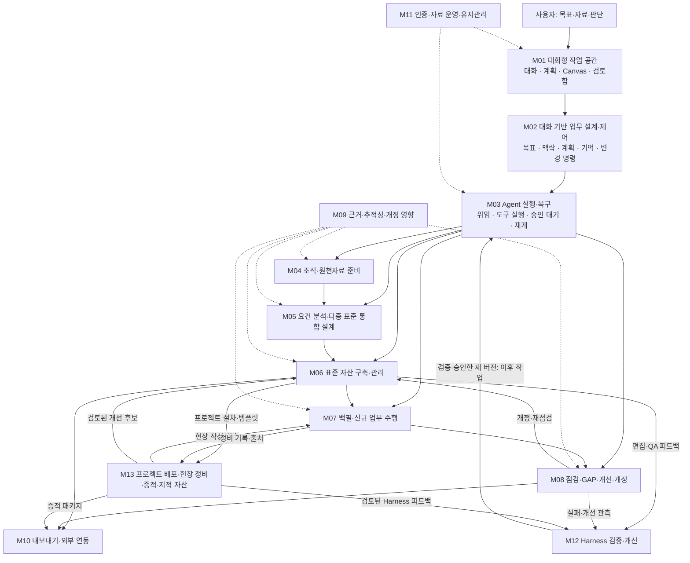

# Processware 기능 구조도

문서 버전 0.4 · 작성일 2026-10-07 · 연결 기준: 기획서·요구사항정의서 0.6

## 1. 구조의 기준

**전문가는 대화형 작업 공간에서 표준을 관리하고, 현장은 배포된 프로젝트 절차·템플릿을 사용한다.** 현장 산출물을 회수·정비해 감사/감리/인증/심사 증적과 회사 지적 자산으로 연결한다. 모든 직원에게 표준 구축·Harness UI를 요구하지 않는다. 프로세스 자산과 생성 Harness의 두 개선 루프를 검증·승인·버전으로 연결한다. 원천자료·요건·자산·증적·개선은 같은 업무 안에서 생성·조회·변경하는 대상이며, 결과 Canvas와 근거 패널에서 확인한다.

**다중 표준 통합 구축과 기존 기준선에 추가 표준 적용은 S1 핵심 기능이다.** M05가 두 모드를 설계하고 M02·M03이 실행을 제어하며 M06의 자산·M09의 표준별 근거와 커버리지·발행 QA로 연결한다. 공통 활동을 재사용해도 원 요건은 각각 보존한다.

**자산과 Harness의 이중 개선도 핵심이다.** M06·M08의 편집/QA/실패를 M12 피드백으로 연결하고, 후보·격리 평가·승인·릴리스 후 M03의 신규 run에 적용한다. 자산 기준선과 Harness release는 별도 버전이며 일반 편집이나 새 release가 다른 쪽을 자동 변경하지 않는다.

이 구조도는 기능 분해와 연결 관계를 정의한다. 13개 기능군이 각각 별도 메뉴·화면·Agent·서비스가 되어야 한다는 의미는 아니다. 기존 29개 전문 Agent는 M02·M03이 작업 목적에 맞게 선택하는 실행 자원이다.

S0는 실제 실행·승인 재개를 검증하는 단계, S1은 자산 구축 MVP, S2는 백필·개선까지 포함한 개인 업무 v1, S3는 확장이다. 사용자의 전체 목표를 충족하는 범위는 S2다.

## 2. 전체 기능 구조도



실선은 주 실행·업무 흐름, 점선은 여러 기능에 공통으로 적용하는 지원 기능이다. 실행 결과·근거·질문·승인 요청은 M03 → M02 → M01로 돌아온다. 각 업무는 필요한 중간 단계에서 시작할 수 있으며, 모든 요청이 신규 구축 순서를 처음부터 반복하지는 않는다.

## 3. 전문가와 현장의 기능 구조

```text
Processware 전문가 관리 영역
├─ 프로젝트 배포·현장 회수·증적/지적 자산
│  └─ 현장은 절차·파일/외부 템플릿을 사용하고 결과·확인 응답을 제출
├─ 새 업무 시작
│  ├─ 다중 표준 통합 / 기존 기준선에 표준 추가 / 단일 표준 구축
│  ├─ 목표를 대화로 설명 / 자료 첨부 / 시작 예시
│  └─ 조직·적용 범위·기준선 선택 또는 대화로 확인
├─ 업무 목록
│  ├─ 진행 업무 / 검토 대기 / 완료 업무
│  └─ 중단 업무 이어하기 / 다른 업무로 이동
├─ 대화형 작업 공간 [기본 화면]
│  ├─ 대화: 질문·지시·수정·상태 확인
│  ├─ 맥락: 조직·기준선·자료·선택 문단
│  ├─ 계획·진행: 단계·진행·남은 질문·중단·재개
│  ├─ 검토·결정: 근거·변경안·영향·확정 대상·승인
│  ├─ 결과 Canvas
│  │  ├─ 원문·요건·자산·증적·점검 결과 보기
│  │  └─ 문단 선택 수정 / 전후 비교 / 대안 / 이력
│  └─ 업무 기억: 목표·제약·결정·미해결 사항 확인·정정
├─ Harness 개선 [같은 대화 shell의 업무]
│  └─ 피드백·scope / 후보·diff / 비교 평가 / 릴리스 / 버전 관측·복귀
├─ 자료·자산 찾기 [보조 진입]
│  └─ 검색 결과를 현재 업무에 연결 / 상세 패널 열기
└─ 설정·운영 [보조 진입]
   └─ 계정·조직 / 실행 정책·예산 / 자료 권한 / 백업·운영
```

원천자료 업로드, 요건 판단, 자산 편집, 백필 검토는 위 기본 화면 안의 대화·카드·Canvas로 수행한다. 전체 표와 정밀 양식은 필요한 경우 확장하는 보조 기능이다. 좁은 화면에서는 대화·결과 탭으로 전환하며 작업 맥락을 유지한다.

## 4. 기능군별 상세 분해

| 기능군 | 목적 | 요구사항 수 | 구현 단계 |
|---|---|---:|---|
| M01 대화형 작업 공간 | 사용자가 업무를 시작하고 결과와 결정을 확인하는 기본 화면 | 16 | S1 14개 / S2 2개 |
| M02 대화 기반 업무 설계·제어 | 사용자의 말을 실행 가능한 업무와 변경으로 연결 | 12 | S1 10개 / S2 2개 |
| M03 Agent 실행·복구 | 실제 작업 실행과 상태·승인 대기·복구를 관리 | 6 | S1 6개 |
| M04 조직·원천자료 준비 | 사용할 조직 범위와 근거 자료를 확정 | 6 | S1 5개 / S2 1개 |
| M05 요건 분석·다중 표준 통합 설계 | 원천자료를 분석하고 통합 구축·기존 기준선 추가 적용의 두 핵심 모드를 설계 | 12 | S1 12개 |
| M06 표준 프로세스 자산 구축·관리 | 근거가 연결된 자산을 초안부터 승인 기준선까지 관리 | 8 | S1 8개 |
| M07 실제 산출물 백필·업무 수행 | 기존 산출물과 신규 수행 결과를 구분하여 증적화 | 7 | S2 7개 |
| M08 점검·GAP·개선·개정 | 실제 이행과 외부 요건의 차이를 평가하고 개선을 환류 | 8 | S2 7개 / S3 1개 |
| M09 근거·추적성·개정 영향 | 전체 업무에서 출처와 버전 간 연결을 보존 | 3 | S1 2개 / S2 1개 |
| M10 내보내기·외부 연동 | 확정 결과를 외부에서 활용할 수 있게 제공 | 3 | S1 1개 / S2 1개 / S3 1개 |
| M11 인증·자료 운영·유지관리 | 개인 서버에서 자료와 작업을 지속 운영 | 7 | S1 6개 / S3 1개 |
| M12 Harness 검증·개선 | 자산 편집·실패 피드백에서 실행 Harness의 검증된 개선으로 환류 | 10 | S1 9개 / S2 1개 |
| M13 프로젝트 배포·현장 정비·증적·지적 자산 | 전문가의 표준 관리 결과를 현장에 배포하고 회수 결과를 증적과 회사 지적 자산으로 환류 | 10 | S2 10개 |

### M01. 대화형 작업 공간

사용자가 업무를 시작하고 결과와 결정을 확인하는 기본 화면.

- 목표 입력·자료 첨부
- 조직·기준선·선택 문단 표시
- 계획·질문·진행·근거 카드
- Canvas·선택 수정·변경 비교
- 검토함·이어서 작업
- 접근성·모바일 전환

| 요구사항 | 기능 | 단계 |
|---|---|---|
| FR-UX-01 | 업무 중심 홈·탐색 | S1 |
| FR-UX-02 | 대화 입력창·첨부·전송 상태 | S1 |
| FR-UX-03 | 가시적 맥락 chip·문서 언급 | S1 |
| FR-UX-04 | 계획 카드와 업무 단계 strip | S1 |
| FR-UX-05 | 짧은 선택형 질문·확인 카드 | S1 |
| FR-UX-06 | 제어 가능한 스트리밍·작업 상태 | S1 |
| FR-UX-07 | 승인된 카드 renderer | S1 |
| FR-UX-08 | 산출물 canvas·선택 수정 | S1 |
| FR-UX-09 | 대화형 백필 검토 카드 | S2 |
| FR-UX-10 | 명확한 결정 카드·검토함 | S1 |
| FR-UX-11 | 변경 되돌리기·대안 비교 | S1 |
| FR-UX-12 | 업무 기억 패널·정정 | S1 |
| FR-UX-13 | 여러 업무의 배경 실행·복귀 | S1 |
| FR-UX-14 | 대화 UI 접근성·입력 보호 | S1 |
| FR-UX-15 | 결과·한계·다음 업무 카드 | S1 |
| FR-UX-16 | 폭별 대화·결과 패널 전환 | S2 |

### M02. 대화 기반 업무 설계·제어

사용자의 말을 실행 가능한 업무와 변경으로 연결.

- 목표·통합/추가 모드·표준 판·base 구체화
- 대상 문서와 판 식별
- 실행 계획·전문 Agent 위임
- 자연어 지시를 검증 가능한 변경 명령으로 변환
- 중요한 결정 연결
- 업무 기억·설명·중간 지시

| 요구사항 | 기능 | 단계 |
|---|---|---|
| FR-CON-01 | 대화로 목표 구체화 | S1 |
| FR-CON-02 | 대화 맥락·대상 판 연결 | S1 |
| FR-CON-03 | 업무 계획·분해·Agent 위임 | S1 |
| FR-CON-04 | 대화 지시의 실제 객체 변경 | S1 |
| FR-CON-05 | 근거·변경·결과 카드 | S1 |
| FR-CON-06 | 대화 안의 명시적 승인 | S1 |
| FR-CON-07 | 지속 업무 기억·재접속 | S1 |
| FR-CON-08 | 진행 보고·중간 지시·취소 | S1 |
| FR-CON-09 | Agent 자율 범위와 중요 결정 | S1 |
| FR-CON-10 | 상태·근거 설명 질의 | S1 |
| FR-CON-11 | 대화로 백필 매핑·필드 수정 | S2 |
| FR-CON-12 | 대화로 개선·개정 루프 | S2 |

### M03. Agent 실행·복구

실제 작업 실행과 상태·승인 대기·복구를 관리.

- 작업·하위 실행 등록
- 전문 Agent·도구 정책
- 이벤트·진행 상태
- 체크포인트·승인 재개
- 중단·재시도·예산 제한
- 실제 실행 결과 기록

| 요구사항 | 기능 | 단계 |
|---|---|---|
| FR-RUN-01 | 구조화 작업 시작 | S1 |
| FR-RUN-02 | 작업 관찰·이벤트 | S1 |
| FR-RUN-03 | 체크포인트·재시작 복구 | S1 |
| FR-RUN-04 | HITL 승인과 반려 | S1 |
| FR-RUN-05 | 취소·재시도·예산 제한 | S1 |
| FR-RUN-06 | 실행 엔진·도구 정책 | S1 |

### M04. 조직·원천자료 준비

사용할 조직 범위와 근거 자료를 확정.

- 조직 프로필·적용 범위
- 원본 등록·해시·이용 권한
- 문서 추출·정규화
- 선택적 OCR
- 표준 판·변경 자료 관리

| 요구사항 | 기능 | 단계 |
|---|---|---|
| FR-ORG-02 | 조직 프로필과 범위 | S1 |
| FR-SRC-01 | 원천 자료 등록 | S1 |
| FR-SRC-02 | 자료 이용 권한 | S1 |
| FR-SRC-03 | 포맷 판별과 추출 | S1 |
| FR-SRC-04 | 선택적 OCR | S2 |
| FR-SRC-05 | 표준 판과 delta 관리 | S1 |

### M05. 요건 분석·다중 표준 통합 설계

원천자료를 분석하고 통합 구축·기존 기준선 추가 적용의 두 핵심 모드를 설계.

- 원문 구조·원자 요건 추출
- 적용 표준 구성·통합/추가 모드
- 표준 간 대응·고유·상충 검토
- 공통 활동·원 의무 보존 설계
- 기존 기준선 증분 계획·회귀 검사
- 표준별 커버리지·구성 변경
- 조직 테일러링·업무 흐름 설계

| 요구사항 | 기능 | 단계 |
|---|---|---|
| FR-STD-01 | 다중 표준 업무 모드·적용 구성 | S1 |
| FR-STD-02 | 표준 간 요건 대응·관계 검토 | S1 |
| FR-STD-03 | 공통·고유 의무를 보존한 통합 구축 | S1 |
| FR-STD-04 | 기존 기준선에 추가 표준 증분 적용 | S1 |
| FR-STD-05 | 표준별 고유·상충 조건의 명시적 처리 | S1 |
| FR-STD-06 | 표준별 독립 커버리지·공통 재사용 조회 | S1 |
| FR-STD-07 | 통합·추가 적용 누락 및 회귀 발행 게이트 | S1 |
| FR-STD-08 | 적용 표준 구성 변경·제거·판 교체 | S1 |
| FR-REQ-01 | 구조·원자 요건 추출 | S1 |
| FR-REQ-02 | 요건 검토·적용 판단 | S1 |
| FR-REQ-03 | 통합 요건·상충 관리 | S1 |
| FR-REQ-04 | 업무 흐름과 조직 테일러링 | S1 |

### M06. 표준 프로세스 자산 구축·관리

근거가 연결된 자산을 초안부터 승인 기준선까지 관리.

- 공통/고유 자산·증분 초안·무변경 판 재사용
- POL·PRO·WI·TMP·EX 초안
- 결정적 번호·메타 규칙 검사
- WI 본문·실행 명세
- 선택 편집·diff
- QA·제한적 수정
- 승인·발행·폐기·기준선 전환

| 요구사항 | 기능 | 단계 |
|---|---|---|
| FR-AST-01 | 자산 라이브러리·검색 | S1 |
| FR-AST-02 | 프로세스 자산 초안 생성 | S1 |
| FR-AST-03 | 결정적 번호·메타 검증 | S1 |
| FR-AST-04 | WI 본문과 실행 명세 | S1 |
| FR-AST-05 | 자산 편집·변경 비교 | S1 |
| FR-AST-06 | QA와 제한적 자가수정 | S1 |
| FR-AST-07 | 승인·기준선 발행 | S1 |
| FR-AST-08 | 폐기·이력·기준선 전환 | S1 |

### M07. 실제 산출물 백필·업무 수행

기존 산출물과 신규 수행 결과를 구분하여 증적화.

- 백필 배치·파일 추출
- WI 후보·파일 그룹 추천
- 필드별 출처·미확인·상충
- 대화로 예외 검토
- legacy_evidence REC 발행
- 승인 WI·TMP를 이용한 신규 REC 작성·보정

| 요구사항 | 기능 | 단계 |
|---|---|---|
| FR-BFL-01 | 백필 배치와 추출 | S2 |
| FR-BFL-02 | WI 후보 추천 | S2 |
| FR-BFL-03 | 파일 그룹과 primary 검토 | S2 |
| FR-BFL-04 | 필드 매핑·미확인·상충 | S2 |
| FR-BFL-05 | 백필 REC 발행 | S2 |
| FR-DO-01 | WI 기반 새 수행 기록 | S2 |
| FR-DO-02 | 수행 기록 승인·보정 | S2 |

### M08. 점검·GAP·개선·개정

실제 이행과 외부 요건의 차이를 평가하고 개선을 환류.

- 자체 이행 점검
- 백필 증적 평가
- 외부 표준 GAP
- finding·NCR 초안
- 개선 큐·원인 분석
- 개정 계획·재실행·효과 확인
- KPI 추세

| 요구사항 | 기능 | 단계 |
|---|---|---|
| FR-CHK-01 | 자체 이행 점검 | S2 |
| FR-CHK-02 | 백필 증적 평가 정책 | S2 |
| FR-GAP-01 | 외부 표준 GAP 분석 | S2 |
| FR-CHK-03 | 점검 결과 확정·NCR 초안 | S2 |
| FR-ACT-01 | 개선 큐와 중복 방지 | S2 |
| FR-ACT-02 | 원인 분석·개정 계획 | S2 |
| FR-ACT-03 | 개정 재실행·효과 확인 | S2 |
| FR-KPI-01 | KPI 정의·추세·개선 연결 | S3 |

### M09. 근거·추적성·개정 영향

전체 업무에서 출처와 버전 간 연결을 보존.

- 원문 ↔ 요건 ↔ 자산 ↔ 증적 ↔ finding ↔ 개정 연결
- 표준별 독립 커버리지·Crosswalk·MAT
- 개정 영향 분석
- 과거 증적의 수행 당시 기준선 보존

| 요구사항 | 기능 | 단계 |
|---|---|---|
| FR-TRC-01 | 양방향 추적성 | S1 |
| FR-TRC-02 | 커버리지·MAT 보기 | S1 |
| FR-TRC-03 | 개정 영향 분석 | S2 |

### M10. 내보내기·외부 연동

확정 결과를 외부에서 활용할 수 있게 제공.

- 자산·기준선 내보내기
- 점검·GAP 보고서 내보내기
- 선택적 Redmine 연동

| 요구사항 | 기능 | 단계 |
|---|---|---|
| FR-EXP-01 | 자산·기준선 내보내기 | S1 |
| FR-EXP-02 | 점검·GAP 보고서 내보내기 | S2 |
| FR-INT-01 | Redmine 선택 연동 | S3 |

### M11. 인증·자료 운영·유지관리

개인 서버에서 자료와 작업을 지속 운영.

- 단일 사용자 인증
- 기존 저장소 가져오기 미리보기
- 외부 편집 감지·재색인
- 백업·복원
- 감사 이력·운영 상태
- 보관·삭제·용량
- 추가 문서 포맷

| 요구사항 | 기능 | 단계 |
|---|---|---|
| FR-ORG-01 | 단일 사용자 인증 | S1 |
| FR-OPS-01 | 기존 저장소 preview import | S1 |
| FR-OPS-02 | 외부 편집 감지·재색인 | S1 |
| FR-OPS-03 | 백업·복원 | S1 |
| FR-OPS-04 | 감사 이력·운영 상태 | S1 |
| FR-OPS-05 | 보관·삭제·디스크 관리 | S1 |
| FR-FMT-01 | 추가 한국 문서·구형 파일 지원 | S3 |

### M12. Harness 검증·개선

자산 편집·실패 피드백에서 실행 Harness의 검증된 개선으로 환류.

- 피드백·원인·개선 큐
- 이번 업무·조직·공통 적용 scope
- 지침·템플릿·규칙/도구 후보 diff
- 정답·회귀 평가 세트
- 기준·후보 sandbox 비교
- 릴리스 결정·불변 release·run별 버전 고정
- 사후 관측·호환 복귀
- S2 실행 코드·adapter 검증·배포

| 요구사항 | 기능 | 단계 |
|---|---|---|
| FR-HAR-01 | 편집·대화 피드백의 Harness 개선 연결 | S1 |
| FR-HAR-02 | 피드백 분류·원인·개선 큐 | S1 |
| FR-HAR-03 | 개선 적용 범위·정책 계층 | S1 |
| FR-HAR-04 | Harness 변경안·명세·정밀 편집 | S1 |
| FR-HAR-05 | 정답·회귀 평가 세트 관리 | S1 |
| FR-HAR-06 | 기준·후보 Harness의 격리 비교 실행 | S1 |
| FR-HAR-07 | 평가 근거 기반 Harness 릴리스 승인 | S1 |
| FR-HAR-08 | 불변 Harness 릴리스·작업별 버전 고정 | S1 |
| FR-HAR-09 | 적용 효과 관찰·Harness 복귀 | S1 |
| FR-HAR-10 | 실행 규칙·도구·어댑터 코드의 검증된 개선 | S2 |

### M13. 프로젝트 배포·현장 정비·증적·지적 자산

전문가의 표준 관리 결과를 현장에 배포하고 회수 결과를 증적과 회사 지적 자산으로 환류.

- 프로젝트 기준선 선택·테일러링
- DOCX/XLSX 빈 템플릿·절차 파일 배포
- adapter capability·전달/회수 receipt
- 현장 작성·수집·배포 판 추적
- 비정형 필드 정비·provenance·사후 사실 확인
- 목적별 증적 패키지·공개 필터
- 검토된 범용 사례·지적 자산화
- 전문가 관리·현장 사용 역할 분리

| 요구사항 | 기능 | 단계 |
|---|---|---|
| FR-FLD-01 | 프로젝트 표준 자산 선택·테일러링 | S2 |
| FR-FLD-02 | 프로젝트 절차·템플릿 파일 배포 | S2 |
| FR-FLD-03 | 시스템 연동 배포·회수 계약 | S2 |
| FR-FLD-04 | 현장 사용·산출물 수집 경로 | S2 |
| FR-FLD-05 | 배포 템플릿·현장 산출물 역추적 | S2 |
| FR-FLD-06 | 비정형 현장 산출물 정비·표준화 | S2 |
| FR-FLD-07 | 원 작성자 사실 확인·전문가 검토 | S2 |
| FR-FLD-08 | 감사·감리·인증·심사용 증적 패키지 | S2 |
| FR-FLD-09 | 검토된 회사 지적 자산 축적·재사용 | S2 |
| FR-FLD-10 | 전문 관리와 현장 사용의 역할·공개 범위 | S2 |

## 5. 대화에서 실제 업무로 이어지는 기능 연결

| 사용자 요청 | 기능 연결 | Agent가 보여줄 결과 | 필요한 결정 |
|---|---|---|---|
| 이 자료로 우리 조직 표준 프로세스를 만들어 줘 | M01 → M02 → M03 → M04 → M05 → M06, M09 공통 적용 | 실행 계획, 원문 근거, 적용 요건, 자산 초안, QA, 변경안 | 불확실한 적용 판단·상충 해결·기준선 발행 |
| A와 B를 통합해 공통 업무는 한 번만 수행하게 해 줘 | M01 → M02 모드/구성 → M03 → M04 → M05 대응·공통/고유 → M06; M09 표준별 검증 | 원 의무 보존·통합 흐름·관계/상충·고유 자산·표준별 커버리지 | 관계·상충·통합 기준선 발행 |
| 기존 A 기준선에 B를 추가하고 필요한 부분만 바꿔 줘 | M01 → M02 불변 base → M03 → M05 증분 계획 → M06; M09 회귀·coverage | 재사용/보완/신규/상충/판단 대기·link-only·최소 diff·A 회귀 | 추가 범위·새 구성·변경 묶음 발행 |
| 이 절차에서 선택한 문단만 간단히 해 줘 | M01 선택 범위 → M02 변경 명령 → M03 → M06, M09 영향 확인 | 선택한 판·범위의 초안과 diff, 관련 요건 영향 | 승인본에 반영할 변경 묶음의 발행 |
| 이 산출물을 백필해 줘. 앞의 세 파일은 같은 회의야 | M01 → M02 → M03 → M07, M09 출처 연결 | WI 후보·파일 그룹·필드 매핑·미확인 사항, 백필 REC 초안 | 매핑·필드 snapshot 확정, REC 발행 |
| 이 GAP을 해소하고 관련 절차도 개정해 줘 | M01 → M02 → M03 → M08 → M09 → M06 → M08 | GAP 근거, 개정 영향, 개선 계획, 새 자산 초안, 재점검 | 개선 범위·기준선 발행·실제 효과 확인 |
| 이 프로젝트에 템플릿을 배포하고 돌아온 파일을 정비해 증적/범용 사례로 만들어 줘 | M06 승인 자산 → M13 프로젝트 배포 → 현장 작성 → M07 원본/매핑/정비 → M13 증적·지적 자산 → M08/M12 개선 | 배포 manifest·원본/정비 REC·provenance·목적별 증적·권한 검토 사례 | 테일러링/배포·정비·증적 공개·회사 재사용은 각각의 결정 |
| 앞으로 이 조직의 WI 역할 누락을 검사하도록 Harness도 보완해 줘 | M06 편집 → M12 피드백·scope·후보·평가·release → M03 신규 작업; M09 원 의무 회귀 | 현재 자산 수정 + 별도 Harness 후보·평가·릴리스·작업별 버전 | 후보 범위·평가 근거·신규 작업용 활성화·복귀 |
| 지난 작업 어디까지 했지? 계속해 줘 | M01 → M02 기억·현재 상태 조회 → M03 체크포인트·재개 | 실제 완료·실행·대기 상태와 다음 단계 | 변경된 범위·기준선 또는 미해결 결정만 확인 |

각 요청의 시작점은 기존 자료·승인 기준선·진행 상태에 따라 달라진다. 자료 추출·초안 작성·규칙 검사는 허용 범위에서 자동 진행하며, 중요한 판단과 발행에서 사용자 결정을 받는다.

### 변경·승인의 공통 흐름


계획 승인, 백필 매핑 확정, REC 발행, 기준선 발행은 각각의 대상·범위를 가진 결정이다. 동일한 대화에서 수행해도 하나의 포괄 승인으로 합치지 않는다. 실행 실패는 실패 상태로 표시하고, 실제 저장 결과를 얻은 경우에만 완료로 보고한다.

## 6. 자료·상태의 공통 구조

| 공통 대상 | 관리하는 내용 | 주 연결 기능 |
|---|---|---|
| 조직·접근 범위 | 조직 프로필, 자료·검색·실행 범위 | M04·M11; 모든 업무에 적용 |
| 업무·대화·기억 | 목표, 메시지, 선택 대상, 질문, 결정 참조 | M01·M02 |
| 실행·이벤트·체크포인트 | 실제 실행 상태, 진행, 결과, 재개 위치, 예산 | M03 |
| 원천자료·판·출처 위치 | 원본, 정규화 입력, 이용 권한, 해시, 페이지·문단 | M04·M09 |
| 요건·적용 판단·업무 흐름 | 원자 요건, 적용·제외 사유, 상충, 테일러링 | M05·M09 |
| 자산·문서 판·기준선 | POL/PRO/WI/TMP/EX/REC/MAT/REF, 초안, 승인본, 이력 | M06·M07·M09 |
| 백필 매핑·수행 증적 | 파일 그룹, 필드별 출처, 미확인·상충, 수행 당시 판 | M07·M09 |
| finding·개선·변경 묶음 | 점검 결론, 원인, 영향, 개정 범위, 효과 확인 | M08·M09 |
| 결정·변경 이력 | 승인 대상 snapshot, 결정자, 시점, 실제 저장 결과 | M02·M03·M06·M07·M08·M11 |

대화 기록은 업무 맥락이다. 자산·증적·결정·실행 상태는 실제 저장된 객체와 이력을 기준으로 관리한다. 화면 재연결과 서버 작업 취소를 구분하고, 승인본의 되돌리기는 새로운 변경·승인 절차로 남긴다.

## 7. 구현 순서와 기능 경계

| 단계 | 기능 구조에서 먼저 구현할 부분 | 확인할 결과 |
|---|---|---|
| S0 기술 검증 | M01 최소 대화 → M02 실행 계획·명령 → M03 실제 실행·승인 재개; M11 기본 인증·격리 | 실제 ingest/plan 실행, 승인 대기·재개, 허용 파일 경계; 모의 채팅만으로 통과시키지 않음 |
| S1 자산 구축 MVP | M01·M02·M03 공통 업무 흐름, M04·M05 두 모드·관계·구성/증분·M06, M09 표준별 추적성·커버리지, M10 자산 내보내기, M11 기본 운영 | 통합 구축과 기존 기준선 추가 적용을 모두 실제 대화·QA·발행으로 완료 |
| S2 개인 업무 v1 | M07 백필·신규 수행, M08 점검·GAP·개선, M09 영향 분석; 대화 백필·개선·폭별 UI와 보고서 확장 | 실제 증적을 연결하고 개선→개정→재점검까지 완료 |
| S3 확장 | M08 KPI, M10 Redmine, M11 추가 한국 문서·구형 포맷 | 사용 경험에 따른 선택적 고도화 |

기능군에는 여러 단계의 요구사항이 섞인다. 상세 분해 표의 개별 요구사항 단계를 우선한다. 기존 Claude Code 하네스 연결은 기획 가정이며 S0 검증 후 결정한다. 기능 구조도는 특정 AI 제공자나 웹 템플릿에 종속되지 않는다.

1인 운영의 점검은 자체 점검으로 표시한다. 백필에서 확인하지 못한 작성일·작성자·승인 사실을 생성하지 않는다. 자료 소유와 AI 처리 허용 여부를 구분한다. 표준 커버리지와 실제 이행 평가도 별도로 관리한다.

## 8. 이중 개선의 기능 경계

자산 변경 루프는 M06/M08→QA→새 자산 기준선이다. Harness 변경 루프는 M12의 피드백→원인·scope→후보→고정 평가→release 결정→불변 release/신규 작업 적용→관측·복귀다. 생성 run과 EffectiveHarnessSnapshot이 둘을 연결한다. 지침·템플릿·지원 설정의 루프는 S1, 새 실행 규칙·tool/adapter 코드는 S2다. 후보 평가가 운영 쓰기·승인·외부 전송을 만들지 않으며 조직 overlay가 보호 정책을 약화할 수 없다.

## 9. 전문가 관리와 현장 사용·회사 환류

전문 관리 영역은 M01~M12의 표준/통합/Harness 기능을 사용한다. M13은 회사 기준선을 프로젝트의 적용 절차/TMP로 배포하고 원 배포·작성/수집 판·정비 필드 출처·검토·공개 목적을 연결한다. 현장에는 적용 절차·빈 양식·안내·제출 경로만 제공한다. 초기 전문 운영자 1명과 외부/파일 기반 현장 사용을 유지하며 전 직원의 authoring 계정은 요구하지 않는다.

S2 파일 round-trip을 필수로 검증한다. 개별 제품 adapter는 capability·receipt를 검증한 경우에만 실제 연동 완료를 표시한다. 정비 증적과 회사 재사용 사례는 별도 권한·범위·승인을 가지며 사후 정비가 과거 승인/서명/수행 사실을 생성하지 않는다. 지적 자산→표준 또는 Harness 변경은 검토된 개선 후보로 연결한다.

## 10. 연결 문서와 검증

- [기획서](01_Processware_기획서.md)
- [요구사항정의서](02_Processware_요구사항정의서.md)
- [요구사항 목록](04_Processware_요구사항목록.csv)
- [대화형 UI·UX 상세명세](05_Processware_대화형_UI_UX_상세명세.md)
- [Harness 검증·개선 상세명세](10_Processware_Harness_검증개선_상세명세.md)
- [프로젝트 배포·현장 정비·증적/지적 자산 명세](11_Processware_프로젝트배포_현장정비_증적지적자산_명세.md)

요구사항 목록의 기능 요구사항 108개를 13개 기능군에 각각 한 번씩 주 배정했다. 횡단 기능은 다른 기능군과 연결하여 사용한다. 비기능 요구사항 25개는 원 요구사항정의서를 따르며 이 문서에서 새로 분할하거나 우선순위를 변경하지 않았다.
