# Processware 화면 목록 및 화면별 흐름도

버전 0.4 · 작성일 2026-10-07 · 기준: 기획서·요구사항정의서 0.6, 기능 구조도 0.4

## 1. 화면 구성 원칙

**전문가의 기본 화면은 UI-13 Agent Workspace다.** 현장은 프로젝트 적용 절차·빈 양식·안내·제출 경로를 사용하며 표준 구축·Harness 과정을 알 필요가 없다. 목표 입력, 진행 업무, 검토 대기, 대화, 결과 Canvas를 같은 작업 공간의 상태·영역으로 제공한다. UI-02~11은 대화에서 여는 상세 패널이며, UI-12는 운영 진입이다. UI-14는 같은 대화 shell에서 자산과 연결된 Harness 개선 업무를 진행한다. 별도 링크로 열 수 있어도 업무마다 순서대로 방문할 필요는 없다.

기존 UI-01~14를 유지하고 전문가용 UI-15 프로젝트 배포·UI-16 증적/지적 자산을 추가했다. 현장 사용은 배포 파일·외부 도구 계약이며 내부 구축 화면 방문을 요구하지 않는다. 아래 route는 구현 계약 제안이며 실제 구현 주소가 아니다. `/tasks/new`는 새 업무 진입을 명확히 하기 위한 추가 제안으로 기존 `/tasks/:id`와 구분하여 처리한다. UI-13-START와 UI-13-CANVAS는 설명용 하위 흐름 표기이며 새 화면 ID가 아니다.

각 흐름도의 세로 줄은 대표 정상 경로, 옆 가지는 질문·수정·예외·다른 패널 이동이다. 조회·검토만 필요한 경우 중간 단계에서 종료하거나 대화로 돌아갈 수 있다. 패널을 닫으면 원래 대화, 입력문, 선택 대상, 스크롤 위치를 복원한다.

## 2. 화면 목록

| ID | 화면·패널 | 표현 형태 | route 제안 | 단계 | 핵심 기능 |
|---|---|---|---|---|---|
| UI-13 | Agent Workspace | 기본 업무 화면 | /tasks/:id; /tasks/new는 신규 진입 route 제안 | S1; 폭별·백필·개선 확장 S2 | 통합/추가 모드·적용 표준 판·불변 base, 조직·선택 대상, 대화·계획·근거·결정 카드, Canvas·기억; 실제 사용 Harness 버전·개선 업무 연결 |
| UI-01 | 로그인 | 독립 진입 화면 | /login | S1 | 계정 입력, 로그인, 인증 오류, 원래 업무로 돌아갈 위치 |
| UI-02 | 업무 상태·조직 보조 패널 | 조직·업무 요약 패널 | /orgs/:id | S1；KPI 추세 S3 | 조직 프로필·범위, 현재 기준선, 진행·검토 대기·최근 개정; KPI는 확장; 승인 적용 표준 구성과 추가 적용 업무 |
| UI-03 | 자료 검토 | 원문·권한·추출 품질 패널 | /sources | S1；OCR S2；추가 포맷 S3 | 기준 자료·증적 구분, 원본·판·해시, 이용 권한, 원문 위치, 추출·OCR 품질; 표준 ID·적용 판·역할·scope |
| UI-04 | 적용요건·업무 흐름 | 근거·적용 판단 Canvas | /requirements | S1 | 표준별 원 의무·원문, 동등/중첩/포함/고유/상충/불확실 관계와 방향, 적용 판단·흐름 |
| UI-05 | 표준 프로세스 자산 | 문서·diff·QA Canvas | /assets/:id | S1 | 통합/증분 초안·무변경 판 재사용·link-only, 자산 ID·판·본문·근거·diff·QA·기존 의무 회귀·발행 |
| UI-06 | 근거·추적성 | 연결·커버리지 패널 | /traceability | S1 | 표준 판·scope별 독립 커버리지·Crosswalk·공통/고유·원 의무 연결, 누락·N/A·미평가 |
| UI-07 | WI 기반 신규 수행 | 단계·기록 Canvas | /execution | S2 | 승인 WI·TMP 판, 수행 단계, 필수 사실·증적, 기록 초안, 승인·보정 이력 |
| UI-08 | 실제 산출물 백필 | 예외 중심 매핑·필드 패널 | /backfill/:batch | S2 | 배치 성공·제외·실패 수, WI 후보, 파일 그룹·primary, 필드 출처·미확인·상충; 당시 프로젝트 배포 판·필드 변환/보정·사후 확인·현장 작성자 확인 수준 |
| UI-09 | 자체 점검·외부 표준 GAP | 판정·증적·보고서 Canvas | /assessments | S2 | 점검 종류·기준선·증적 범위, 근거·판정·미평가, finding·NCR 초안, 보고서 |
| UI-10 | 개선·개정·효과 확인 | 개선 루프 Canvas | /improvements/:id | S2 | finding·중복, 원인 분석, 관련 자산·증적 영향, 개정 계획·diff, 효과 확인 |
| UI-11 | 작업·승인·복구 | 실제 실행·결정 상세 패널 | /runs/:id | S1 | 실행 단계·이벤트·체크포인트, 질문·gate, 변경·근거·QA·snapshot, 예산·중단 상태; 통합/추가의 원 의무 누락·표준별 회귀·구성/관계/링크 snapshot |
| UI-12 | 설정·운영 | 독립 운영 화면·보조 패널 | /settings | S1；Redmine S3 | AI 접속 설정·도구 정책·예산, 저장소 import preview, 외부 편집·재색인, 백업·복원·감사·보관 |
| UI-14 | Harness 검증·개선 Workspace | 대화 shell의 개선·평가·릴리스 화면 | /harness/improvements/:id | S1 지침/템플릿/설정；S2 실행 코드 | 원 자산 diff·피드백·생성 run, 적용 scope·base release, 후보 diff, 기준/후보 평가, 활성 버전·복귀 |
| UI-15 | 프로젝트 자산·배포 | 전문가의 프로젝트 선택·배포 Workspace | /projects/:id/deployments | S2 | project scope·회사 baseline·선택/테일러링 WI/TMP 판·diff·파일/adapter·공개 정책·manifest·전달/수신 |
| UI-16 | 증적·회사 지적 자산 | 전문가의 증적 공개·범용 사례 Canvas | /evidence-packages/:id | S2 | 목적·프로젝트·기간·선택 기준·당시 배포/WI/TMP 판·원본/정비·provenance·한계·공개 권한·재사용 후보 |

### UI-13 안의 사용자용 보기

| 보기 | 목적·주 행동 | 다음 흐름 |
|---|---|---|
| 새 업무 | 통합 구축/기존 기준선에 추가 적용·단일 표준, 목표·첨부·구성 판 | 계획·질문·실행 |
| 진행 업무 | 실제 진행·대기 상태를 보고 업무 선택 | 같은 업무 대화로 재개 |
| 검토 대기 | 결정 종류·대상·판·차단 이슈 확인 | 해당 결정 카드와 Canvas |
| 완료 업무 | 실제 결과·한계·이력·후속 업무 | 결과 열기·후속 업무 시작 |
| 업무 대화 | 질문·수정·지시·판단·상태 확인 | 카드·Canvas·실제 실행 |
| 결과 Canvas | 본문·근거·diff·이력, 문단 선택 | 선택 범위를 대화에 연결 |
| 자료·자산 찾기 | 조직 범위에서 검색하고 맥락에 추가 | 현재 업무에 연결하거나 새 업무 |
| 업무 기억 | 목표·제약·결정 참조·미해결 사항 확인 | 기억 정정·계획 재검토 |
| Harness 개선 연결 | 자산 수정과 별도 영속 개선 의도·run 버전·scope | UI-14 후보·평가·release |

별도 회원가입, 채팅과 분리된 강제 작업 등록 폼, 문서 유형별 필수 CRUD 순회는 기본 동선에 포함하지 않는다.

## 3. 전체 화면 흐름도

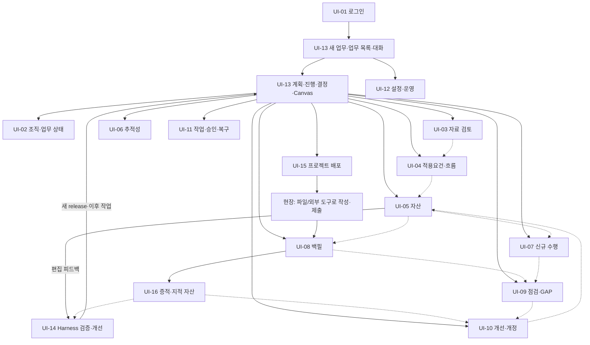

실선은 대화에서 화면·패널을 여는 동선이다. 점선은 대표 업무 연결이다. 열린 패널에서 일반적으로 UI-13으로 돌아오며 조직·기준선·객체 판·업무 ID를 유지한다. 예를 들어 새 자산 구축은 UI-03→04→05의 기능을 쓰지만 검토 패널을 직접 열지 않고 대화 카드로도 완료할 수 있다.

## 4. 각 화면의 상세 흐름도

### UI-13. Agent Workspace

- 진입: 로그인 성공, 새 업무, 업무 목록에서 선택, 검색 결과를 업무에 연결, 재접속
- 주요 정보: 통합/추가 모드·적용 표준 판·불변 base, 조직·선택 대상, 대화·계획·근거·결정 카드, Canvas·기억; 실제 사용 Harness 버전·개선 업무 연결
- 사용자 행동: 목표 설명, 자료 제공, 질문 답변, 중간 지시, 선택 수정, 대안 비교, 대상 범위 승인, 중단·재개
- 완료·복귀: 실제 산출물·저장 결과와 제외·한계·다음 업무를 표시; 완료·보류·부분 실패를 구분
- 대화 예시: **A와 B를 통합해 줘. 또는 기존 A 기준선에 B를 추가하고 필요한 부분만 바꿔 줘.**

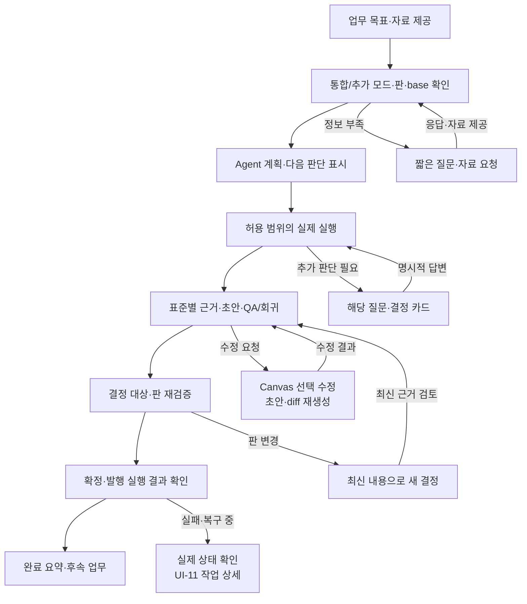

**적용 규칙:** 계획 동의가 최종 발행을 승인하지 않는다. 일반 초안 작업은 매 단계 승인을 요구하지 않는다. 대화 카드와 패널은 같은 객체를 변경한다. 두 구축 모드는 S1 필수다. 표준 구성과 원 의무 판을 가시적으로 유지한다. 전문가의 관리 shell이며 현장은 배포 파일/외부 도구만 사용할 수 있다.

**관련 요구사항:** FR-STD-01, FR-CON-01, FR-CON-02, FR-CON-03, FR-CON-04, FR-CON-05, FR-CON-06, FR-CON-07, FR-CON-08, FR-CON-09, FR-CON-10, FR-CON-11, FR-CON-12, FR-UX-01, FR-UX-02, FR-UX-03, FR-UX-04, FR-UX-05, FR-UX-06, FR-UX-07, FR-UX-08, FR-UX-09, FR-UX-10, FR-UX-11, FR-UX-12, FR-UX-13, FR-UX-14, FR-UX-15, FR-UX-16.

### UI-01. 로그인

- 진입: 미인증 진입, 세션 만료, 로그아웃 후
- 주요 정보: 계정 입력, 로그인, 인증 오류, 원래 업무로 돌아갈 위치
- 사용자 행동: 로그인, 실패 후 재입력; 공개 회원가입 없음
- 완료·복귀: 인증 후 유효한 원래 업무 또는 UI-13 새 업무로 이동
- 대화 예시: **원격 접속 후 이전 업무 이어하기**

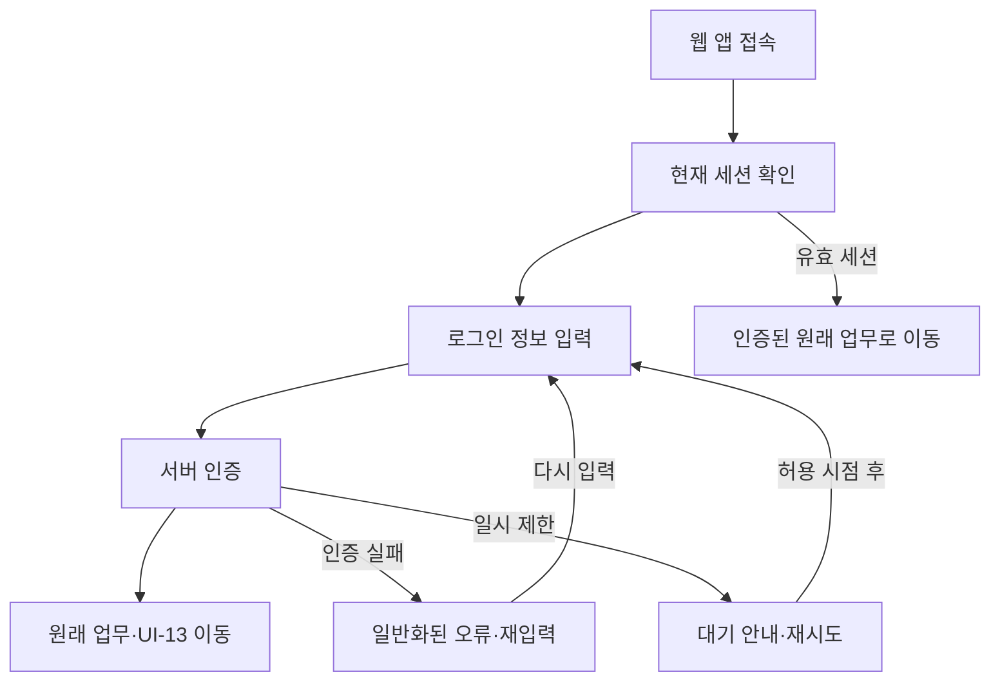

**적용 규칙:** 로그인 전 자료나 업무 내용을 노출하지 않는다. 세션 만료가 서버 작업 취소를 뜻하지 않는다. 복귀 주소는 앱 내부의 허용 경로만 사용한다.

**관련 요구사항:** FR-ORG-01.

### UI-02. 업무 상태·조직 보조 패널

- 진입: 조직 맥락 선택, 업무 목록, 현재 조직의 기준선·검토 대기 확인
- 주요 정보: 조직 프로필·범위, 현재 기준선, 진행·검토 대기·최근 개정; KPI는 확장; 승인 적용 표준 구성과 추가 적용 업무
- 사용자 행동: 조직 전환, 설정을 대화로 정정, 업무 열기, 판단 대기 항목 선택
- 완료·복귀: 선택한 조직의 업무를 UI-13에서 시작·재개; 요약은 실제 상태에서 계산
- 대화 예시: **이 조직의 승인 대기 업무를 보여줘.**

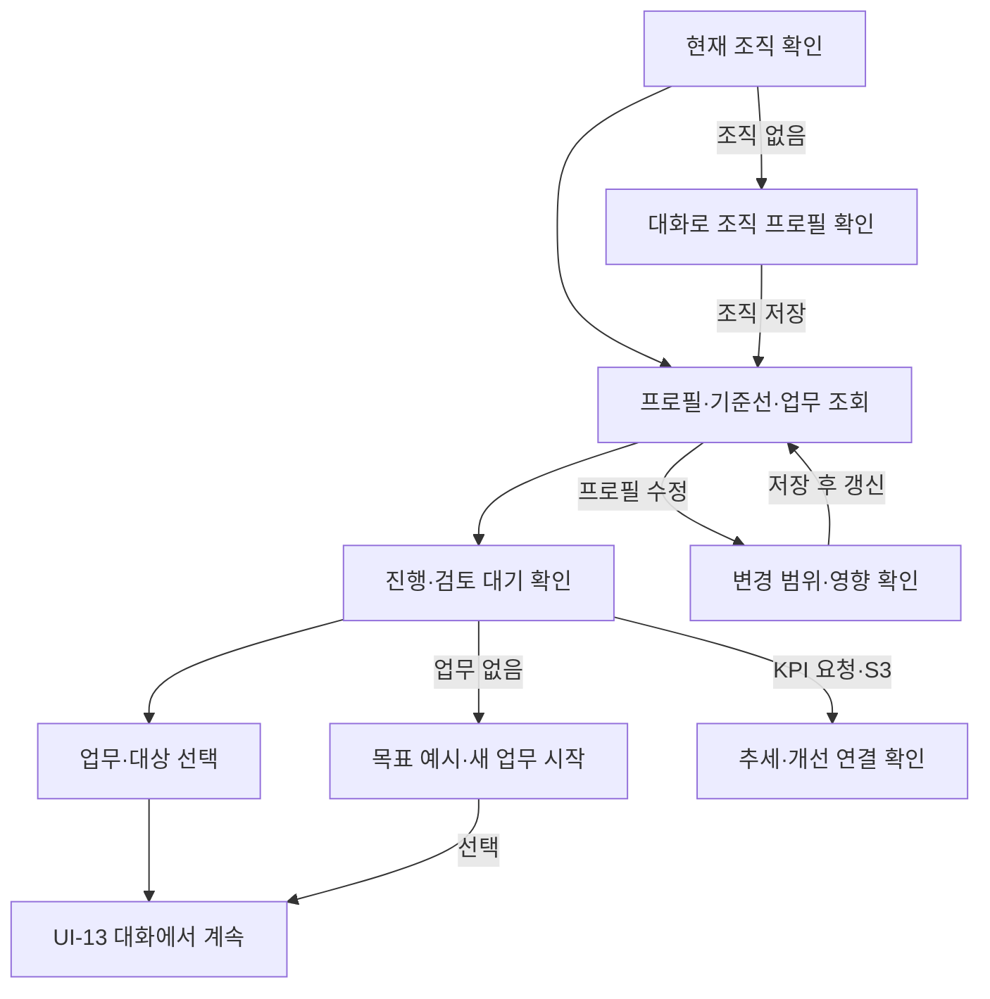

**적용 규칙:** 조직 전환 시 검색·AI 참조 범위를 새 조직으로 전환한다. 다른 조직의 자료를 묵시적으로 함께 사용하지 않는다.

**관련 요구사항:** FR-ORG-02, FR-KPI-01.

### UI-03. 자료 검토

- 진입: 대화 첨부, 자료 검색, 근거 카드, 새 표준 판 등록
- 주요 정보: 기준 자료·증적 구분, 원본·판·해시, 이용 권한, 원문 위치, 추출·OCR 품질; 표준 ID·적용 판·역할·scope
- 사용자 행동: 등록·교체 판 추가, 허용 범위 확인, 추출 재시도, 원문 대조, 확인 결과를 업무에 연결
- 완료·복귀: 확인된 정규화 입력과 원문 위치를 UI-04 또는 UI-08로 연결
- 대화 예시: **이 PDF를 기준 자료로 등록하고 추출 누락을 확인해 줘.**

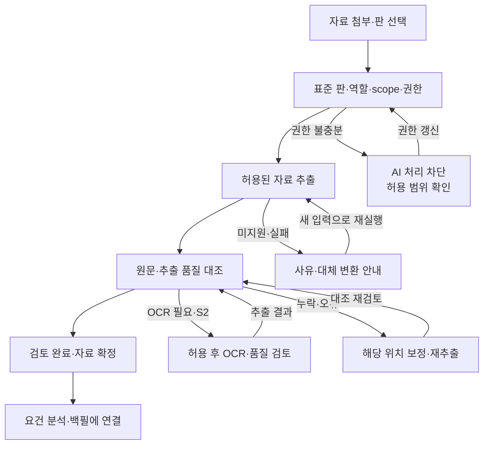

**적용 규칙:** 원본과 정규화 입력은 구분한다. 권한이 확인되지 않은 AI 처리는 진행하지 않는다. 새 판은 기존 원본을 덮어쓰지 않는다.

**관련 요구사항:** FR-SRC-01, FR-SRC-02, FR-SRC-03, FR-SRC-04, FR-SRC-05, FR-FMT-01.

### UI-04. 적용요건·업무 흐름

- 진입: 자료 확정 후 요건 카드, 상충 카드, 요건 검색
- 주요 정보: 표준별 원 의무·원문, 동등/중첩/포함/고유/상충/불확실 관계와 방향, 적용 판단·흐름
- 사용자 행동: 요건 분할·병합·정정, 적용·제외·보류 판단, 상충 해결, 테일러링 지시
- 완료·복귀: 검토한 요건·판단·업무 흐름을 확정하고 UI-05 자산 초안으로 연결
- 대화 예시: **이 요건은 두 개로 나누고, 우리 조직에 적용하지 않는 항목은 이유를 남겨줘.**

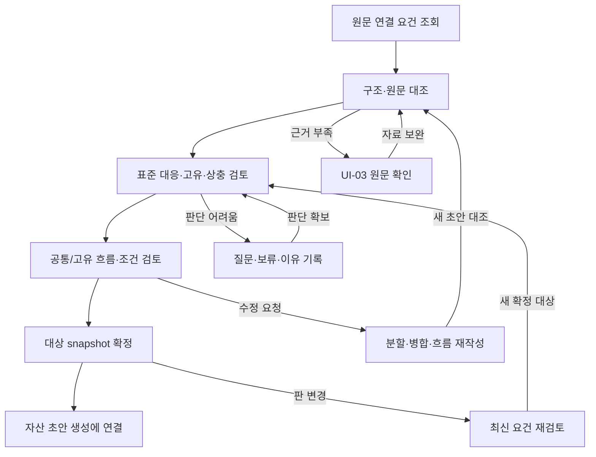

**적용 규칙:** 제외는 사유와 함께 남긴다. 초안 저장과 확정은 구분한다. 근거 없는 AI 설명을 승인 요건으로 자동 승격하지 않는다. 원 의무는 삭제하지 않는다. 포함 방향·추가 조건을 보존하고 상충을 기준 표준 우선으로 자동 해결하지 않는다.

**관련 요구사항:** FR-STD-02, FR-STD-05, FR-REQ-01, FR-REQ-02, FR-REQ-03, FR-REQ-04.

### UI-05. 표준 프로세스 자산

- 진입: 자산 초안 카드, 자료·자산 검색, 개정 영향 목록, 기록에서 WI 확인
- 주요 정보: 통합/증분 초안·무변경 판 재사용·link-only, 자산 ID·판·본문·근거·diff·QA·기존 의무 회귀·발행
- 사용자 행동: 선택 문단 대화 수정, 정밀 편집, 대안 비교, QA 실행, 발행 검토, 이력·내보내기; 앞으로 적용할 규칙으로 제안→UI-14
- 완료·복귀: 새 승인 기준선과 실제 발행 결과를 표시; 이전 판과 이력 보존
- 대화 예시: **선택한 문단을 줄이되 연결된 의무 요건은 유지해 줘.**

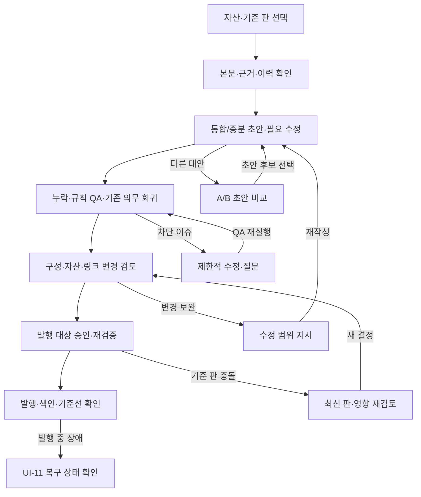

**적용 규칙:** active 본문을 직접 수정하지 않는다. 초안 되돌리기는 새 변경으로 기록한다. 과거 기준선 복귀도 QA·변경 묶음·발행 결정이 필요하다. 내보내기는 이용 권한을 적용한다. 추가 적용은 무변경 ID/revision/hash를 유지한다. 표준 추가·제거·판 교체도 새 구성과 발행 대상이다.

**관련 요구사항:** FR-HAR-01, FR-STD-03, FR-STD-04, FR-STD-08, FR-AST-01, FR-AST-02, FR-AST-03, FR-AST-04, FR-AST-05, FR-AST-08, FR-EXP-01.

### UI-06. 근거·추적성

- 진입: 근거 카드, 자산의 관련 요건, 커버리지 질의, 원문 역추적
- 주요 정보: 표준 판·scope별 독립 커버리지·Crosswalk·공통/고유·원 의무 연결, 누락·N/A·미평가
- 사용자 행동: 대상 범위 선택, 누락 확인, 링크 근거 열기, 관련 자산·증적로 이동, 정정 요청
- 완료·복귀: 검증된 연결과 누락을 확인하거나 연결된 수정 업무를 UI-13에 생성
- 대화 예시: **이 절차가 어떤 요건을 충족하는지 보여주고 연결이 빠진 항목을 찾아줘.**

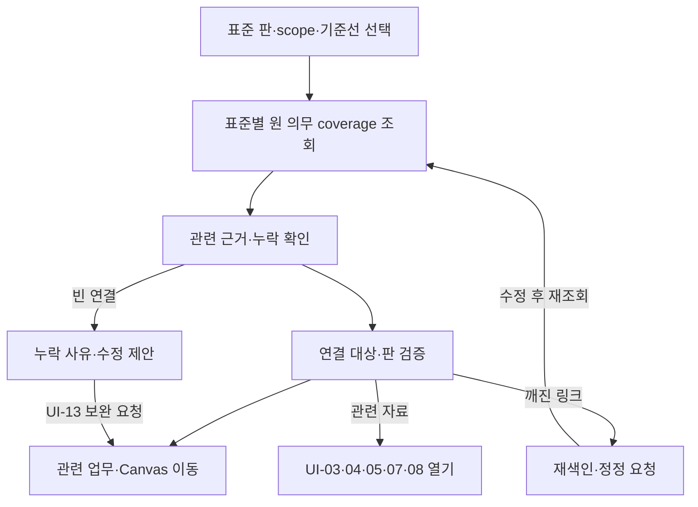

**적용 규칙:** 자료 간 링크는 대상 판에 묶는다. 커버리지 수치는 실제 이행이나 인증 적합 판정을 대신하지 않는다. 매트릭스는 보조 검토 수단이다. N/A는 사유와 별도 집계하고 분모에서 제외한다. 통합 그룹 수로 표준별 원 요건 분모를 대체하지 않는다.

**관련 요구사항:** FR-STD-06, FR-TRC-01, FR-TRC-02.

### UI-07. WI 기반 신규 수행

- 진입: 이 업무를 수행하자라는 대화, 승인 WI·TMP 선택, 미완료 수행 기록 재개
- 주요 정보: 승인 WI·TMP 판, 수행 단계, 필수 사실·증적, 기록 초안, 승인·보정 이력
- 사용자 행동: 단계 안내 요청, 실제 수행 정보 제공, 증적 첨부, 미완료 저장·재개, REC 발행 검토
- 완료·복귀: 수행 당시 기준선·판을 참조하는 신규 REC 발행; 보정은 이력으로 보존
- 대화 예시: **이 WI에 따라 검토 회의를 진행하고 기록을 남기자.**

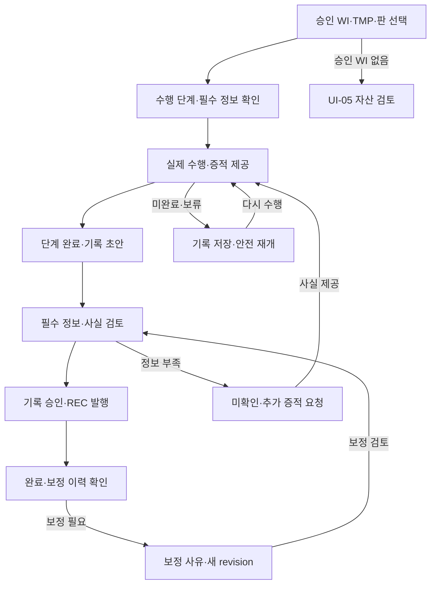

**적용 규칙:** Agent가 수행하지 않은 사람의 업무를 완료로 기록하지 않는다. 신규 수행과 legacy_evidence 백필을 구분한다.

**관련 요구사항:** FR-DO-01, FR-DO-02.

### UI-08. 실제 산출물 백필

- 진입: 백필 목표·첨부, 배치 카드, 저점수·상충 카드, 중단 배치 재개
- 주요 정보: 배치 성공·제외·실패 수, WI 후보, 파일 그룹·primary, 필드 출처·미확인·상충; 당시 프로젝트 배포 판·필드 변환/보정·사후 확인·현장 작성자 확인 수준
- 사용자 행동: 파일 그룹 정정, WI 선택, 상충값 확인, 미확인 유지, 매핑·필드 확정, REC 발행; 원 작성자 확인 응답 출처·정비 결과→UI-16
- 완료·복귀: 원본 해시·출처·WI 판과 연결된 legacy_evidence REC; 부분 결과도 구분 표시
- 대화 예시: **앞의 세 파일은 같은 회의야. 승인자는 미확인으로 남겨줘.**

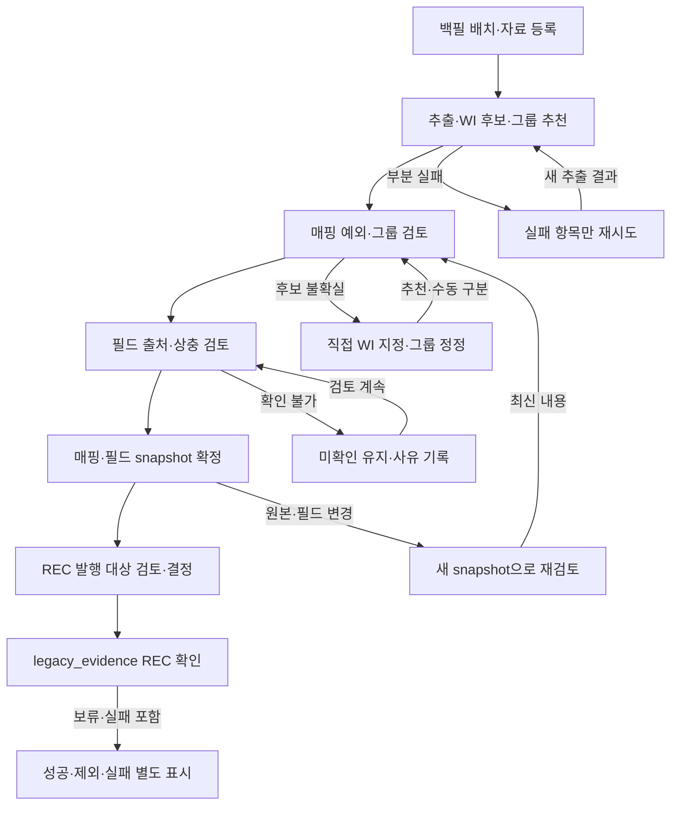

**적용 규칙:** 수동 WI 지정은 confidence 100%로 표시하지 않는다. 없는 작성일·작성자·승인 사실을 만들지 않는다. 매핑 확정과 REC 발행은 별도 범위의 결정이다.

**관련 요구사항:** FR-FLD-04, FR-FLD-05, FR-FLD-06, FR-FLD-07, FR-BFL-01, FR-BFL-02, FR-BFL-03, FR-BFL-04, FR-BFL-05.

### UI-09. 자체 점검·외부 표준 GAP

- 진입: 자체 점검 또는 GAP 요청, finding 카드, 점검 이력·보고서
- 주요 정보: 점검 종류·기준선·증적 범위, 근거·판정·미평가, finding·NCR 초안, 보고서
- 사용자 행동: 범위 지정, 증적 보완, 판정 정정·확정, 개선 연결, 보고서 내보내기
- 완료·복귀: 근거가 있는 finding 확정 및 개선 업무 연결; 미평가 유지; 보고서 일치
- 대화 예시: **이 기준선과 증적으로 실제 이행을 자체 점검해 줘.**

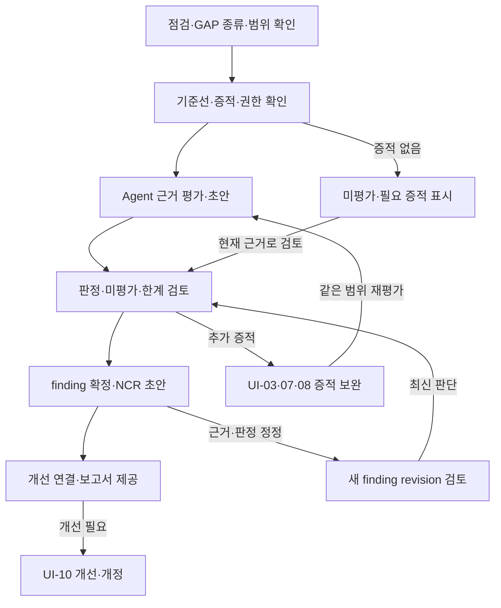

**적용 규칙:** 1인 검토는 자체 점검으로 표시한다. 백필 증적의 한계를 평가에 반영한다. 자체 이행 점검과 외부 표준 GAP을 구분한다.

**관련 요구사항:** FR-CHK-01, FR-CHK-02, FR-GAP-01, FR-CHK-03, FR-EXP-02.

### UI-10. 개선·개정·효과 확인

- 진입: finding에서 개선, 새 표준 판의 개정 영향, 개선 큐·보류 업무 재개
- 주요 정보: finding·중복, 원인 분석, 관련 자산·증적 영향, 개정 계획·diff, 효과 확인
- 사용자 행동: 범위·원인 검토, 계획 수정·승인, 자산 개정 지시, 효과 증적 제공, 종결·재개
- 완료·복귀: 새 기준선과 효과 확인 결과를 연결; 구현 완료와 개선 종결을 구분
- 대화 예시: **이 GAP을 해소하고 영향을 받는 지침도 개정해 줘.**

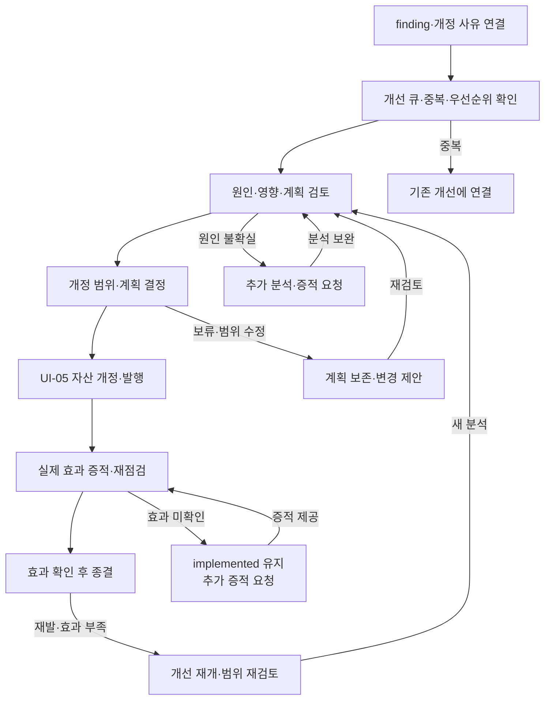

**적용 규칙:** 계획 승인이 자산 발행을 대신하지 않는다. 과거 기록은 수행 당시 기준선을 유지한다. 종결 요청만으로 효과 사실을 생성하지 않는다.

**관련 요구사항:** FR-TRC-03, FR-ACT-01, FR-ACT-02, FR-ACT-03.

### UI-11. 작업·승인·복구

- 진입: 진행·결정·실패·복구 카드, 작업 목록, 서버 상태 확인
- 주요 정보: 실행 단계·이벤트·체크포인트, 질문·gate, 변경·근거·QA·snapshot, 예산·중단 상태; 통합/추가의 원 의무 누락·표준별 회귀·구성/관계/링크 snapshot
- 사용자 행동: 상태 관찰, 승인·반려·보류, 중단 요청, 재시도·재개, 실제 결과 열기
- 완료·복귀: 완료·실패·중단·복구 상태를 UI-13에 동일하게 반영
- 대화 예시: **이 작업이 어디서 멈췄는지 보고 승인 대기 항목을 열어줘.**

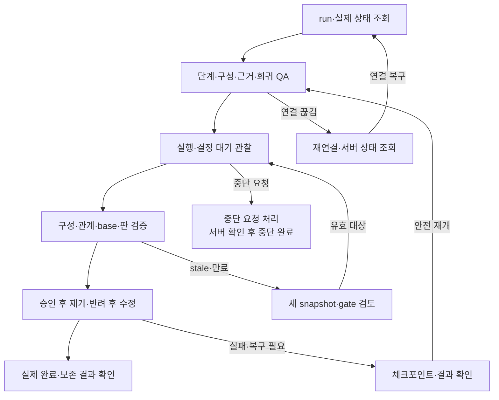

**적용 규칙:** 중단 요청 접수와 중단 완료를 구분한다. 재연결은 새 실행을 만들지 않는다. 변경된 승인 대상은 기존 결정을 재사용하지 않는다.

**관련 요구사항:** FR-STD-07, FR-AST-06, FR-AST-07, FR-RUN-01, FR-RUN-02, FR-RUN-03, FR-RUN-04, FR-RUN-05.

### UI-12. 설정·운영

- 진입: 설정 메뉴, 운영 오류 카드, 가져오기·백업·복원 요청
- 주요 정보: AI 접속 설정·도구 정책·예산, 저장소 import preview, 외부 편집·재색인, 백업·복원·감사·보관
- 사용자 행동: 설정 변경·검증, 가져오기·복원 미리보기, 대상 범위 확정, 운영 실행·결과 확인
- 완료·복귀: 실제 설정·작업 결과를 기록하고 관련 업무·운영 상태에 반영
- 대화 예시: **기존 저장소를 가져올 때 충돌할 자료부터 보여줘.**

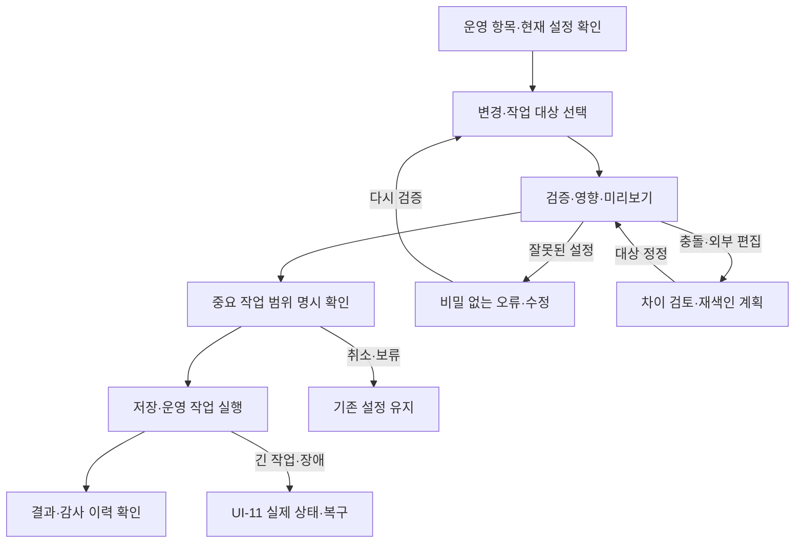

**적용 규칙:** AI 키 원문을 다시 표시하지 않는다. 일반 설정 변경에 불필요한 승인을 추가하지 않는다. 복원·삭제·외부 전송 등 중요한 작업은 대상과 영향이 확인된 결정으로 수행한다.

**관련 요구사항:** FR-RUN-06, FR-OPS-01, FR-OPS-02, FR-OPS-03, FR-OPS-04, FR-OPS-05, FR-INT-01.

### UI-14. Harness 검증·개선 Workspace

- 진입: 자산 편집에서 앞으로 적용 요청, 실패/QA 피드백, Harness 개선 큐·버전 관측
- 주요 정보: 원 자산 diff·피드백·생성 run, 적용 scope·base release, 후보 diff, 기준/후보 평가, 활성 버전·복귀
- 사용자 행동: 원인·범위 정정, 후보 선택 편집, 시험 결과 비교, release 승인, 버전 관측·호환 복귀
- 완료·복귀: 평가된 새 release를 이후 작업에 적용; 기존 작업·자산 유지; 실패 후보 보류·정정
- 대화 예시: **이 문서의 역할을 보완하고 앞으로 이 조직의 WI에서 누락되지 않게 Harness도 개선해 줘.**

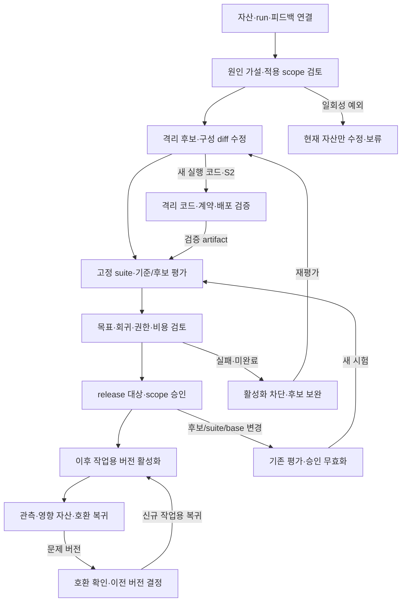

**적용 규칙:** 일반 편집은 영속 개선 동의가 아니다. 평가 sandbox는 운영 쓰기·승인·외부 전송을 하지 않는다. 진행 run의 버전은 고정하며 복귀는 과거 자산·REC·감사 삭제가 아니다.

**관련 요구사항:** FR-HAR-02, FR-HAR-03, FR-HAR-04, FR-HAR-05, FR-HAR-06, FR-HAR-07, FR-HAR-08, FR-HAR-09, FR-HAR-10.

### UI-15. 프로젝트 자산·배포

- 진입: 회사 기준선의 프로젝트 배포 요청, 프로젝트 목록, 배포/회수 receipt
- 주요 정보: project scope·회사 baseline·선택/테일러링 WI/TMP 판·diff·파일/adapter·공개 정책·manifest·전달/수신
- 사용자 행동: 프로젝트 선택·테일러링, 필드/형식 검토, 배포 승인, 실제 상태 확인
- 완료·복귀: 현장 절차·빈 템플릿·작성/제출 안내 전달; 회사 기준선 유지
- 대화 예시: **프로젝트 P에 필요한 절차와 템플릿을 배포해 줘.**

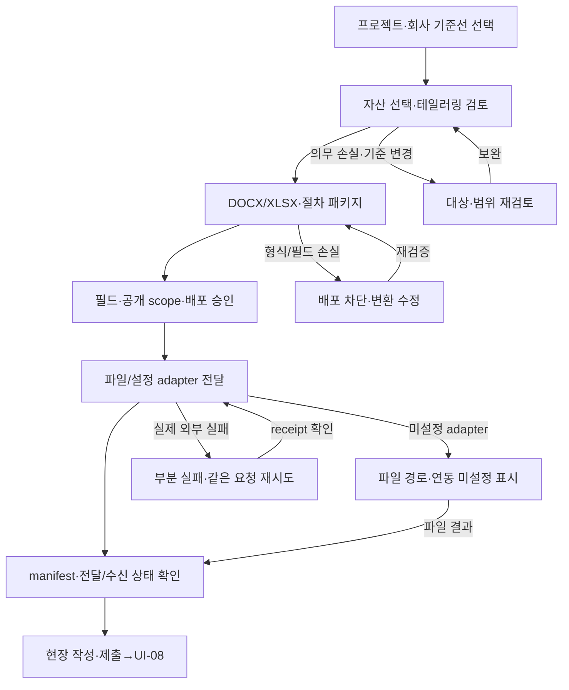

**적용 규칙:** 현장은 표준 구축/Harness UI를 알 필요가 없다. 프로젝트 판과 회사 표준 변경은 별도다. 생성/전달/수신을 구분하고 draft·타 프로젝트·내부 구축 정보는 공개하지 않는다.

**관련 요구사항:** FR-FLD-01, FR-FLD-02, FR-FLD-03, FR-FLD-10.

### UI-16. 증적·회사 지적 자산

- 진입: 정비 REC 검토 완료, 목적별 증적 요청, 범용 사례 후보
- 주요 정보: 목적·프로젝트·기간·선택 기준·당시 배포/WI/TMP 판·원본/정비·provenance·한계·공개 권한·재사용 후보
- 사용자 행동: 증적 범위·제외 검토, 색인/HTML/PDF/ZIP 생성, 범용성·권한·정보 제거 검토, 지적 자산 승인
- 완료·복귀: snapshot 증적 패키지와 별도 승인된 범용 사례; 표준/Harness 개선 후보 연결
- 대화 예시: **심사 제출 자료로 묶고, 고객 정보는 제거해서 범용 교훈만 회사 자산 후보로 만들어 줘.**

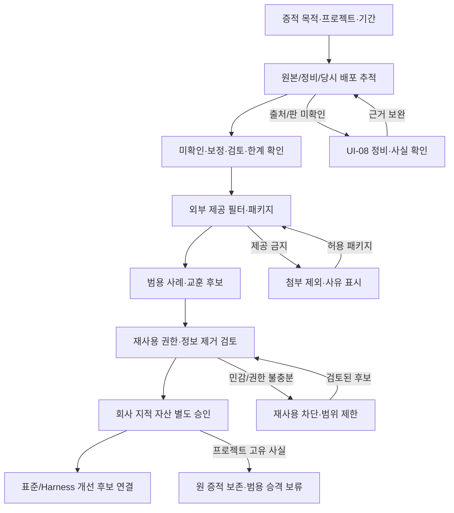

**적용 규칙:** 원본과 사후 정비·확인·예시를 구분한다. 패키지 생성은 적합/인증 합격이 아니다. 증적 공개와 회사 지적 자산 재사용·Harness 후보는 각각 권한/범위/검증 결정을 가진다.

**관련 요구사항:** FR-FLD-08, FR-FLD-09.

## 5. 핵심 업무의 화면 연결 흐름

세부 패널의 기능 연결이며 모든 패널을 반드시 직접 방문해야 하는 순서가 아니다. 대화 카드로 동일 검토·결정을 수행할 수 있다.

### 핵심 업무: 다중 표준 통합 구축

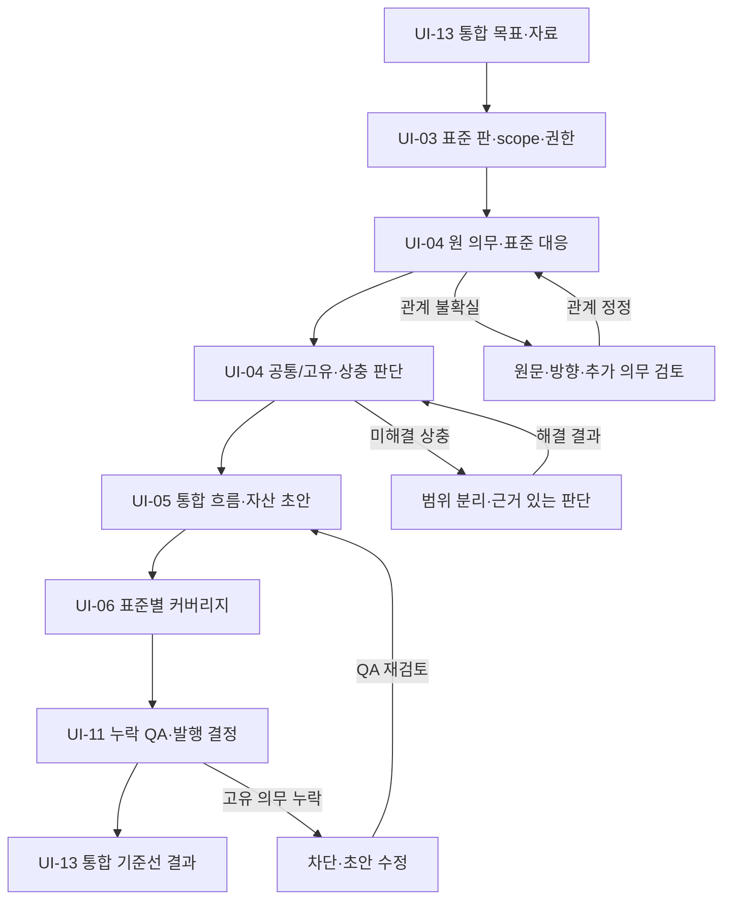

### 핵심 업무: 기존 기준선에 추가 표준 적용

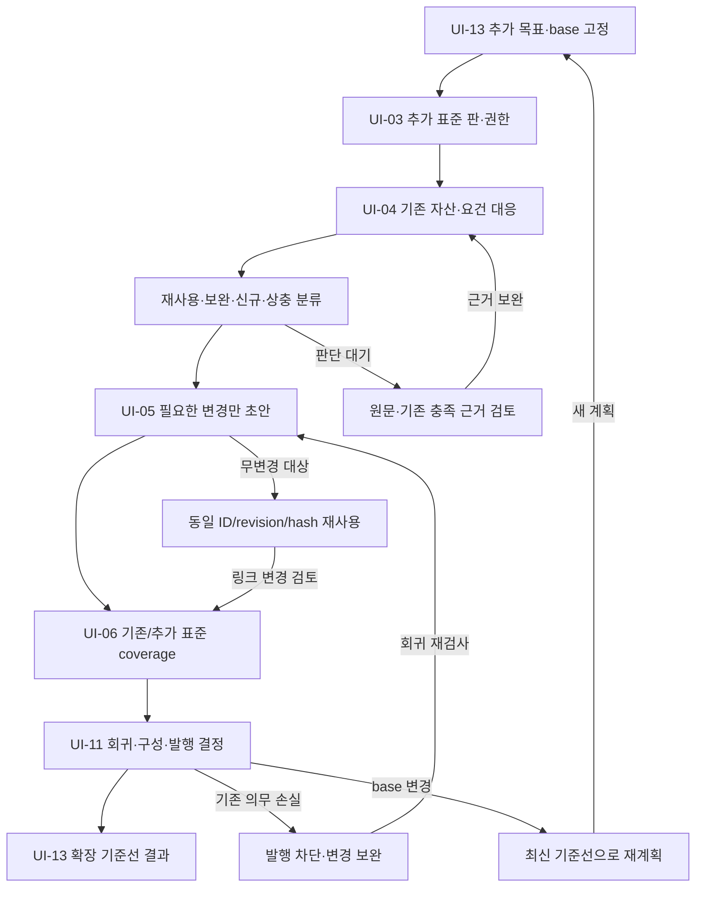

### 핵심 업무: 자산과 Harness의 검증된 이중 개선

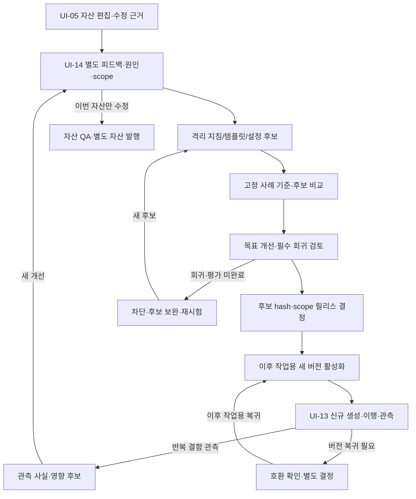

### 핵심 업무: 전문가 관리→현장 배포→정비·증적·회사 지적 자산

```mermaid
flowchart TD
    N0["전문가 UI-05 회사 기준선"]
    N1["UI-15 프로젝트 선택·테일러링"]
    N2["절차·빈 양식·안내 배포"]
    N3["현장: 익숙한 도구로 작성·제출"]
    N4["UI-08 원본·배포 판 회수"]
    N5["비정형 정비·출처·사실 확인"]
    N6["UI-16 목적별 증적 패키지"]
    N7["별도 검토 회사 지적 자산"]
    N8["표준/Harness 개선 후보"]
    N0 --> N1
    N1 --> N2
    N2 --> N3
    N3 --> N4
    N4 --> N5
    N5 --> N6
    N6 --> N7
    N7 --> N8
    N2 -->|"시스템 연동 선택"| B0["검증 adapter·실제 receipt"]
    B0 -->|"현장 사용"| N3
    N5 -->|"미확인·상충"| B1["원 작성자 응답·제한 보존"]
    B1 -->|"전문가 검토"| N5
    N7 -->|"권한/정보 부족"| B2["재사용 보류·정보 제거"]
    B2 -->|"범위 검토"| N7
    N8 -->|"표준 개정"| B3["별도 자산 검토·발행"]
    B3 -->|"새 기준선"| N0
    N8 -->|"Harness 개선"| B4["UI-14 후보·평가·release"]
```

## 6. UI-13 하위 흐름

### 새 업무·업무 목록·재개

```mermaid
flowchart TD
    N0["새 업무·진행·검토 대기·완료"]
    N1["목표 입력 또는 기존 업무 선택"]
    N2["조직·대상·현재 상태 확인"]
    N3["메시지 접수·작성문 보존"]
    N4["계획·미해결 질문·실행 표시"]
    N0 --> N1
    N1 --> N2
    N2 --> N3
    N3 --> N4
    N1 -->|"기존 업무"| B0["저장된 업무·결정·run 조회"]
    B0 -->|"같은 업무 재개"| N2
    N3 -->|"접수 실패"| B1["입력문 유지·같은 요청 재전송"]
    B1 -->|"동일 요청 식별자"| N3
    N2 -->|"세션 만료"| B2["UI-01 재인증"]
    B2 -->|"원래 업무 복귀"| N2
```

### Canvas 선택 수정·결정

```mermaid
flowchart TD
    N0["근거·산출물 카드 열기"]
    N1["문서 판·선택 범위 확인"]
    N2["선택 내용을 대화로 수정"]
    N3["범위 내 초안·diff·QA"]
    N4["변경 대상·영향 검토"]
    N5["결정 기록·저장 결과 확인"]
    N0 --> N1
    N1 --> N2
    N2 --> N3
    N3 --> N4
    N4 --> N5
    N2 -->|"다른 대안"| B0["A/B 초안 비교"]
    B0 -->|"후보 선택"| N4
    N3 -->|"수정 되돌리기"| B1["새 초안 변경 이력 생성"]
    B1 -->|"충돌 검증"| N3
    N4 -->|"발행 요청"| B2["UI-11 발행 대상 승인"]
    B2 -->|"유효 snapshot 확인"| N5
    N5 -->|"판 충돌"| B3["최신 판·변경 재검토"]
    B3 -->|"새 결정 대상"| N4
```

문단 선택은 선택 문서의 판·범위를 대화 입력창에 넣으며 메시지를 자동 전송하지 않는다. 대안 선택은 초안 후보 결정이다. 초안 되돌리기는 새 변경 이력이며, 승인본 복귀는 새 변경 묶음·QA·발행 결정을 필요로 한다.

## 7. 공통 오류·복구 흐름

```mermaid
flowchart TD
    N0["연결·실행 이상 인지"]
    N1["서버 run·결정·결과 조회"]
    N2["실제 상태에 맞게 표시"]
    N3["보존 결과·안전 지점 검토"]
    N4["같은 업무에서 재개·후속 작업"]
    N0 --> N1
    N1 --> N2
    N2 --> N3
    N3 --> N4
    N1 -->|"서버 계속 실행"| B0["재연결 후 최신 이벤트"]
    B0 -->|"실행 상태 유지"| N2
    N1 -->|"중단 요청 처리 중"| B1["처리 중 표시·상태 확인"]
    B1 -->|"서버 확인"| N1
    N1 -->|"중단 완료"| B2["checkpoint·결과 보존"]
    B2 -->|"재개 준비"| N3
    N2 -->|"부분 실패"| B3["성공·실패·제외 구분"]
    B3 -->|"실패 항목만 재시도"| N3
    N3 -->|"발행 중단"| B4["manifest·저장 상태 복구"]
    B4 -->|"발행 결과 조회"| N1
```

| 상황 | 사용자에게 보이는 상태 | 행동·복귀 |
|---|---|---|
| 빈 목록·첫 사용 | 목표 입력·예시 또는 필요한 자료 안내 | 새 업무·자료 연결 |
| 메시지 접수 실패 | 작성문 보존·미접수 표시 | 같은 요청 식별자로 재전송; 중복 실행 방지 |
| 인증 만료 | 재로그인 안내; 자료 미노출 | UI-01 후 원래 업무 복귀; 서버 run 유지 |
| 연결 끊김 | 서버 상태 확인 중 | 재연결·이벤트 복원; 취소로 표시하지 않음 |
| 질문 대기 | 필요한 판단·이유·추천 | 응답·나중에; 독립 단계는 진행 가능 |
| 승인 대기 | 결정 종류·대상·판·근거·차단 이슈 | 해당 범위 승인·수정·보류 |
| 오래된 결정 | 검토 이후 내용 변경 | 최신 snapshot 검토·새 결정 |
| 중단 요청 중 | 서버에서 중단을 처리 중 | 상태 확인; 확인 후 중단 완료 |
| 부분 실패 | 성공·제외·실패와 보존 결과 | 실패 항목만 재시도·부분 검토 |
| 발행 복구 중 | 실제 commit·색인·기준선 상태 조회 | 같은 변경 묶음으로 복구; 중복 발행 금지 |
| 권한·범위 오류 | 일반화된 사유·허용 범위 안내 | 올바른 조직·자료 선택; 다른 조직 내용 미노출 |

답변 스트리밍 중단과 실제 작업 중단은 필요 시 별도 버튼으로 구분한다. 보류·반려·취소·실패는 서로 다른 상태로 보존한다. 승인 버튼은 차단 이슈가 있으면 이유와 함께 비활성화한다.

## 8. 화면 간 전달·복귀 계약

| 전달 맥락 | 적용 내용 |
|---|---|
| 업무 | Task·Conversation ID, 필요 시 run·gate ID |
| 조직·기준선·표준 구성 | 조직, 통합/추가 모드, 표준 구성 판·scope·role, 불변 base; 조직 전환·구성 변경은 범위 재확인 |
| 대상 | 객체 ID, revision, 원문 위치·선택 문단 범위 |
| 결정 | 결정 종류, 대상 snapshot, 승인 범위, 현재 gate 상태 |
| UI 복귀 | 이전 화면·패널, 작성 중 입력문, 스크롤, 검색·필터·정렬 |
| 좁은 화면 | 대화/결과 탭 전환, 같은 맥락 유지; UI-13 폭별 고도화 S2 |

다른 업무로 이동해도 허용된 서버 작업은 계속 실행된다. 화면에서 닫은 패널과 실제 작업 중단을 혼동하지 않는다. 직접 링크로 패널을 열 때도 인증·조직 범위를 검증하며, 연결된 업무가 없으면 조회 상태에서 새 업무 또는 기존 업무 연결을 제안한다.

## 9. 단계별 구현·문서 검증

- **S1:** UI-01~06, UI-11~14의 자산 구축·공통 운영 흐름. UI-13에서 통합 구축과 추가 적용 각각 목표→계획→실제 실행→표준별 검토·회귀→발행까지 연결. FR-STD-01~08과 AT-29~36은 S1 필수다.
- **S2:** UI-15 프로젝트 선택/배포·UI-16 증적/회사 지적 자산·UI-08 현장 회수/정비/사실 확인 및 UI-14 실행 코드·도구/adapter 검증·배포와 UI-07~10, UI-03 OCR 및 UI-13 대화 백필·개선·폭별 전환. 백필→점검→개정→효과 확인까지 연결.
- **S3:** UI-02 KPI, UI-03 추가 포맷, UI-12 Redmine 연동.

검증 범위: 기존 UI-01~14 유지 + UI-15~16 추가, 화면별 16개, 전체 1개, 핵심 업무 연결 4개, UI-13 하위 2개, 공통 복구 1개로 총 24개 흐름도를 구성했다. 기존 기능 요구사항 108개의 주 화면 배정을 화면 목록과 연결했다. 이 검증은 문서 구조·매핑 확인이며 실제 웹 앱 동작 시험을 의미하지 않는다.

연결 문서: [기획·요구사항 통합](00_Processware_기획_요구사항_통합.html), [요구사항정의서](02_Processware_요구사항정의서.md), [대화 UI·UX 상세명세](05_Processware_대화형_UI_UX_상세명세.md), [기능 구조도](06_Processware_기능구조도.html).
