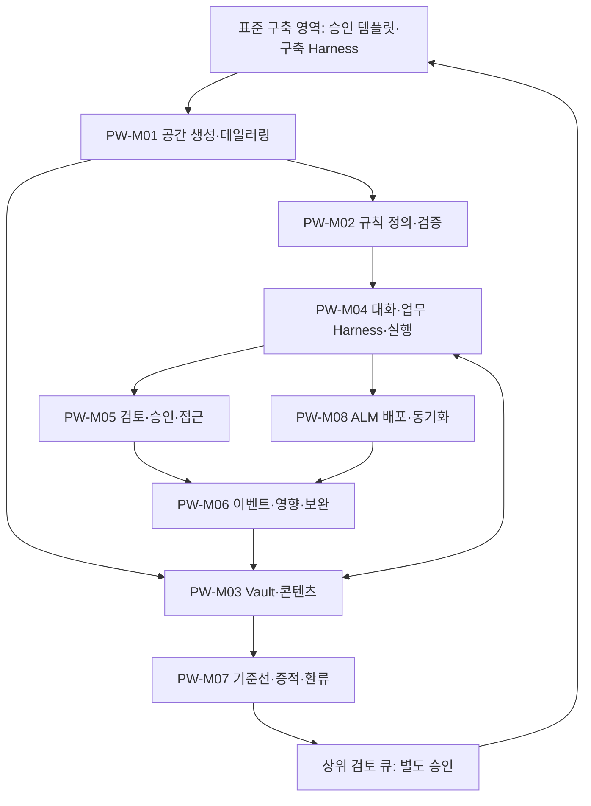

# Processware 프로젝트 작업 공간 기능 구조도

버전 1.0 · 2026-10-07 · 신규 프로젝트 작업 공간 PW 기준선 · 검토용 설계

## 1. 기능 계층과 책임

사용자는 프로젝트 홈과 대화 작업실에서 업무를 시작한다. 각 기능 모듈은 동일한 권한·규칙·판·승인 command를 이용한다. 상위 표준 구축 영역은 승인 릴리스를 제공하고 검토된 개선 제안을 받으며 프로젝트 내용은 자동 공유하지 않는다.

## 2. 모듈별 요구사항 매핑

| 모듈 | 책임 | 요구사항 | 대표 결과 |
| --- | --- | --- | --- |
| PW-M01 | 공간 생성·테일러링 | PW-01 PW-02 PW-19 | 초안 Workspace·적용 릴리스·초기 자산 목록 / 승인된 ProjectOverlayRevision·활성화 결과 / MigrationPlan·적용 기록·사전/사후 점검 |
| PW-M02 | 프로세스 규칙 정의·검증 | PW-03 PW-10 PW-11 PW-18 | RuleDefinitionRevision·근거·검토 상태 / ValidationResult·허용/차단 결과·위반 위치 / RuleValidationReport·오류·경고·미결 목록 / ReviewGroup·ExceptionGrant·기한 업무 |
| PW-M03 | Vault·콘텐츠·수입 | PW-04 PW-05 PW-07 PW-17 | AssetItem·AssetRevision·TraceLink·SourceRecord / ImportBatch·원본·매핑·검토된 항목 수정판 / ChangeProposal·새 자산 수정판·변경 이력 / ConflictRecord·갱신된 제안·유효 결정 |
| PW-M04 | 대화·Harness·실행 | PW-06 PW-08 PW-09 | ConversationTask·맥락 스냅샷·계획 후보 / WorkspaceHarnessRelease·평가 결과·적용 판 / ExecutionRun·도구 영수증·진행 이벤트 |
| PW-M05 | 검토·승인·접근 | PW-12 PW-16 | ApprovalRequest·Decision·적용 결과 / Membership·PolicyDecision·접근 감사 기록 |
| PW-M06 | 이벤트·영향·보완 | PW-13 PW-14 | EventRecord·처리 단계·후속 업무·재시도 기록 / ImpactAssessment·보완 업무·재검토 상태 |
| PW-M07 | 기준선·증적·환류 | PW-15 PW-20 PW-21 | BaselineSnapshot·ExportReceipt·RestoreReport / EvidencePackage·PDF/DOCX 등 선택 출력·색인 / ImprovementProposal·검토 결정·전달 영수증 |
| PW-M08 | ALM 배포·동기화 | PW-22 PW-23 PW-24 | DeploymentPlan·원격 ID/판·단계 영수증 / SyncRecord·ConfigDrift·검토·복구 업무 / AdapterRelease·호환성·제한·평가 결과 |

## 3. 공통 통제와 단계

인증·프로젝트 scope·유효 역할·expected revision·규칙 판정·승인 지문·감사·outbox·도구 Receipt는 모듈 공통 기반이다. Agent가 모듈을 호출해도 같은 통제가 집행된다.

P1은 내부 작업 공간의 한 사이클(PW-01~15), P2는 현장 사용자·정합성 확대(PW-16~21), P3은 실제 ALM 구성·왕복·확장(PW-22~24)이다. 모듈 하나가 여러 단계를 포함할 수 있으며 모듈명만으로 전체 구현 완료를 표시하지 않는다.

## 4. 기존 구축 영역과 경계

입력은 승인된 TemplateRelease이며 산출물 유형·규칙·Agent 도구 계약·평가·권한/이용 범위를 수신한다. 출력은 프로젝트 산출물·실행 기록·기준선 및 검토된 ImprovementProposal이다. 조직 자산·공유 Harness 직접 갱신은 이 도메인의 권한이 아니다.
