# Processware 프로젝트 작업 공간 화면 목록·흐름도

버전 1.0 · 2026-10-07 · 신규 프로젝트 작업 공간 PW 기준선 · 검토용 설계

## 1. 전체 화면 목록

대표 요구사항은 화면별 주 책임 매핑이며 기능을 그 화면에만 제한하지 않는다. PW-01 생성 작업은 프로젝트 홈에서 시작해 PW-UI02에서 구성한다. 공통 변경·승인·검증은 작업실과 개별 패널에서 연결된다.

| 화면 | 이름 | 단계 | 주 책임 요구사항 | 연결 화면 |
| --- | --- | --- | --- | --- |
| PW-UI01 | 프로젝트 홈 | P1 | PW-01 | PW-UI02 PW-UI03 |
| PW-UI02 | 생성·조정 | P1 | PW-02 PW-03 PW-11 | PW-UI03 PW-UI08 |
| PW-UI03 | 대화 작업실 | P1 | PW-06 PW-08 PW-09 | PW-UI04 PW-UI05 PW-UI06 |
| PW-UI04 | Vault 탐색·편집 | P1/P2 | PW-04 PW-05 PW-07 PW-17 | PW-UI03 PW-UI05 |
| PW-UI05 | 변경·검토·승인 | P1/P2 | PW-12 PW-18 | PW-UI04 PW-UI06 |
| PW-UI06 | 실행·정합성 | P1 | PW-10 PW-13 PW-14 | PW-UI03 PW-UI04 PW-UI05 |
| PW-UI07 | 기준선·증적·출력 | P1/P2 | PW-15 PW-20 | PW-UI04 PW-UI05 |
| PW-UI08 | 설정·연동·개선 | P2/P3 | PW-16 PW-19 PW-21 PW-22 PW-23 PW-24 | PW-UI02 PW-UI05 PW-UI06 |

## 2. 전체 흐름

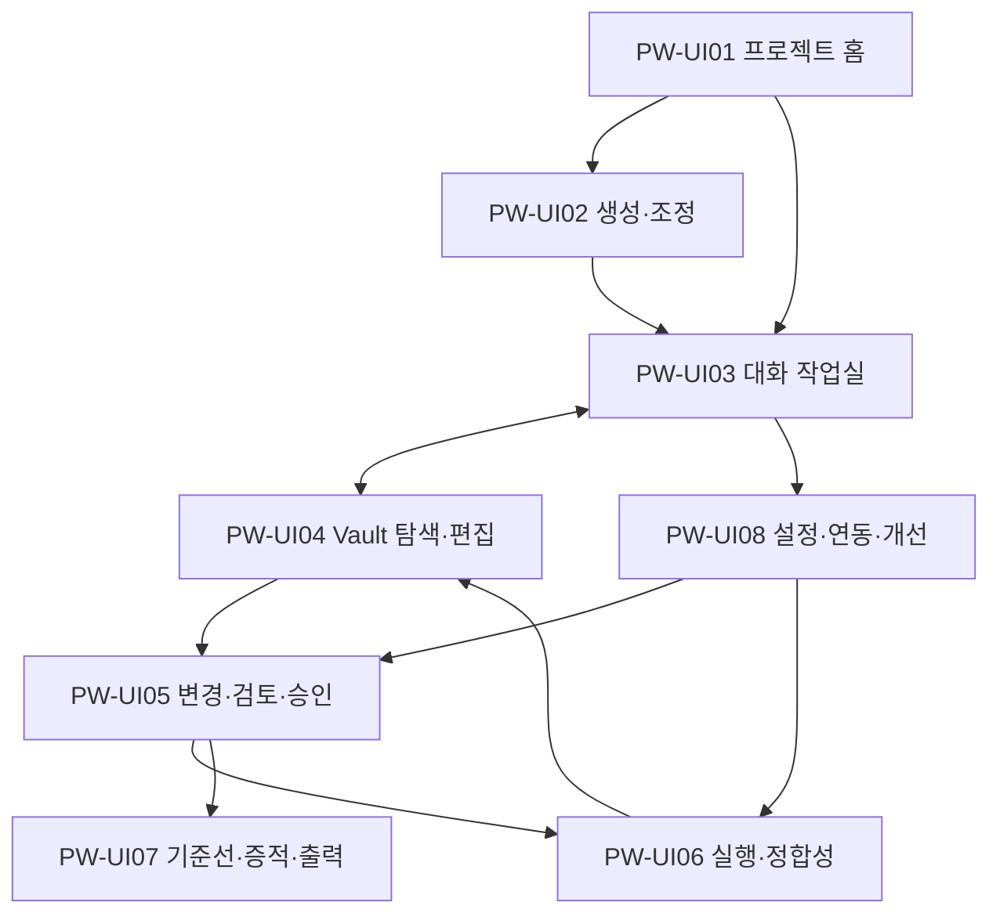

## PW-UI01 프로젝트 홈

단계: P1 · 요구사항: PW-01

프로젝트 목록 → 선택 → 권한 확인 → 현재 공간·담당 업무 → 작업실 진입.

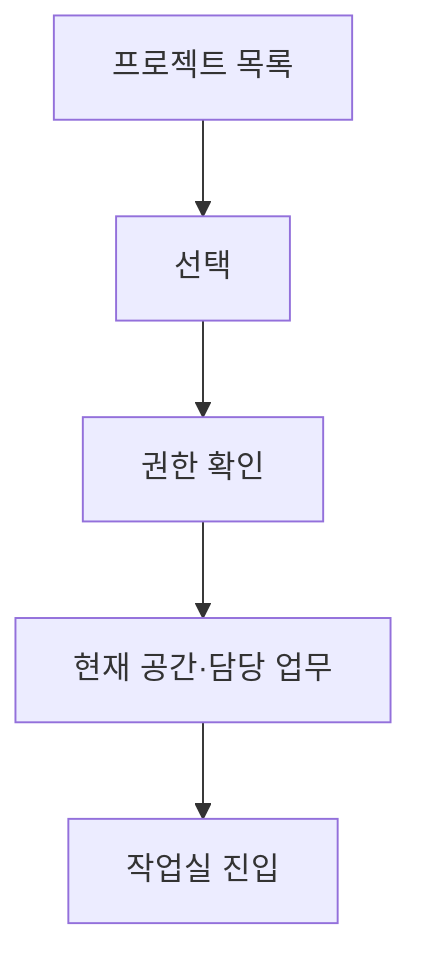

예외·복귀: 무권한 공간은 표시하지 않는다. 공간 미선택 상태에서 업무 실행을 시작하지 않는다.

## PW-UI02 생성·조정

단계: P1 · 요구사항: PW-02 PW-03 PW-11

템플릿 선택 → 범위·역할 조정 → 규칙 검토 → 정의 검사 → 오류 보완 또는 생성안 승인 → 공간 활성화.

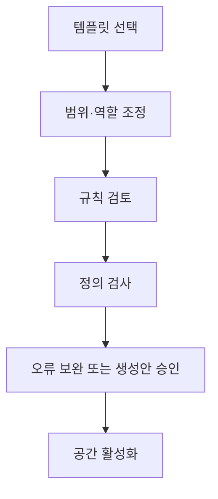

예외·복귀: 검사 실패→해당 조정 항목으로 복귀. 취소→초안 보존/폐기 선택. 필수 미결→운영 활성화 금지.

## PW-UI03 대화 작업실

단계: P1 · 요구사항: PW-06 PW-08 PW-09

의도 입력 → 허용 맥락 조회 → 계획·질문 → 실행 구성 확인 → 실행/승인 대기 → 결과 패널 → 다음 업무.

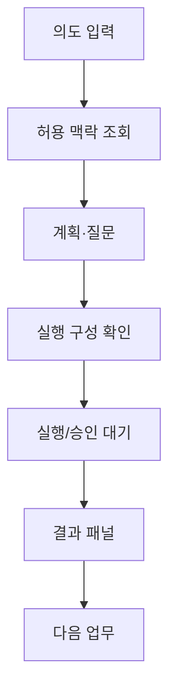

예외·복귀: 정보 부족→질문 대기. 사람 승인 필요→PW-UI05. 연결 종료→서버 상태 조회. 중단→완료 단계·부작용 확인.

## PW-UI04 Vault 탐색·편집

단계: P1/P2 · 요구사항: PW-04 PW-05 PW-07 PW-17

검색·관계 탐색 → 특정 항목 판 선택 → 직접/AI 수정 또는 파일 수입 → 변경안 → 기준 판 검사 → 충돌 해결 또는 검토 요청.

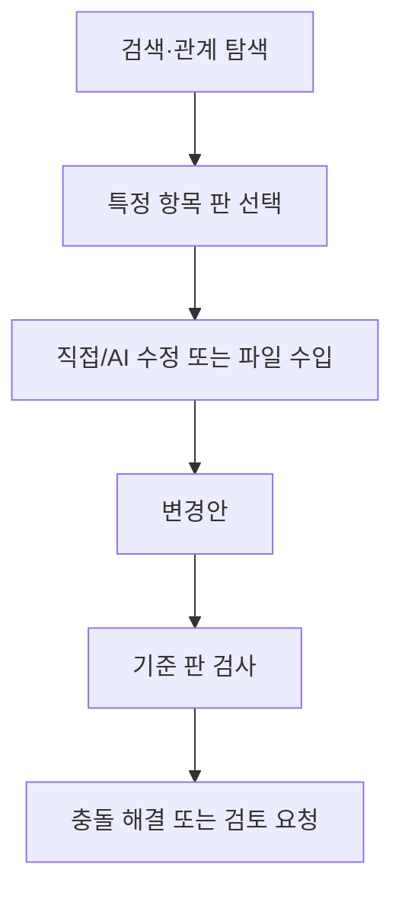

예외·복귀: 추출 실패→원본/미지원 안내. 판 충돌→차이 비교→제안 재구성. 승인판 수정→새 수정안.

## PW-UI05 변경·검토·승인

단계: P1/P2 · 요구사항: PW-12 PW-18

요청 선택 → 대상 판·근거·차이 확인 → 규칙 검사 → 보완/반려 또는 승인 → 적용 판·실행 결과 확인.

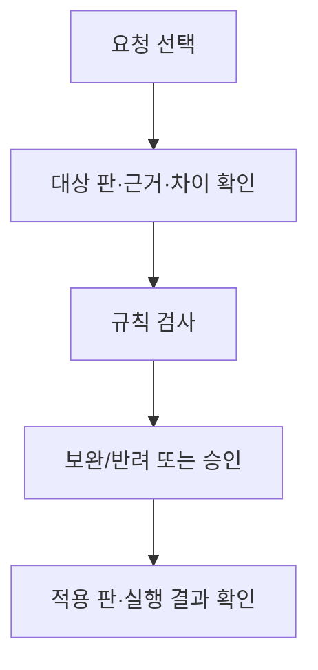

예외·복귀: 낡은 판·만료·권한 변경→승인 불가. 반려→PW-UI04. 적용 실패→PW-UI06. 기한 경과는 자동 승인 아님.

## PW-UI06 실행·정합성

단계: P1 · 요구사항: PW-10 PW-13 PW-14

실행/이벤트 선택 → 판정·단계 영수증 확인 → 위반 위치/실패 원인 → 보완 또는 승인된 재시도 → 결과 확인.

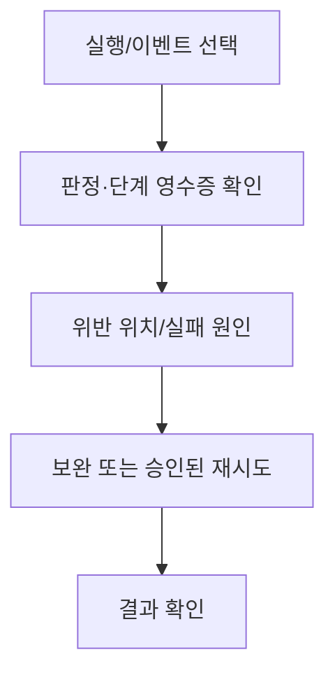

예외·복귀: 외부 결과 불명→확인 대기. 금지 재시도→수동 조치. 중복 이벤트→기존 처리 결과 조회. 판정 불가→자료 보완.

## PW-UI07 기준선·증적·출력

단계: P1/P2 · 요구사항: PW-15 PW-20

목적·범위 선택 → 항목 판·근거 수집 → 누락·권한 점검 → 기준선/패키지 검토 → 출력 생성·해시 확인 → 다운로드.

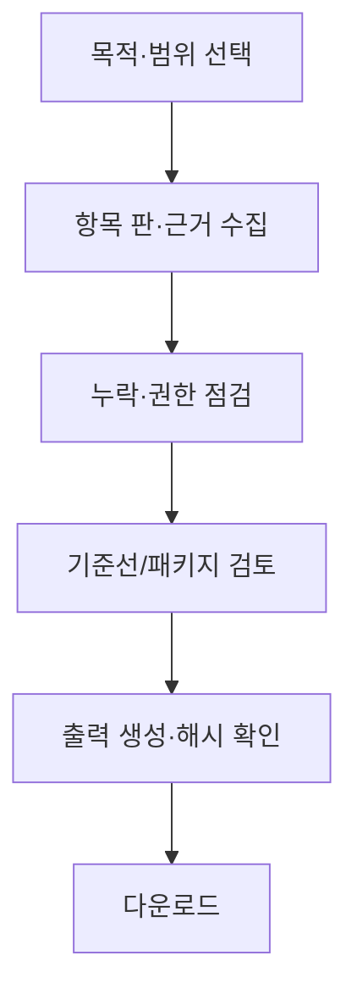

예외·복귀: 자료/해시 누락→완료 금지 또는 명시적 제외 검토. 권한 위반→항목 제외/정책 검토. 생성 실패→재생성 이력.

## PW-UI08 설정·연동·개선

단계: P2/P3 · 요구사항: PW-16 PW-19 PW-21 PW-22 PW-23 PW-24

설정 작업 선택 → 변경안·영향·지원표 → 정책/권한 검사 → 승인 → 적용·외부 확인 → 기록·차이 점검.

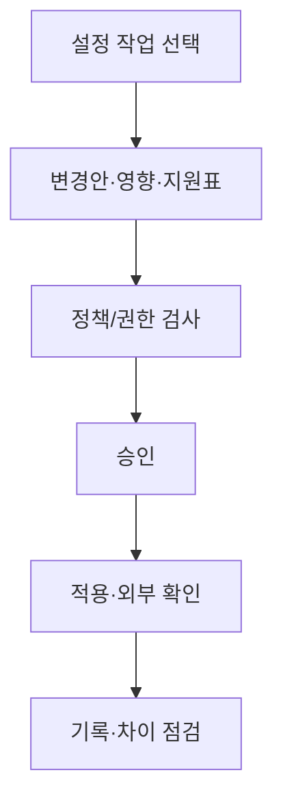

예외·복귀: 지원 불가 필수 통제→운영 배포 차단. 충돌→기준 시스템·차이 검토. 갱신→진행 run 계획. 환류→별도 조직 승인.

## 3. 핵심 업무 흐름

### 3.1 대화 변경과 판 충돌

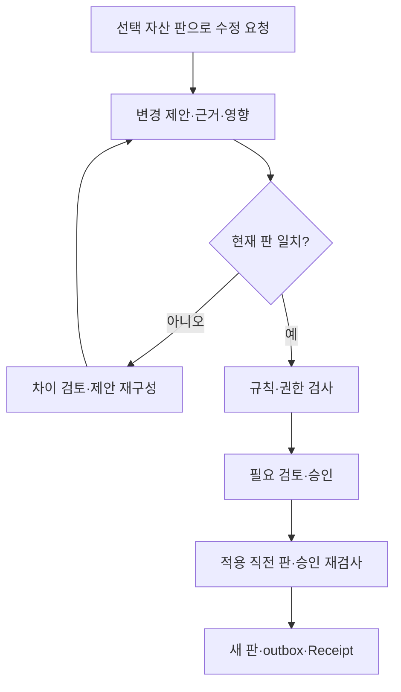

### 3.2 이벤트·외부 실패 복구

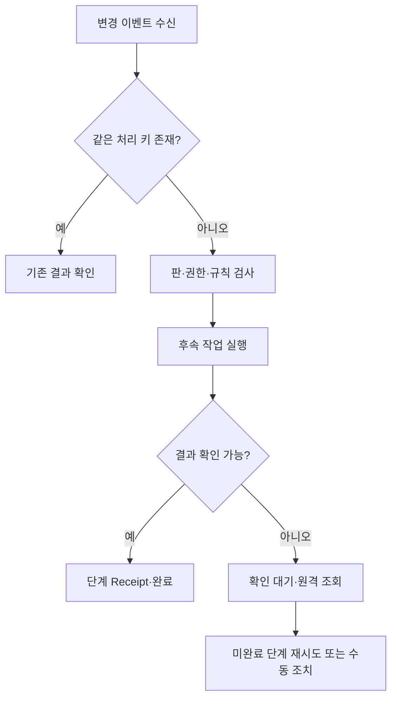

### 3.3 템플릿 갱신·환류

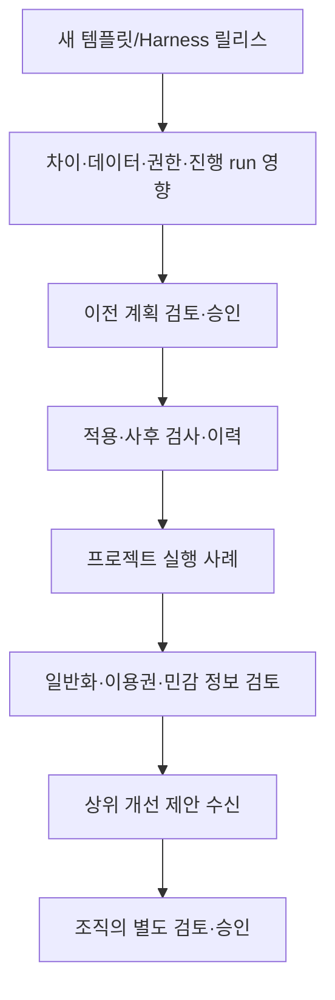

총 12개 흐름: 전체 1개, 화면별 8개, 핵심 3개. HTML은 외부 렌더링 서비스 없이 동일 정의를 노드·연결 흐름으로 표시한다. 조건·실패·복귀는 해당 흐름과 예외 설명을 함께 읽는다.
